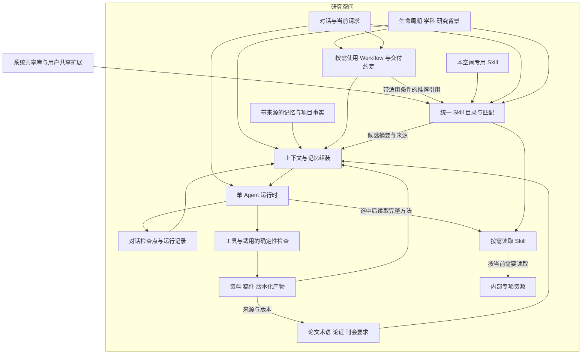

# PaperAgent 三类生命周期与上下文记忆架构

> 2026-10-28 更新：当前为 10 个 Workflow、35 个 Skill。旧入口与旧 Skill 的迁移、版本确认和主动服务，以 [生命周期 V1 与 Skill V2 落地记录](lifecycle_v1_and_skills_v2.md) 为准；以下保留历史架构说明。

更新日期：2026-10-26。本文定义科研项目、期刊与会议论文、毕业与学位论文三个产品入口，以及共用的柔性工作流、上下文和记忆机制。采用对话、Skill 与资料为中心的交互，不设置独立 Task 板块。现有 Python、FastAPI、文件工作空间和单 Agent 决策循环继续使用，旧 Task 数据与接口兼容读取。第 1—12 节为当前设计，第 14—20 节保留前轮实施记录，第 21 节记录八个业务 Workflow 入口的本轮实现。完整目标方案另见 research_assistant_system_design.md。

## 1 设计目标

用户进入一个研究空间后直接对话、查看材料或编辑稿件。讨论方法、修改摘要、临时换方向都不要求创建 Task、选择任务类型或维护完成状态。

三个生命周期承载长期研究对象与现实进展。对话表达当前意图，Skill 提供可复用专业方法，资料与产物保存依据和结果；Workflow 在需要协调完整业务交付时使用。步骤多、执行时间长或调用多个 Skill，本身都不是创建 Workflow 的理由。

核心约定：

- 阶段只是现实进展标签，不与 Workflow 一一对应。
- 普通写作、分析、评审、检索和格式处理可直接通过对话调用 Skill。
- Workflow 可以跳过、重排、暂停或退出；明确的交付要求按适用范围执行。
- 当前请求可以改变方向；旧计划不是必须完成的队列。
- 事实、假设、承诺和实际成果分开保存，模型建议不会自动升级为事实。
- 完成一次运行或一份文档不自动推进现实阶段、投稿状态或外部审批状态。

## 2 总体结构



保持统一运行时。Workflow 是业务协调策略，Skill 是可复用方法，工具执行有边界的操作，质量内核执行已实现的确定性检查。用户不需要管理通用 Task 实体。

前台以研究空间、对话、资料和稿件为主。后台保留运行 ID、执行事件和检查点，用于中断恢复与诊断；这些记录不构成一个用户必须维护的任务列表。

## 3 生命周期与典型能力

### 3.1 科研项目 project

| 阶段 | 典型能力与业务场景 | 输入与主要交付物 |
| --- | --- | --- |
| topic 选题准备 | 指南解读、选题论证 | 指南与研究基础 → 要求清单、候选题与匹配依据 |
| application 项目申请 | 申请书与活页、申报前评审 | 选题、模板、用户事实 → 申请材料与待补事实 |
| kickoff 立项启动 | 获批要求梳理、实施计划 | 立项通知与申请书 → 获批基线、任务与里程碑 |
| execution 研究实施 | 进展整理、成果登记、计划调整 | 实际活动与证据 → 进展和变更记录 |
| midterm 中期检查 | 中期报告、汇报、意见处理 | 获批基线与阶段成果 → 中期材料、后续计划 |
| final 结题验收 | 成果核对、报告、附件、验收修改 | 实际成果与验收要求 → 报告、证据清单、验收材料 |
| archive 归档延伸 | 归档、成果总结、关联论文 | 最终材料 → 归档包、关联成果 |

长期主线：申报承诺 → 获批目标 → 实际进展 → 成果证据 → 验收结果。未获批、延期、变更和终止属于状态或事件，不要求用户依次通过所有阶段。

### 3.2 期刊与会议论文 paper_conference

类型属性区分 journal 与 conference，写作能力共用，终稿、报告和海报要求按目标配置。

| 阶段 | 典型能力与业务场景 | 主要交付物 |
| --- | --- | --- |
| topic 研究定位 | 问题、贡献、目标分析 | 研究问题、贡献说明、目标候选 |
| literature_review 文献与设计 | 文献综合、研究设计 | 文献矩阵、缺口、研究方案 |
| research 研究实施 | 数据与结果整理 | 方法记录、结果证据、图表 |
| drafting 论文写作 | 大纲、分节写作、统稿 | 稿件、图表和补充材料 |
| submission 投稿准备与跟踪 | 目标适配、材料检查、投稿记录 | 投稿包、投稿轮次、状态时间线 |
| revision 返修与改投 | 意见拆解、修订、回复、改投适配 | 修订稿、回复信、修改对照 |
| production 录用后交付 | 终稿、校样、会议报告或海报 | 最终稿与展示材料 |
| archive 发表归档 | 发表登记、成果关联 | 发表记录、版本归档 |

论文与投稿记录独立。一篇论文允许多个按时间记录的投稿轮次，每轮关联独立的稿件版本、目标要求、审稿意见、回复信与期限。改投新增轮次，不覆盖旧记录。

### 3.3 毕业与学位论文 thesis

本科、硕士、博士，以及学校、院系、专业、培养方案共同决定适用节点。预答辩、中期、再次送审等可选，不内置统一学校流程。

| 阶段 | 典型能力与业务场景 | 主要交付物 |
| --- | --- | --- |
| topic 选题规划 | 选题、导师要求、可行性 | 选题方案与时间表 |
| proposal 开题 | 报告、综述、汇报、开题修改 | 开题材料与意见记录 |
| research 研究实施 | 方法实施、结果整理 | 方法、数据与结果证据 |
| midterm 中期检查 | 进展与计划调整 | 中期材料 |
| drafting 论文撰写 | 章节规划、分章写作、一致性检查 | 初稿与附录 |
| advisor_review 导师审阅 | 意见拆解、逐章修订 | 修改稿与意见处理表 |
| blind_review 送审盲审 | 条件核对、匿名、送审检查、意见回应 | 送审稿与评审后修订稿 |
| defense 答辩 | 汇报、问答准备、意见修改 | 演示文稿、讲稿、修改说明 |
| final 定稿归档 | 学校格式、版本核对、归档 | 最终论文与归档包 |

长期主线：开题方案 → 研究实施 → 导师修改 → 送审版本 → 答辩版本 → 归档版本。外部查重、评审与答辩结果通过材料或用户输入登记。

## 4 Skill 与按需 Workflow

生命周期状态保存类型、现实阶段、关注阶段、历史与来源，允许跨阶段工作。写申请书、中期报告和结题材料仍可作为业务入口，但底层共享交付约定和上下文机制；阶段目录不决定必须执行哪个 Workflow。

Skill 描述专业方法、适用条件、建议操作、典型错误和输出要求。指南解读、选题、文献综述、研究设计、章节写作和学术评审首先作为 Skill 建设，支持 Agent 按需组合。

### 4.1 共享为主，研究空间专用为补充

共享范围与专业适用性是两个维度。基金申请评审虽专业，仍适合跨研究空间共享；只对本课题成立的数据清洗方法才放在空间专用库。三个生命周期使用同一套 Skill 发现与读取机制，不各自复制一份能力库。

| 来源 | 当前目录 | 放置内容 |
| --- | --- | --- |
| builtin 系统共享 | src/paperagent/skills/library | 产品维护的通用和专业科研方法 |
| shared 共享扩展 | `<workspace_root>/skills` | 用户或团队跨研究空间复用的方法 |
| workspace 空间专用 | `<workspace_root>/projects/<id>/skills` | 仅当前研究适用的特殊方法 |

这里的共享扩展是同一部署下的文件共享，不表示已经实现团队账号、权限或云端技能市场。空间专用 Skill 仅在当前空间发现和读取，不能因另一个空间关键词相同而跨空间召回。

现有 YAML 格式继续兼容，新增可选 name、description；scope、triggers 描述适用性。scope.lifecycle_types 可提升相关生命周期中的候选排序，但不是访问权限或强制调用条件。旧 layer=general/domain/task/project 仅作为方法分类和兼容排序使用；其中 task 不代表重新引入独立 Task 实体。来源由实际目录确定，不能在 YAML 内冒充。

同 id、同 version 的默认解析顺序为：本空间专用 → 共享扩展 → 系统共享。覆盖整份定义，不拼接不同文件的指令；目录摘要通过 shadowed_sources 明示被替代来源。`builtin:academic_writing@1.0` 等带来源的精确 key 仍可读取原定义。同来源、同 id、同 version 的重复定义报错，不能依赖文件名碰巧决定生效者；不同版本并存，未指定版本且存在歧义时要求精确 key，不擅自选“最新”。共享 Skill 更新不应夹带项目事实。

方法与数据边界：评估创新性的方法放 Skill；本课题创新点及已确认决定放项目资料与记忆；学校/期刊模板作为资料；“本轮只审阅方法部分”属于当前对话要求。只有可复用的方法差异才需要新 Skill，不能把每份模板、每次意见、每个阶段都变成 Skill。

最小空间专用定义可保存到当前空间 `skills/case_review.yaml`；若以后适合多个空间复用，再经人工整理移入共享扩展，去除当前项目事实。文件示例：

```yaml
id: case_review
version: "1.0"
name: 案例材料核查
description: 按本研究采用的方法核查案例材料的来源和比较口径。
layer: task
triggers: [案例核查, 案例比较]
procedure:
  - 按当前问题读取相关材料和已确认的方法约定。
  - 按需核查来源、时间范围和比较口径，标注不确定性。
  - 将发现及材料定位返回当前对话，不覆盖已确认事实。
```

### 4.2 研究空间、Workflow 与 Skill 的引用关系

研究空间保存长期背景、资料、记忆和业务状态，决定候选方法的背景；Workflow 根据当前请求可选启用，声明交付关系及适用检查，并通过 skill_recommendations 引用共享或空间专用方法。每条推荐包含 skill_id、version、when、workflow_id 和 optional=true。

推荐不是调用队列。when 是供 Agent 结合当前请求与资料判断的自然语言条件，不是已经求值的布尔结果。匹配器只提高候选发现权重；没有必选 Skill、固定顺序或“前一个 Skill 完成才能调用下一个”的约束。Agent 可以跳过、回访或使用推荐以外的 Skill，也可以完全不启用 Workflow。

当前项目申请引用申请书论证、研究设计、学术写作；中期进展引用中期报告方法、项目证据核查、学术写作；结题引用项目证据核查和学术写作。项目证据核查也可在普通对话直接使用。推荐只提供专业方法，不替代用户显式交付要求和已有确定性检查。

### 4.3 渐进读取与中断续接

首次上下文只提供有限候选摘要：标识、版本、描述、适用线索、来源、推荐条件和 read_with 精确入口；不自动注入 procedure、checklist 或整份正文。候选不是已调用记录，也不保证覆盖全部可用能力。

`read_context(kind=skill_catalog)` 可分页发现当前空间可用目录，key 可选为检索词；`read_context(kind=skill,key=...)` 才读取入口方法和资源目录，并按 offset/max_chars 分页。YAML 与 SKILL.md 入口目前仍在宿主侧解析以形成索引，“按需读取”指进入模型上下文的内容，并非磁盘级懒解析或向量检索。

资源使用 `read_context(kind=skill_resource,key=<来源限定 Skill key>,resource_id=<资源 ID>)` 单独读取，正文不会随入口或候选自动注入。每份资源提供适用条件、内容 SHA256、分页位置和来源；续页传入 expected_sha256，发现内容变化时重新从头读取，避免拼接两个版本。读取只返回声明的包内文本，不执行脚本，不接受任意路径、上级目录或指向包外的链接。单页 500—20000 字符，默认 6000。

支持两种入口：原 YAML 增加 resources（id/path/description/when）；带 YAML front matter 的 SKILL.md 将正文作为入口说明。Markdown 包未显式声明 resources 时，自动列出 references/**/*.md；其他文本资源须显式声明。资源相对入口所在目录定位，扩展名限 md/txt/json/yaml/yml，建议统一放 references 下。references/assets/scripts/agents 下的 YAML 以及 Markdown 包内的辅助 YAML 不作为独立 Skill。来源覆盖与空间隔离沿用第 4.1 节。

续接保留当前请求、交付约定、工作笔记和稿件版本，重新发现当前可用 Skill；此前的实际读取结果保留在运行事件中，可回读来源。Skill 不持有独立执行游标或另一份项目记忆。当前目录若发生修改，重新读取反映当前定义；本轮不承诺 Skill 内容不可变快照或逐字重放旧运行。

### 4.4 Workflow 使用边界

当需要独立维护版本、轮次、交接或多产物一致性时，再配置 Workflow。例如一轮返修需协调原稿、意见、修订稿、回复信和期限；单独修改一个段落无需启动整轮返修。

选择原则：

1. 用户显式选择优先，用户也可以关闭本轮 Workflow。
2. 对明确的材料交付请求，可匹配适用的 Workflow。
3. 普通讨论、局部写作、检查和 Skill 使用不因现实阶段而自动套用流程。
4. 恢复上次运行时保留其明确要求；转向另一个请求时不强行沿用旧计划。

WorkflowSpec 与阶段目录独立，记录适用生命周期、建议阶段、材料关系、可选动作、交付物和检查条件。一个阶段可使用多个 Workflow，一个 Workflow 也可服务多个阶段。

当前可选目录共八个入口：论文生命周期提供 paper_writing、publication_management；项目提供 project_opportunity_discovery、grant_application、project_midterm_report、project_final_report；学位论文提供 thesis_writing、thesis_defense。原三个项目交付机制保留，五个新入口提供请求范围内的协调配置，复用已有方法与上下文；不要求写完全部建议产物。

目录用 available_capabilities、planned_capabilities、planned_skill_ids 区分当前方法和待补功能，模型观察以 capability_status 提供这些信息。新增入口不代表无人值守网站发现、真实邮箱连接、投稿轮次或答辩 PPTX 已实现。未创建的 Skill 不放入可读取推荐列表。

旧阶段派生 ID 保留解析与原始身份，观察中的 canonical_workflow_id 说明对应业务家族；旧检查点不批量迁移，未建立家族对应的旧项目阶段仍保留原通用行为。阶段 API 的旧 workflow_id 字段保持兼容，另提供 suggested_workflows 作为建议。建议阶段不是入口访问条件。

评审默认是一项 Skill，评审报告是有版本的产物；需要持续管理意见处理、修订和复核时才引入业务 Workflow。AI 评审结论和外部专家意见分别保存，不自动变成项目事实。

### 4.5 英文学术论文写作

共享 `english_academic_writing@1.0` 提供入口，内部资源覆盖论证与引言、方法与结果、讨论与摘要结论、英文表达、图表公式、刊会要求、评审返修、上下文维护。按请求动作、文本范围、修改影响和证据可用性选择资源；资源之间没有先后依赖。英文摘要、局部语法修改或研究构思均可直接使用，不要求填完论文背景、启动 Workflow 或先建完整提纲。

写作保持两条相互校验的线：研究问题→方法→所需证据，以及实际证据→结果→解释→有边界的贡献。设计中的预期结果不能当成已发生发现；理论论文、综述、方法论文不强制采用同一种章节结构。英文润色保留科学含义、数值、引用、确定性程度和已确认术语，允许必要重复，不以替换同义词或机械禁词代替质量判断。

期刊与会议共用写作能力，要求分别核对。会议先识别具体届次与 Track，再按实际需要核对匿名要求、页数口径、补充材料、rebuttal、camera-ready 等；这些是待核对类别，不是所有会议的固定规则。期刊按实际文章类型和作者指南核对。未指定刊会不妨碍局部写作。评审资源可独立使用，也可配合已有 reviewer_response 等 Skill；未新增强制流程。

### 4.6 独立论文评审与可选复核

共享 `paper_review@1.0` 服务全文、章节、单项方法或历史意见的评审；`paper_revision` 服务授权修改，`reviewer_response` 服务已有审稿意见的回应。三者可以独立调用，也可根据当前请求组合，目录匹配不代表已经调用。调整 reviewer_response 的宽泛触发词，减少将“评审论文”误配为“回复审稿人”；候选排序仍是启发式发现，由单 Agent 结合请求判断。

评审入口可按需读取通用依据、定量/SEM、计算/LLM、水资源、洪水水动力、图表符号、跨轮次、持续记录共 8 份资源。按实际方法与主张选择，不因一个关键词自动叠加专业标准。不复制原参考包中的固定多遍通读、特定导师偏好和项目先例；个人标准由用户明确提供，保存在空间专用 Skill 或本空间资料中。

普通短评可直接回复；需要长期保留时保存独立评审报告。意见明确区分严重程度、证据确定性、规则类别、覆盖状态和处理状态，不要求固定条数或给总分。严重程度为 critical/major/minor/note，证据为 supported/tentative/unverified，覆盖为 checked/not_applicable/outside_scope/unavailable。“已检查”可发现问题，“未发现问题”不能覆盖未读取材料。

评审请求默认只评估和生成独立报告，稿件修改依当前用户请求在决策层判断。本轮未新增自然语言授权识别的硬性状态机。保存报告的服务不会修改正文、切换稿件焦点或创建 Task。返修回复、原审稿意见、实际稿件变化分别保存；回复信写“已修改”或评论关闭，不等于问题解决。

持久报告绑定所读稿件哈希、来源、检查范围和关联论文知识。可选复核记录允许待处理、部分解决、已解决、再现、作者保留、无法核对，没有强制状态顺序。助手的复核状态只是候选，用户采纳或人工记录后才成为有效判断；“作者保留”不转化为科学通过。已解决需要受影响正文/配套稿件中的定位及匹配片段，回复信或历史评论本身不能充当修复证据。片段存在只证明位置与版本可追溯，是否真正解决问题仍需实质判断。

稿件、来源、关联术语/论证/刊会背景变化时保留历史判断并提示复核；过期的“已解决”在当前视图中显示为无法核对，不删除历史结论。原报告永远指向其原版本，后续复核独立保存，不能悄悄把旧报告改成新稿件的评审。

## 5 数据模型与存储边界

评审能力按第 4.6 节独立使用；报告与可选复核属于论文产物及领域记录，继续进入同一个研究空间。

| 数据 | 持久来源 | 作用 |
| --- | --- | --- |
| 生命周期 | lifecycle.json | 现实阶段与变更历史 |
| 对话 | messages.jsonl | 用户表达、回答与上下文原文 |
| 当前讨论与稿件焦点 | conversations/main.json | 当前请求、工作笔记、稿件指针与本轮检查点 |
| 历次执行 | conversations/runs 与事件日志、runs | 旧计划、要求、错误、已执行操作与结果 |
| 项目事实 | project_dossier.json | 目标、进展、成果、来源和用户采纳记录 |
| 论文知识 | manuscript.json | 论文背景及术语、论证、刊会要求的版本化记录与来源指针 |
| 论文评审与复核 | paper_reviews.json 与 reviews/paper/*.md | 固定版本评审报告、检查覆盖、问题证据与可选复核历史 |
| 资料与证据 | 原始材料、references、evidence | 可追溯的科研依据 |
| 稿件 | drafts 与不可变版本快照 | 当前文本、历史版本和交付绑定 |
| 长期记忆 | MemoryRecord | 有作用范围与来源的偏好、决定和经验 |
| 共享与空间专用方法 | 各来源 skills 目录的 YAML / SKILL.md 与内部资源 | 复用的方法与适用说明，不存当前项目事实 |
| 具体业务记录 | DomainStore 及业务服务 | 投稿轮次、截止日期等明确领域状态 |

project_memory 是可重建的派生视图，不承载唯一事实。不同研究空间默认隔离，跨空间复用需显式关联来源与版本。

第一阶段一个研究空间提供一条持续对话；每条消息产生一次运行，不产生新的 Task。旧 tasks 文件、sessions 接口及既有提醒数据保留兼容，不自动迁移成已确认决定，也不作为新对话的默认计划。

继续使用 JSON/JSONL、原子替换和进程内锁；多进程事务和协作冲突处理属于后续阶段。

### 5.1 论文知识的职责与有效性

`manuscript.json` 是论文领域记录，与 project_dossier 的项目事实职责相对应；它不是另一套对话记忆或执行状态。继续使用现有消息、ConversationManager、MemoryManager、证据卡、导入材料与稿件快照。来源校验复用 ProjectDossier，当前文本仍在 drafts，历史内容仍在 versions。没有登记时不创建论文记录文件，不批量迁移旧空间。

| 记录 | 内容 | 使用边界 |
| --- | --- | --- |
| profile | 语言变体、文章类型、研究设计、刊会类型及名称/届次、Track、出版阶段 | 用户维护；出版阶段为自由文本，不是执行状态机 |
| term | 概念标题、首选术语、定义、允许与需核对的变体 | 同概念且作用稿件重叠的冲突记录提示复核，不按时间静默覆盖 |
| argument | 问题、方法、证据、结果、解释、边界、贡献、不作出的主张 | 允许部分字段；文字论证与来源保存不等于完成科学核验 |
| venue_rule | 规则文本、官方要求/示例/偏好、来源网址、核对日期、适用说明 | 绑定保存时的目标配置；来源核对状态与用户采纳分开 |

记录至少给出一项现有稿件、导入资料、证据卡或作者原话来源，可限定 artifact_names、关联其他记录及其版本。新记录不要求整篇论文完备。稿件来源保存既有不可变快照，同时比较当前稿件；关联版本、来源或目标背景变化会产生 needs_review，并沿记录依赖传播。修改目标配置后，旧刊会要求保留原配置，需显式更正复核；单纯再次点击采纳不会洗掉旧来源版本。

助手通过 `record_manuscript_context` 只能保存 proposed 候选，不能覆盖 confirmed 或 withdrawn 记录；界面/API 的用户操作可以采纳、更正或撤回。所有修订保留历史并校验 expected_revision，避免陈旧表单覆盖更新。已采纳只是作者决定，不是外部事实认证。刊会来源标记 checked 需要核对日期和网址或真实已登记的资料/证据，服务器不据此宣称已经抓取官网或独立验证。助手提供的核对标记仍降为 unverified。

`applies_to` 是供阅读判断的适用说明，当前不会自动解析成投稿政策规则。确定性检查只扫描已采纳记录中的登记术语、来源和关联有效性，artifact_names 控制具体稿件范围；返回候选稿件字节哈希与论文知识指纹。科学论证、引用支持、刊会合规和排版明确为 not_checked，检查结果不是投稿准入门槛，也不会自动替换正文。

## 6 上下文组织

每轮按当前用户请求组装：研究空间与现实阶段、选中稿件、当前工作笔记、近期完整对话、相关项目事实和记忆、Skill 与工具目录，以及适用的 Workflow。

Skill 目录与完整说明分开加载。长材料按页或章节读取，原文保留来源和版本。对话记录、研究事实、AI 建议和正式要求不能相互混淆。

论文知识进入同一 CurrentContext.manuscript：背景加至多 12 条记录摘要（标题、类别、版本、采纳状态、复核标志与读取入口），不直接装入全部术语定义和论证正文。`read_context(kind=manuscript)` 分页读取全量；key 为 record_id 时返回当前记录及历史。有限摘要不是完整知识清单，持续写作前应按需读取相关完整记录与来源。继续对话时重新组装当前状态；无需恢复另一套 manuscript_state 或重放写作步骤。

论文评审进入同一 CurrentContext.paper_reviews：最近至多 5 份报告摘要、总数、遗漏数及待采纳复核数。正文、完整意见、旧版本源稿和复核历史按需读取；旧意见不作为新的用户命令。上下文预算仍由现有机制管理，恢复时观察当前有效性，不自动重放评审、修改或采纳操作。

保护当前请求、明确限制、当前稿件版本、重要错误与待解问题。按预算移除可再次检索的无关材料；预算不足时明确报告，不静默丢弃关键限制。提供诊断与原文读取入口。

换话题会归档此前运行的计划与约定，不要求先完成旧工作。共享材料与长期记忆继续可用；旧上下文按需回读，不将所有历史指令机械地套用到新请求。

## 7 记忆写入 检索与失效

MemoryRecord 保留 working、project、user、episodic、prospective 五层，增加类型、来源、确认状态、有效状态、有效期、替代关系和固定召回标志。

来源包含用户消息或文件位置；确认状态区分明确提供、材料支持、模型推断和待确认。模型推断不自动升级为核实事实。明确的用户偏好和决定可以直接记录，避免重复确认。

检索先过滤作用范围和有效状态，再计算相关性并限量。中文至少支持连续文字片段匹配；后续可加入全文索引与向量检索。用户偏好和明确固定的约束可以独立于关键词召回，其余零相关记录不进入上下文。

更新以新记录替代旧记录并保留来源。撤销或删除后不再召回，保存删除标记用于防止后续自动蒸馏恢复旧内容。当前阶段不自动把任意聊天文本写成长时记忆；通过显式记忆操作和候选审查逐步开放。

## 8 对话续接与产物版本

续接能力由对话检查点、运行日志、稿件版本与长期记忆共同承担，不要求用户创建或选择 Task。

每次运行保存当前请求、用户补充、可调整的工作计划、待解问题、工作笔记、目标稿件版本、已执行动作与最近结果。中断后重新观察当前资料与文件，再决定下一步，不能自动重放旧操作。

用户输入“继续”等明确续接表达，或点击“继续上次未完成的工作”，恢复上一轮的计划和交付要求。普通新请求建立新的工作上下文，旧上下文按运行 ID 归档；选中的稿件与项目知识继续保留。首轮不承诺准确自动识别所有自然语言换题与答复，也不自动寻找任意历史分支。

当前稿件通过显式选择或实际写入更新指针，不用文件名排序猜测。重新打开对话时核对内容哈希；稿件被外部修改时提示重新读取。用户可清除稿件焦点，不删除稿件。

旧 Task 检查点保留原状，明确传入旧 task_id 的客户端继续使用旧语义。新路径不创建 Task，也不把 Task 列表换名隐藏。将旧记录中的经验提升为长期记忆仍需有来源和适当确认。

后续增强：多个对话分别维护当前焦点、历史中断点选择、明确要求的作用范围管理、来源可回读的语义压缩。

## 9 API 与界面

主界面提供研究空间、对话、相关专业能力、资料和稿件。背景设置包含生命周期、现实阶段、当前稿件和可选交付流程；不提供新建 Task 或任务状态管理作为工作前提。

- 消息接口默认进入当前研究空间的持续对话，返回 run_id 与 conversation_id。
- resume=true 明确恢复上次工作；普通新请求可改变方向。
- workflow_mode=off 关闭本轮流程，workflow_id 显式选择已有流程；未指定时按当前交付意图判断。
- workflow_options 限定当前交付要求；明确续接时继承，新方向不自动沿用。
- 项目详情返回 conversation、相关 skills、资料、稿件、记忆与运行记录。
- skills 候选由同一匹配函数为运行时、项目详情与 Workflow 预览生成，考虑请求、空间学科/生命周期及可选流程推荐。
- GET /api/skills 默认返回目录摘要；include_content=true 保留显式获取全文的兼容入口。GET /api/skills/{skill_key}?project_id=... 按需查看具体方法，空间专用 key 必须带对应空间。
- GET /api/skills/{skill_key}/resource：resource_id、project_id、offset、max_chars、expected_sha256；界面在方法内部点击专项资源并分页读取。
- GET /api/projects/{id}/manuscript；PUT /manuscript/profile；POST /manuscript/records；POST /manuscript/records/{record_id}/review；POST /manuscript/check。写入与检查沿用同空间运行中的 409 保护。
- 论文/会议与毕业论文空间新增折叠的“论文知识”面板，管理背景、术语、论证和刊会要求，查看来源、候选采纳与复核提示。背景刷新保留未提交表单；点击“刷新记录”读取最新候选和稿件列表，保存后自动刷新。
- 论文知识面板内的“论文评审与复核”查看报告、检查覆盖和意见，可采纳助手复核建议或记录人工判断；直接对话即可使用评审 Skill。GET/POST /api/projects/{id}/paper-reviews；GET /paper-reviews/basis?filename=...；GET /paper-reviews/{report_id}/report；POST /paper-reviews/{report_id}/issues/{issue_id} 记录人工复核；POST 其 /adopt 子路径采纳候选。写入复用现有运行保护和版本竞争检测。
- Workflow 预览返回 workflow、有限候选 skills 和完整推荐目录 workflow_skills，均不注入方法正文；workflow_mode=auto/off 使用新对话语义，省略该字段保留旧预览客户端行为。
- 界面标注系统共享、共享扩展、本空间专用及流程建议，点击候选才取方法正文；切换可选流程只刷新建议，不执行 Skill。
- POST /api/projects/{id}/conversation/focus 选择或清除当前稿件。
- /context 提供对话、记忆、Skill、Workflow 和预算诊断的实际组装视图。

旧 sessions 与 tasks 接口保留兼容。新界面不从这些接口生成任务列表，也不通过机会或通知按钮隐式创建 Task。当前运行仍实行同一空间串行执行；客户端断线不等于服务器已停止。

## 10 兼容与迁移

旧研究空间不批量改写。没有 conversations/main.json 时直接从当前请求开始，既有对话、资料和项目事实仍可读取，不自动挑选某个旧 Task 作为当前目标。

旧 task_id 请求继续支持计划、交付约定和事件读取，便于已有客户端与历史验收脚本过渡；默认新请求不写 tasks 目录。旧业务提醒记录和调度接口保留，后续逐步绑定到具体领域对象。

旧阶段派生的 Workflow ID 保留解析，新目录将可用 Workflow 与阶段分开提供。对话新增的上下文读取与工作笔记动作保留旧动作别名，避免已有模型调用和脚本突然失效。

## 11 分阶段落地

| 阶段 | 内容 | 验收标准 |
| --- | --- | --- |
| C1 对话入口与恢复 | 移除独立 Task UI；原生对话检查点；稿件焦点；Workflow 按需启用；旧接口兼容 | 普通交流不建 Task；重启后可继续；换题不强制旧计划；旧记录保留 |
| C2 Skill 与要求管理 | 已完成共享/空间来源、候选查看、按需目录及内部资源、Workflow 推荐、论文领域要求的来源/作用范围/修订/撤回；后续补充显式能力锁定、通用要求冲突解析、更准确的对话意图切换 | 候选来源和推荐条件可查；不把推荐当已调用；临时要求不污染长期记忆 |
| C3 专业业务交付 | 项目配置继续共用机制；逐步接入投稿轮次、返修、送审和答辩产物关系 | 每个业务关系能追溯到材料、版本和实际状态，不为每个能力另建 Workflow |
| C4 长周期上下文 | 多对话、历史中断点选择、全文检索、受控压缩与候选记忆 | 跨对话共享已确认知识，局部要求隔离，摘要可回读来源 |
| C5 稳定性与协作 | 事务恢复、备份、权限、冲突检测、长期真实样例验收 | 中断不重复操作、不丢材料；多人修改有明确冲突记录 |

各阶段在实际验证后记录完成范围，不将目录、Skill 文件或接口存在视为专业业务已经完成。

## 12 测试策略

保留项目资料、引用、模板、记忆、领域对象和旧 Task 兼容回归。新增默认对话不建 Task、普通 Skill 不自动启用 Workflow、显式流程与关闭、稿件焦点、工作计划切换、预算/取消/重启续接、版本变化、项目记忆隔离、旧运行读取和 HTTP/UI 测试。

浏览器验证用户可以直接对话、选择稿件、查看能力、改变现实阶段、核查资料并发现续接入口。真实模型行为另行验收；离线通过不代表所有意图切换或事实推断可靠。

## 13 公开机制参考

- [Codex 分层项目约定](https://learn.chatgpt.com/docs/agent-configuration/agents-md)：作用范围和逐层加载。
- [技能渐进加载](https://learn.chatgpt.com/docs/build-skills)：目录与完整内容分开。
- [OpenAI 上下文压缩](https://developers.openai.com/api/docs/guides/compaction)：缩减活动上下文并携带续接状态。
- [记忆与压缩示例](https://developers.openai.com/cookbook/examples/agents_sdk/building_reliable_agents_memory_compaction)：当前任务状态、跨任务经验和可靠产物分别管理。

以上公开机制提供设计参考，本文的数据结构与三类生命周期方案是 PaperAgent 的领域设计，不宣称复刻 Codex 的内部实现。

## 14 2026 年 10 月 13 日实施记录（历史）

- A：设计文档已建立，原有 131 项测试通过。
- B：三类目录、显式阶段与历史、跨阶段工作流选择、局部任务合同、创建与阶段界面已接入。目录目前提供阶段策略，未把所有专业验收规则实现为检查器。
- C：来源/确认状态/有效期/替代与删除、研究空间隔离与旧任务作用域兼容、中文片段召回、保守预算、技能渐进读取、原文分页、上下文诊断已接入。保留全部任务指令；尚未实现自动语义压缩，受保护信息超预算时明确报错，不静默截断。
- D：独立持久任务、动态计划与写作计划、跨运行续接、稿件快照和版本变化提示、API 与房间入口已接入。属于检查点恢复并重新决策，不提供自动工具重放或多进程事务恢复。投稿/送审等业务版本绑定留在 E。
- E：项目申请、中期进展、项目结题三个 Workflow 已接入阶段合同、来源记录、固定版本绑定、专属检查、文档导出和管理界面，详见第 15 节。论文/会议和毕业论文的六个专业 Workflow 仍待实现。
- F：全文检索、自动语义压缩与多进程恢复增强尚未完成。

实现入口：`domain/lifecycle.py`、`workflows/catalog.py`、`workflows/registry.py`、
`tasks/session.py`、`tasks/memory_manager.py`、`harness/context_budget.py`、
`harness/context_assembler.py`、`lifecycle_api.py` 和 `web/lifecycle.js`。

可通过 `GET /api/projects/{id}/context?task_id=...` 检查某任务的实际上下文。
记忆删除使用失效标记保留历史，不擦除原始聊天或文件；当前没有自动蒸馏器会重新生成删除的记录。
文件锁只覆盖同进程服务；现有 DomainStore 的其他实体仍沿用旧实现，不承诺多进程并发一致性。

验证记录：全量 pytest 150 项（原基线 131 项，新增 19 项机制回归）；独立 Playwright
验证创建类型、阶段持久化、跨阶段工作流选择、记忆创建/更正/删除，使用临时工作空间且未调用真实模型。
Node 对新增界面脚本进行语法检查。既有 FastAPI startup/shutdown 的弃用告警未在本轮改动。

## 15 项目申请、中期进展、项目结题：第二阶段实现

本节记录前轮交付机制。以下“任务合同”在新对话路径中对应本次运行的交付约定；独立 Task 入口已由第 8—10 节方案取代，旧接口仍兼容。

### 15.1 三个可独立进入的 Workflow

| Workflow | 默认建议内容 | 跨阶段依据 | 可交付内容 |
| --- | --- | --- | --- |
| `grant_application` | 立项依据、研究问题、目标、方法、实施计划、预期成果、研究基础、预算 | 已有研究材料、用户要求、项目决定 | 大纲、单节、申请正文、论证活页、审查后的修订稿 |
| `project_midterm_report` | 原定目标、实际完成工作、阶段成果、偏差与调整、下一阶段计划、经费情况 | 明确绑定的申请/任务书基线、目标记录、已采纳的决定及实际进展 | 任意章节或完整中期报告、待补信息及质量提示 |
| `project_final_report` | 目标完成情况、研究工作、成果证据、价值与应用、局限、经费及附件 | 申请基线、历史中期记录与报告、最新成果、问题和调整 | 任意章节或完整结题报告、目标对应检查、来源附录 |

表中内容是建议，可以跳过、回退、重排和追加。无需先完成申请工作流才能处理已有项目的中期报告，也不要求有中期报告才能写结题报告。系统不会把预期成果当成已完成成果；未完成事项及原因是有效的进展记录。

每个任务持久化 `workflow_options`：`scope=partial/full`、`delivery=draft/ready`、可选 `sections`。没有显式设置时按请求推断，默认交付工作草稿。用户通过界面/API 指定的字段会锁定，Agent 不得降级这些要求以绕过检查；用户可以再次调整或清空设置。Agent 对未锁定字段的规划调整仍可保存。推断无法覆盖所有自然语言表达，界面选择可覆盖推断。

章节约定优先级为：本任务明确指定的章节 → 本阶段绑定模板的章节 → 已导入申请模板中提取的章节（仅申请工作流）→ 默认建议。`sections=[]` 表示用户明确取消必需章节。局部任务不检查整个官方模板；用户为本次局部任务指定的章节仍适用。原有统一最低字数降为写作提示，不再用固定篇幅拒绝工作草稿。

### 15.2 事实记录与材料版本

新文件 `projects/<id>/project_dossier.json` 保存三类历史：

- `records`：目标、实际进展、实际成果、决定/调整、问题、后续计划和经费记录；含阶段、内容、来源、关联记录及关联时的版本、变更理由、创建者、任务和基线版本。
- `bindings`：申请材料、申请/任务书基线、中期报告、结题报告以及三个阶段各自的模板。绑定指向内容哈希快照，不指向“最近编辑的草稿”。重新采用或解除用途绑定保留历史，不删除文件。
- `deliveries`：每次完成文档时的草稿快照、适用合同、项目资料修订号、记录版本、绑定版本、质量结果和导出结果。完成文档不自动采纳为正式基线或阶段成果，不推进现实阶段。

Agent 的 `record_project_context` 只能写入 `proposed` 候选记录。用户界面/API 可以采纳、更正或撤回；已采纳记录不能被 Agent 覆盖。更正要求 `expected_revision`，旧版本不覆盖，过期请求会失败。`confirmed` 只表示用户采纳，不能解释为已外部审批、独立核验或经费合规认证。

来源可以是本项目草稿、已导入材料、证据卡或用户说明。草稿来源固定快照，证据卡保存当时内容，材料保留登记元数据与内容哈希并在交付检查时检测变化/丢失。材料原始二进制不额外整份复制，仍应保留原文件；用户说明属于自述。源字段和定位信息用于人工追溯，不证明某个成果真实发生。

目标更正会使下游 `related_versions` 与当前目标版本不一致；采用新基线会要求相关进展复核。不会把新目标自动写回旧报告，也不会静默把旧事实当作新基线下的结论。

### 15.3 上下文与记忆衔接

三个 Workflow 的 `project_handoff` 每次从项目资料重新生成：提供固定材料版本、按目标/决定优先排列的最多 24 条活动记录预览、总数及省略数。其余记录不会删除，Agent 通过 `read_context(kind=project_dossier)` 分页读取；指定记录 ID 可查看该记录历史，`project_source` 按绑定 ID 读取固定文本并核验哈希。

记录在本项目内持久存在，不依赖当前任务关键词命中，因此申请阶段的决定、中期的问题和调整可以在结题的新任务中继续读取。任务计划和工作草稿仍使用各自的任务检查点；切换阶段不复制上个任务的计划。偏好、通用经验仍由原有 MemoryManager 管理，业务承诺和实际进展由项目资料管理，`project_memory.json` 继续作为可重建视图。

记录预览不能作为逐字引用依据。Agent 必须读取完整记录和来源；正文可用 `{{project:pr_...}}` 对应事实记录。导出时转换为编号的“项目依据”，附上内容、用户采纳状态、记录版本和来源说明。引用已撤回或不存在的记录会报错。

### 15.4 检查与交付边界

`kernel/project_delivery.py` 已接入实际 `finish`，以及界面的文档检查入口。规则随合同范围变化：

| 检查项 | 工作草稿 | 提交准备 |
| --- | --- | --- |
| 占位/待补事实、缺少约定章节 | 提示 | 在适用范围内阻止完成 |
| 全文中期/结题没有基线、目标或本阶段进展说明 | 提示 | 阻止完成；允许用“未完成及原因”作为实际进展 |
| 正文引用不存在/已撤回的记录，适用绑定源快照损坏 | 阻止完成 | 阻止完成 |
| 正文引用候选记录、相关目标已更正、来源材料变化、基线已更换 | 提示 | 要求核对后再交付 |
| 未映射目标的额外成果、缺少正文来源标记 | 提示人工核查 | 提示人工核查 |
| 事实真实性、语义上的目标完成度、经费合规 | 人工核查 | 人工核查，系统不宣称已经验证 |

局部任务只核对正文实际引用和本任务的章节，不能因无关阶段的数据不完整而阻塞。全文报告会核对本阶段进展及其关联的目标。固定目标字数、默认章节及建议执行次序都不是强制流程。

三个 Workflow 均输出 Markdown 和包含全文的 DOCX，导出文件保留内容版本与资料修订号。申请流程兼容已有 DOCX 表格模板的额外填充输出；绑定的 Markdown 模板只约束结构，不承诺复刻官方表格版式。中期和结题目前提供标准 DOCX，不自动填报外部申报系统。导出异常会在回复与交付记录中明确保留，不能冒充已导出。

### 15.5 操作入口与接口

科研房间 →「生命周期与任务」设置本次 Workflow、范围和交付要求；展开「申请、中期与结题的衔接资料」，采用材料版本、填写阶段模板章节、管理目标/成果/问题及其来源、采纳候选信息，或运行文档检查。正式采用目标后，填写进展记录时可关联一个或多个目标；更正后用“更正 / 复核关联”重新核对。开始另一阶段的工作可新建任务，同时继续共享项目资料和记忆。

| 接口 | 用途 |
| --- | --- |
| `GET /api/projects/{id}/dossier` | 读取全部审计历史、活动记录及当前绑定 |
| `POST /api/projects/{id}/dossier/records` | 用户建立/更正记录，更正附记录 ID 和预期修订号 |
| `POST /api/projects/{id}/dossier/records/{record_id}/review` | 采纳或撤回，保留理由与历史 |
| `POST /api/projects/{id}/dossier/bindings` | 将草稿当前快照绑定到指定用途；模板可带 required_sections |
| `POST /api/projects/{id}/dossier/bindings/{role}/release` | 解除用途绑定，附 expected_binding_id 和原因 |
| `POST /api/projects/{id}/dossier/check` | 按 workflow_id、filename、workflow_options 运行项目与引用检查 |

消息接口、任务更新和 Workflow 预览均支持 `workflow_options`，例如 `{"scope":"partial","delivery":"ready","sections":["阶段成果"]}`。同一项目运行期间，界面/API 的资料修改被拒绝以避免混入当前生成过程；同进程文件锁和原子替换继续有效，尚不承诺多进程并发事务。

代码入口：`domain/project_dossier.py`、`workflows/project_contract.py`、`kernel/project_delivery.py`、`project_api.py`、`agent/decision_loop.py`、`web/lifecycle.js`。

新增离线回归覆盖三阶段交付与 DOCX 来源、固定基线、记录更正/撤回、来源变化、任意阶段进入、局部/全文约定、用户要求防降级、任务重启后的衔接和 HTTP 接口。浏览器验证创建科研项目、绑定基线、记录及更正目标、撤回记录和局部提交检查。真实模型长文与真实主管部门材料质量尚未进行人工验收；离线机制测试不等于模型写作质量保证。

2026-10-13 验证结果：全量 pytest **169 项通过**（本阶段新增 19 项回归）；Playwright 项目资料及原生命周期操作通过；界面脚本 Node 语法检查通过。4 条既有 FastAPI 生命周期弃用告警保留。测试使用临时工作空间，没有调用真实模型。

## 16 项目目标对照与关键事实核查

### 16.1 可选的目标验收条件与累计观测

目标记录支持 `criteria`：成果类型、数量、单位、期限、验收说明和依据要求（允许用户说明，或要求材料/证据卡）。所有字段按项目需要使用；设置数量时必须同时设置单位，不能填负数或非有限数值。

实际进展/成果记录支持 `measurements`：对应目标、截至日期、累计数量、单位、完成状态和原因。一条记录可以对应多个目标，每个目标只能有一条本次观测，且必须包含在 `relates_to` 中。未完成和不适用必须给出说明。没有结构化指标的旧记录继续可用，不自动从文字猜测数字。

对照表从活动记录即时计算，只使用用户已采纳的观测，按报告截止日期取最新累计值，不把多次汇报相加。中期视图不会使用结题阶段的数据；结题可以展示前期数据，但会标注尚未更新本阶段。同日不同值/不同状态、单位不一致、目标或基线变化、来源失效，以及“数量未达标却声明完成”会标记复核。目标明确配置了数量时，提交准备需提供相应累计观测。材料要求明确设为 `documented` 时，单纯自述或生成草稿不能替代材料/证据卡。

达到数量仅标为“数量达到目标”，不自动宣告成果质量验收通过。数量不足但如实说明未完成可以交付。没有观测时保持未知，不能推断为完成数量 0 或尚未开展工作。期限已过也只是提示，不能推断现实项目应自动结题或失败。局部任务仅约束正文实际涉及的目标，其他目标仍可在对照表中查看。

### 16.2 声明核查与来源版本

系统按句/行提取包含实际成果用语、数量或项目来源标记的候选声明，展示正文位置、关联记录、来源及核查状态。明确的计划表述尽量排除，标题中的事实也参与检查。规则无法保证覆盖所有事实或正确理解所有语境；代码示例不参与核查，用户仍须通读正文。

`workflow_options.claim_policy` 可配置为：

| 模式 | 提交准备要求 |
| --- | --- |
| `advisory` | 候选声明缺依据时提示；既有失效引用等确定性检查仍生效 |
| `traceable` | 候选声明需有已采纳且仍有效的来源，或有用户明确的非事实分类；这是提交准备的默认模式 |
| `reviewed` | 候选声明逐条具有用户“依据支持”或“非事实”的核查结论 |

工作草稿中的未核查项仅提示。对照结构化观测时，可以发现“正文用阿拉伯数字声称完成 3 个，引用的累计观测却是 1 个”这种明确冲突，并拒绝用目标/决定记录证明实际成果；中文数字、复杂比例、成效因果与成果质量仍需人工核查。有引用不等于引用确实支持整句含义。“下一步/计划”章节的一般未来安排不要求当作已发生成果举证，其中明确的实际成果声明仍参与核查。

人工结论存于 `project_claim_reviews.json`，包含草稿内容哈希、声明标识、来源记录的具体修订号、结论、理由和时间。Agent 无权写入人工结论。草稿变化、来源记录更正/撤回或底层材料变化后，旧核查结论不自动沿用。用户可以将误检项分类为非事实，也可以标记争议或待补依据。来源/数量冲突未解决时，不能保存为“依据支持”。

### 16.3 运行时、界面和可审阅产物

- 项目记录编辑器新增可选验收条件和累计观测，可选择用户说明、已导入材料或草稿作为来源。
- 「检查文档」同时返回目标对照表和关键声明清单；在清单中选择来源、结论并说明理由即可保存人工核查。
- 「保存核查清单」输出可下载的 Markdown 与 JSON，位于项目 `reviews/`。文件按核查内容哈希命名，后续修订不会覆盖旧清单；成功完成三个项目 Workflow 时也会保存并关联这些产物。
- `read_context(project_acceptance)` 按阶段读取目标对照；`read_context(project_claims)` 按草稿文件名读取声明核查。上下文交接包含对照摘要和读取入口，完整数据按需加载。
- `GET /dossier/acceptance?stage=...&as_of=YYYY-MM-DD` 获取目标对照，`POST /dossier/claims/review` 保存用户核查。以上路径均位于 `/api/projects/{id}` 下。原 `POST /dossier/check` 返回 `acceptance`、`claims`，可用 `save_report=true` 保存核查清单。

`report_date` 可明确限定观测截止日期；不填时使用服务器当日。`claim_policy` 和 `report_date` 与原范围/交付要求一样可持久化，并保护用户已明确设置的字段，Agent 不得擅自覆盖。

### 16.4 验证方法

新增离线测试验证累计观测不重复计数、阶段/日期过滤、同日冲突、目标变更、单位/来源要求、未完成如实交付、局部任务不被无关目标阻塞、声明来源及人工结论的版本失效。浏览器验证可选指标、累计进展、对照表、逐条人工核查和清单保存。

`python tests/verify_project_model.py --live` 是显式开启的真实模型短流程验收脚本，使用当前配置的提供商，仅生成标注为虚构的案例材料，在独立临时工作空间运行。它限制动作和轮次、禁用外部研究操作，保存实际运行状态、稿件、质量报告及提供商返回预算元数据。该短样例不能替代真实项目长文和复杂模板的人工验收。

已保存的虚构样例可用 `python tests/verify_project_model.py --recheck <样例目录>` 按当前代码重新检查；此命令不调用模型，单独保存 `recheck.json`，保留原始运行结果。规则升级后不能将旧进程的完成状态直接视作新规则验收结果。

2026-10-13 本轮验证：全量 pytest **188 项通过**，包含本轮 19 项新增回归；Playwright 项目指标、逐条人工核查、清单下载及原生命周期操作通过；界面脚本 Node 语法检查通过。4 条既有 FastAPI 弃用告警保留。真实模型结果及人工复核边界见 [项目 Workflow 验证记录](project_workflow_validation.md)。

## 17 对话中心架构第一阶段

2026-10-14：新增 conversation.py 保存一个研究空间内的持续对话、稿件焦点、工作笔记及执行检查点；默认消息与 CLI 运行不再创建 Task。此前上下文按运行 ID 归档，明确续接恢复计划和用户交付要求；换题可直接开始。运行结果以 finished、budget_exhausted、cancelled、error 等真实状态记录，不自动推进现实阶段。

界面取消 Task 选择器、任务列表及从机会/通知隐式创建任务的操作，显示相关 Skill、当前稿件、可选交付流程和中断后的继续入口。阶段目录与可用 Workflow 配置分开，日常 Skill 使用不因当前阶段而强制套用流程。

旧 SessionManager 和 task_id 仅保留为兼容路径。read_context 新增 conversation 和 conversation_events，允许按运行 ID 读取历史；update_conversation_context 保存可修改工作笔记，旧 update_task_context 别名继续兼容。

本阶段限制：每个研究空间仍为单条对话，自动流程识别采用保守关键词规则，任意历史分支恢复和多对话管理留到 C4；Skill 显式选择与要求作用范围界面留到 C2。旧 Task 不自动迁入当前对话。

2026-10-14 验收：全量 pytest **200 项通过**（本轮新增 12 项回归），包含原项目交付、旧 Task 续接、对话默认路径、换题、取消/预算中断、重建后的续接、稿件版本变化、记忆隔离和 HTTP 接口。4 条既有 FastAPI 弃用告警保留。

Playwright 浏览器验证通过：不存在 Task 选择器，生命周期阶段仍可设置，稿件焦点在刷新后保留，未完成运行出现继续入口，原记忆/项目资料/事实核查/清单下载操作继续可用。修复背景刷新收起面板和丢失本轮设置的问题。独立脚本与页面内联 JavaScript 语法检查通过。

测试使用隔离工作空间与离线 Agent，未调用真实模型。首轮沙箱环境阻塞在 Windows 本地 socket 初始化；经执行权限审查后在沙箱外完成本地 HTTP 与浏览器测试，没有跳过这些验证。C1 已完成上述范围，C2—C5 尚未实施；本轮不据离线结果宣称复杂自然语言切换或真实长文交付已验收。

## 18 共享 Skill 与研究空间、Workflow 关联

2026-10-19：按第 4 节实现 C2 中的 Skill 发现与关系部分。SkillLoader 分离来源和旧 layer，支持明确覆盖记录、来源限定读取、版本歧义检测及空间隔离。新增 skills/context.py 统一运行时、项目详情和流程预览的候选生成；新增 skill_catalog 分页读取动作，保留完整方法按需读取。

三个项目 Workflow 的目录声明可选方法引用与适用条件，执行策略明确允许其他 Skill 且不要求推荐被调用。新增共享 project_evidence_review 方法，支持中期、结题及独立日常核查。资料、事实和跨阶段记忆继续沿用原研究空间存储，不复制到 Skill。

界面显示候选来源和流程建议，可点击查看说明与方法。切换 Workflow 或关闭流程重新匹配候选，不启动执行、不修改现实阶段或创建 Task。本轮未实现在线 Skill 编辑器、团队权限、Skill 内容快照和全量专业能力的语义验收。

2026-10-19 验收：全量 pytest **211 项通过**（新增 11 项），4 条既有 FastAPI 弃用告警保留。覆盖来源优先级、多版本歧义、原共享定义精确读取、空间隔离、目录分页、正文不进入初始上下文、三个 Workflow 的推荐关联、关闭流程后的独立 Skill 使用、跳过推荐方法、重建后的续接，以及 HTTP 一致性。

Playwright 验证空间专用 Skill 的来源显示、Workflow 推荐条件、点击读取方法及关闭流程后仍可发现能力；原稿件焦点、记忆、项目资料和声明核查操作继续通过。已查看浏览器截图，新增界面脚本通过 Node 语法检查。本轮使用隔离空间和离线 Agent，未调用真实模型；推荐质量与条件判断的语义准确性仍需真实研究样例验收。

## 19 Skill 内部资源与英文学术论文写作

2026-10-19：在第 18 节基础上完成内部资源读取、英文学术写作方法与论文知识管理。继续保持一个运行时、按需 Skill、可选 Workflow；本轮没有新增论文写作状态机，也没有把段落修改、术语核对和评审分别建成 Workflow。

### 19.1 资源约定与读取示例

共享扩展可放在 `<workspace_root>/skills/my-writing/`，空间专用扩展放在当前研究空间的 `skills/my-writing/`，例如：

```text
my-writing/
  writing.yaml
  references/
    prose.md
    venue.yaml
```

```yaml
id: my_writing
version: "1.0"
name: 本组论文写作
description: 适用于本组英文论文的局部修改
triggers: [英文论文, academic paper]
principles:
  - 保留研究含义和已确认术语
resources:
  - id: prose
    path: references/prose.md
    description: 英文表达
    when: 需要语法、句段衔接或压缩时
  - id: venue
    path: references/venue.yaml
    description: 刊会适配方法
    when: 已明确目标刊会且需要适配时
```

也可使用 `SKILL.md`：front matter 至少提供 name，id 默认使用 name、版本默认 1.0；正文为入口说明，可在 front matter 使用相同 resources 清单。省略清单时自动发现 references 下的 Markdown。导入第三方包只提供方法发现和文本读取，并不代表其外部工具、可执行脚本和项目专用约定已经兼容。第三方包应先检查和适配，本轮未直接加载原包到所有研究空间。

```json
{"action":"read_context","kind":"skill","key":"builtin:english_academic_writing@1.0"}
{"action":"read_context","kind":"skill_resource","key":"builtin:english_academic_writing@1.0","resource_id":"english_prose","offset":0,"max_chars":6000}
```

上面是两个独立动作示例。读取更多页面时，用上次 next_offset 和 sha256 分别填入 offset、expected_sha256。读其他指南由当前请求和返回目录决定，不能把示例理解为固定调用链。资源哈希用于当前读取的一致性；本轮没有实现 Skill 定义的永久锁定、完整不可变资源归档或自动脚本运行。

### 19.2 论文空间的使用方式

1. 普通局部写作可直接开始；长期论文工作可按需补充“论文与目标刊会”，会议名称包含届次，Track 单独填写。
2. 对需要长期保持的概念登记术语，对核心推断登记论证关联；已有结果与规划中的证据明确区分，未知字段留空。
3. 刊会要求分别登记为官方要求、已发表示例或团队偏好，注明来源、核对日期、适用范围；未核实内容保持未核对状态。
4. 稿件来源、论证或目标变化后复核受影响记录，保留修订历史。暂停或中断后，从原对话继续，并读取当前论文知识和原始来源。

这些是可独立采用的操作，不是必须完成的四步流程。界面支持从中间开始、只维护一种记录、撤回旧决定；评审可作为一次独立对话，形成稿件或意见后再按需要关联资料。

ManuscriptContext 使用现有 ProjectSource 和内容寻址快照；不将专业记录重复蒸馏进 MemoryRecord，不创建原参考包的 manuscript_state。read_context 返回带来源的当前记录与历史，record_manuscript_context 的结果进入既有执行事件和对话检查点。术语或论证正文不随候选摘要全部注入。

源码入口：`skills/loader.py`、`skills/library/english_academic_writing.yaml`、`domain/manuscript.py`、`manuscript_api.py`、`web/manuscript.js`；运行时通过原 `schemas/actions.py`、`agent/decision_loop.py`、`harness/context_assembler.py` 接入。具体指南及来源说明见 `skills/library/references/english/`。参考包采用 MIT 许可，保留 Copyright (c) 2026 Wenyu Chiou 及完整许可；原用户资料未修改。

### 19.3 验收与后续范围

全量 pytest **226 项通过、1 项跳过**，其中新增专项测试 15 项通过。覆盖 YAML/Markdown 包发现、正文不自动注入、资源分页及哈希变化、路径/扩展名限制、空间隔离、源稿变化、依赖失效、术语冲突、建议采纳、更正撤回、版本竞争、目标刊会变化、有限摘要与原文回读、关闭 Workflow 后写作及中断续接、HTTP 与运行保护。Windows 当前权限不能创建符号链接，该真实链接越界测试明确跳过；其他路径越界用例通过。4 条既有 FastAPI 弃用警告未改变。

原 `verify_lifecycle_ui.py` 和新增 `verify_manuscript_ui.py` 均通过。论文浏览器测试实际操作背景、术语、论证、刊会要求、修订与过期提示、保留未提交输入、字面诊断，以及未启用 Workflow 时读取专项指南。已查看截图；JavaScript 语法检查通过；隔离构建 wheel 检查确认 8 份指南、MIT 许可和论文面板脚本可随安装分发。

本轮没有调用真实模型，离线成功不等于英文学术长文质量已经验收。科学推断和引用语义需要真实材料与人工评估；当前检查不提供这些认证。下一阶段可按具体需求补充投稿/返修的多版本产物关系、官方指南更新来源、记录历史浏览界面、语义检索与有依据的评审结果绑定；不预设用户必须启用完整投稿流程。C2/C3 已完成本节范围，通用要求冲突解析、多对话、真实模型长周期验收等仍未完成。

## 20 独立论文评审与版本复核

2026-10-20：按第 4.6 节实现独立评审 Skill、内部资源和评审报告/复核记录，继续采用对话与现有论文空间，不新增业务 Workflow。论文评审可以独立于写作开展，也可以只看一种方法、一个章节或一次修订。

### 20.1 方法资源与触发区分

新增 `skills/library/paper_review.yaml`，提供 general、quantitative、computational、water、flood、displays、rounds、continuity 共 8 个资源。通用入口声明适用条件，资源内容按需读取；领域指南不自动联动其他模块。Reviewer_response 移除宽泛 reviewer/peer review/审稿触发，保留 reviewer comments/response letter/审稿意见/回复审稿人等明确线索。目录排序辅助发现，不负责强制执行或保证自然语言意图完全正确。

方法内容参考用户提供的 paper-review 及相关 manuscript-integrity 资源，保留 MIT Copyright (c) 2026 Wenyu Chiou 和完整许可；未导入个人导师覆盖层、特定项目先例、独立状态模板和可执行脚本。严重程度采用明确定义的 critical/major/minor/note，区分证据确定性和偏好权威，不把检查表变成固定评分器。原始用户包未修改。

### 20.2 报告、意见与复核模型

`domain/paper_review.py` 使用既有 Workspace 快照、ProjectSource 校验、ManuscriptContext 和 state_store 原子存储。没有评审时不创建数据文件。`paper_reviews.json` 保存不可变报告记录与追加的复核历史；报告 Markdown 保存在 `reviews/paper/<report_id>.md`，按哈希检查完整性，不占用当前稿件焦点。每次新增报告保留原报告，复核不会改写历史报告正文。

| 对象 | 关键字段 | 解释 |
| --- | --- | --- |
| report | title、scope、round_label、modules、prior_report_id | 轮次标签自由描述；关联旧报告不自动证明旧意见已解决 |
| artifact | filename、expected_sha256、role | 当前工作稿及原始快照；role 区分 manuscript/companion/prior_comments/response |
| knowledge basis | knowledge_ids、保存时 profile 和记录内容 | 明确关联的术语/论证/要求及其状态；后续变更触发复核 |
| check | dimension、coverage、basis | 记录检查过、不适用、范围外或资料不可用，不能用问题数量推断覆盖率 |
| finding | issue_id、location、problem、basis、action_needed、severity、evidence_status、classification、affected_artifacts | 意见是评审判断；没有问题也允许保存报告 |
| followup | expected_revision、status、reason、sources、verifications、adoption | 追加式复核，保留候选、用户采纳和原依据，不设强制状态顺序 |

输入文件名称与受影响文件在工作稿范围内校验；报告保存要求所读稿件的 expected_sha256 与当前版本相符。`read_draft` 现在从不可变快照读取并返回 version，避免读出的文字与声明的版本不同。检查范围与“已读取哪些资源”仍来自评审者报告，不能由哈希存在自动证明语义覆盖。

已解决状态至少需要一项验证：受影响正文或配套稿件 filename、expected_sha256、locator、quote，后端验证版本和原文片段存在。只有回复信、已关闭评论或“fixed”说明不能满足此要求。匹配到片段不等于修复正确；实质是否满足原意见由评审者判断，来源与局限必须保留。

助手 `record_review_followup` 始终写 proposed，不直接改变有效状态；采纳与人工复核只通过用户 API/UI 操作。采纳检查记录修订号和依据有效性，过期候选不能直接采纳。复核的“作者保留”不表示科学通过；允许从任意状态重新提出问题。历史已解决结论在依据变化后保留 recorded_status，当前状态显示 not_verifiable，并标出具体变化原因。连同较旧报告中的待采纳意见，完整历史始终可按需回读。

### 20.3 运行时与界面

`save_paper_review` 保存范围内评审报告；`record_review_followup` 保存候选复核，复用原执行事件、权限分类和对话检查点。读取动作：

```json
{"action":"read_context","kind":"paper_reviews","key":"<report_id 或留空>","offset":0,"max_chars":6000}
{"action":"read_context","kind":"paper_review_source","key":"<report_id>","resource_id":"paper.md","offset":0,"max_chars":6000}
```

前者分页返回当前报告视图及复核历史；后者返回报告所依据的历史源稿，校验快照路径和哈希，支持变更前后的比较。活动稿件仍用 read_draft。顶层 CurrentContext.paper_reviews 限于最近 5 份报告摘要、总数、遗漏数和待采纳数；正文及完整意见不整份进入每轮上下文。恢复原对话会重新核对当前依据，不自动采纳或重新执行历史修改。论文术语和论证继续放 manuscript.json，评审意见不会自动写成已确认科研事实或重复长期记忆。

新增 `paper_review_api.py` 注册在原生命周期/论文路由中，写入沿用空间串行运行的 409 保护。接口均以 `/api/projects/{id}/paper-reviews` 为前缀：

| 方法与路径 | 用途 |
| --- | --- |
| GET / | 全部报告、有效状态与复核历史 |
| GET /basis?filename=... | 当前稿件快照与哈希 |
| POST / | 保存报告，不修改稿件 |
| GET /{report_id}/report | 读取固定版本 Markdown 报告并校验哈希 |
| POST /{report_id}/issues/{issue_id} | 用户记录人工复核 |
| POST /{report_id}/issues/{issue_id}/adopt | 用户采纳某条候选，校验 expected_revision、followup_id、reason |

“论文知识”内部增加折叠的“论文评审与复核”，展示覆盖、证据、严重程度、待采纳判断、原报告与变更提示。可保存人工判断及原文定位；普通对话刷新保留未提交表单，显式“刷新评审”重新读取记录。操作不要求建立 Task、完成完整评审表单或选择固定轮次。

### 20.4 验证与边界

全量 pytest **240 项通过、1 项跳过**，新增评审专项 14 项，覆盖中英意图候选区分、全部资源可读、范围与无问题报告、保存不改稿、陈旧版本拒绝、工作空间隔离、旧源稿回读及篡改检测、回复信不能充当修复证据、候选采纳与重复/过期拒绝、依赖变更、任意状态复核、有限上下文、无 Workflow 中断续接、动作协议和 HTTP 运行保护。跳过项为前轮 Windows 符号链接权限测试；保留 4 条既有 FastAPI 弃用警告。

原生命周期 Playwright 通过；扩展论文 Playwright 实际操作报告查看、助手候选采纳、稿件变更后结论失效、人工复核、未提交表单保留，并验证原论文背景、术语、论证与指南读取。JavaScript 语法检查通过；隔离构建 wheel 确认写作/评审全部资源、MIT 许可和界面脚本包含在安装包中。

本轮使用离线 Agent 和临时空间，尚未验收真实模型的科学评审质量、覆盖率或跨学科准确性。持久评审当前绑定 Markdown 工作稿；已导入 Word/PDF 可作为来源材料，但未实现原生批注、修订标记和自动视觉验收。代码仅核验来源、版本、字段与片段存在，不自动复现分析、认定意见正确或认证投稿合规。新报告不是外部专家意见或录用结论；通用授权语义、多人事务及完整投稿返修业务仍属后续范围。

## 21 生命周期与八个 Workflow 入口 A1

2026-10-26：完成 research_assistant_system_design.md 第 3 节的入口调整及相应可选方法关联。当前共八个业务入口，三个原项目交付配置与五个新协调配置使用同一个 Agent、ConversationManager、MemoryManager、资料、论文知识和版本机制。

| 生命周期 | 可选入口 |
| --- | --- |
| 期刊／会议论文 | paper_writing 论文撰写；publication_management 投稿与评审管理 |
| 科研项目 | project_opportunity_discovery 项目机会寻找；grant_application 项目申请；project_midterm_report 中期报告；project_final_report 结题交付 |
| 毕业／学位论文 | thesis_writing 论文撰写；thesis_defense 答辩相关事宜 |

新增 workflows/coordination.py 组织当前请求、建议产物、上下文读取入口和交互原则。不创建执行游标、必做产物清单或独立记忆；默认 full_document_required=false、write_section_by_section=false，只有显式范围和要求进入请求约定。quality_gates 默认空，不用通用阶段完整性检查阻止机会讨论或局部讲稿工作。原项目的交付约定与检查继续生效。

目录为五个新入口引用当前已经存在的 Skill，带 when 和 optional。未实现的 publication_strategy 与五个答辩 Skill 只列为 planned_skill_ids，不可被当作实际方法读取。学科方法继续按空间背景匹配，推荐清单不限制其他方法使用。完整当前关联见系统设计第 4.9 节，内置 Skill 库仍为 28 个。

select_conversation_workflow 在保守识别到明确业务意图时可选择新入口；普通评审、局部修改、解释和分析不因阶段而启用流程，用户显式选择或关闭优先。自动识别仍是关键词启发式，不宣称自然语言判断完备。“管理投稿与评审”等流程名中的评审字样不会被误当成单次独立评审。实际 lifecycle.current_stage 及历史不会因选择工作流改写。

旧阶段 ID 保留原始身份及上下文续接，返回 canonical_workflow_id 和 legacy_compatibility。例如 paper_conference_revision 对应 publication_management，thesis_blind_review 对应 thesis_writing；其原 Workflow ID 和旧阶段上下文保留。旧项目的其他阶段没有被强行解释为申请或结题。thesis_defense 原 ID 与新正式入口同名，现可显式进入协调配置。

预览响应新增 workflow_skills，为当前流程全部推荐的来源限定元数据；skills 保持默认有限候选。完整推荐通过一次解析有效 Skill 目录生成，遵守共享／空间覆盖关系，不重复扫描每条引用。界面将完整推荐与候选合并显示，正文与资源仍需点击读取，模型每轮不会自动注入全部说明。

界面按生命周期提供 2／4／2 个正式选择，旧保存 ID 可作为历史配置显示。新增当前可用／后续接入说明；项目机会寻找隐藏项目交付选项，不提交无关交付设置。工作流预览与方法详情的请求版本分开，防止快速切换和阅读操作相互取消。选择和预览不执行 Skill、不连接账号、不启动监测、不修改现实阶段。

全量 pytest **272 项通过、1 项跳过**，新增协调测试 27 项并扩展原有目录测试 5 个入口，覆盖八个入口、按需范围、阶段不变、跨生命周期拒绝、全部推荐可读、候选有界、未来 Skill 不可读、旧 ID 续接、论文知识复用及 HTTP 预览无写入。保留 4 条既有 FastAPI 弃用告警；符号链接用例仍因 Windows 权限跳过。

两套 Playwright 验证新增入口、当前／未来能力说明、完整推荐、关闭流程、项目机会表单边界，以及原有稿件、记忆、项目资料和论文评审操作。JavaScript 语法检查通过。使用隔离空间和离线 Agent，未进行真实模型业务语义验收。

A1 仅完成入口、请求协调和方法关系。无人值守机会发现、真实邮箱／账号同步、多次投稿与轮次完整关联、改投策略服务、答辩专项 Skill、PPTX 生成及版式验收继续属于后续阶段，没有通过目录存在宣称已经完成。

## 22. 方法类型、来源与论文写作资源（2026-10-26）

SkillSpec 新增可选 capability_type（general／lifecycle_specific），source_kind 继续由实际来源目录决定，两者互不推导。内置 29 个定义显式分类，旧扩展缺字段保持未分类且可读取。所有分类沿用原有按需发现、来源限定 key、版本覆盖与资源安全读取，不改变调度规则。

paper_writing 增加条件推荐 citation_verification；英文 introduction 和学科 ML 报告分别留在原 Skill 内，通用论证、修订、主题综合与证据指南按资源复用。界面同时显示能力类型与存放来源。资料、长期记忆、作者决定和断点仍使用既有存储，不建立上游框架的第二套状态系统。

完整分类、资源映射和许可见 [Skill 分类与写作资源](skill_classification_and_writing_resources.md)。

## 23. 文献证据、图表与科研产物基础能力（2026-10-26）

Evidence 扩展可选结构化标注与来源哈希，旧卡片兼容。literature_matrix 从原引用／证据派生分页视图，不新增文献记忆。figure_style 保存可选空间默认；基本 SVG 图表与检查增强，检查结果区分确定性错误、警告、不可用及视觉未评估。

presentation_build 与 submission_package 使用既有资料、图表和来源快照生成独立版本目录，research_output_check 核对当前输入和输出变化；内部 manifest 留在空间，投稿 ZIP 只放精简分发清单。界面添加按需查看和附件下载。

PaperReviews 增加 grant 类型和评审模式，申请指南与稿件变化复用原有来源、快照和复核机制。没有申请评审第二套状态机，也没有因新增 Skill 自动执行多 Agent。当前 34 Skill（20 通用、14 专用）、23 工具，详见 [分阶段实施](research_skills_adaptation.md)。
