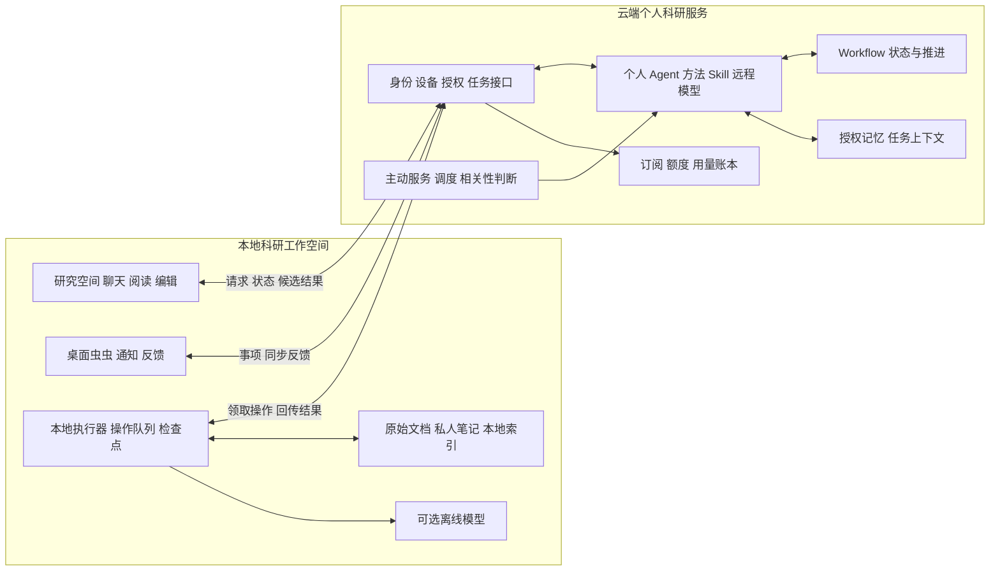

# PaperAgent 云端个人科研 Agent 与本地科研工作空间改造计划

日期：2026 年 10 月 29 日  
版本：改造计划 V1，补充对话与多用户设计  
状态：产品与工程实施方案，尚未实施。

PaperAgent 定位为“云端个人科研 Agent + 本地科研工作空间”。云端持续理解用户的研究目标、选择科研方法、规划任务、管理流程并提供主动服务；本地承载日常科研操作，保存原始材料，完成阅读、编辑、文件处理和成果交付。用户面对的是一个持续协作的个人科研助手，通过本地工作空间使用它。

本计划依据[个人科研助手分工与交互方案 V1](personal_research_assistant_responsibility_plan_v1.md)调整产品形态、职责边界和实施顺序。原方案中的预算控制、候选修改、版本确认、主动服务授权和交付验收继续沿用。涉及首版形态、本地接入优先级、稿件保存依据和模型配置的冲突，以本计划为准。本文只规定改造工作，不触发代码修改、部署或收费开通。

## 1 产品形态与改造目标

### 1.1 用户获得的产品

产品由云端服务和可安装的本地工作空间共同组成。首轮以 Windows 为主要落地环境，复用现有研究空间界面与 Python 文件处理能力；桌面容器的具体框架在打包验证后确定。

本地工作空间提供研究空间、聊天、资料阅读、稿件编辑、执行进度、待处理事项和成果入口。桌面虫虫是提醒与快速交互入口，点击后进入对应研究或任务，共用同一套状态和反馈记录。

云端个人 Agent 在本机关闭后仍可执行公共来源监测、相关性判断、期限提醒和已获授权的云端分析。依赖本机文件、应用或本地模型的步骤等待设备上线；界面明确区分“云端正在处理”和“等待本机执行”。

### 1.2 相对原方案的关键调整

| 原方案安排 | 本次改造安排 | 实施影响 |
| --- | --- | --- |
| 首版浏览器访问，本地连接器后续可选 | 首版包含本地工作空间与执行器 | 首个闭环必须覆盖云端规划和本机执行 |
| 云端同步工作版本是跨设备继续工作的依据 | 本地文件是本机文档的保存依据，云端保存获授权的上下文和任务产物 | 引入文件引用、内容授权和版本核对 |
| Agent、Skill、工具整体迁入云端 | 按科研决策与本机操作拆分 | 混合 Skill 和工具逐项拆分 |
| 模型凭证统一由平台托管 | 支持平台远程模型、用户配置的远程模型及可选离线本地模型 | 模型运行位置、供应商和费用分别标记 |
| 本机接入在第四阶段实施 | 本机队列、检查点和文档操作提前 | 主动服务、商业化建立在云地闭环之上 |

本轮实施范围是多个个人研究者分别注册使用，每人拥有独立账号、多个研究空间和首台设备闭环。多设备身份与数据结构预留，但跨设备接管、整库同步和自动合并放在后续扩展。第 14 至 16 节补充对话、多用户和存储设计。

## 2 八个模块的云端与本地分工

| 模块 | 云端具体保留什么 | 本地具体保留什么 | 协作方式 |
| --- | --- | --- | --- |
| 个人 Agent | 目标理解、任务规划、科研方法选择、下一步判断 | 聊天窗口、执行进度、结果展示 | 本地提交请求和获准上下文，云端返回计划、操作请求和结果 |
| Skill | 专有写作方法、评审标准、申请书论证策略、信息筛选方法 | PDF 读取、Word 编辑、格式转换、导出等操作说明 | 云端方法产生有结构的任务，本地按操作能力契约执行 |
| Workflow | 申请、写作、投稿等流程的任务状态与推进逻辑 | 等待本机执行的操作队列、执行检查点 | 云端维护流程事实，本地回传操作事实 |
| 个人记忆 | 用户授权的研究方向、偏好、项目摘要、任务和截止日期 | 原始文档、私人笔记、文件路径、本地索引 | 摘要与事实经授权同步，原文按任务范围提供 |
| 主动服务 | 文献与课题监测、相关性判断、提醒生成、定时运行 | 桌面虫虫、通知、用户反馈 | 云端保存事项，本地去重展示并同步处理结果 |
| 工具 | 公共检索、外部数据服务、获授权的云端连接 | 文件读写、本机软件操作、本地搜索 | 统一登记运行位置、输入输出、权限与版本 |
| 商业系统 | 账号、订阅、额度、调用鉴权、用量记录 | 登录和购买界面 | 云端判定权益、预留和结算，本地展示凭据与结果 |
| 模型 | 执行云端 Agent 推理，接入平台或用户配置的远程模型 | 可选本地模型，处理独立的离线任务 | 云端模型承担主 Agent，本地模型只运行明确的离线任务 |

这里的“个人记忆”是可持续使用的研究事实与偏好；任务中临时提供的正文属于任务上下文。正文进入远程模型前仍需明确授权，不能因记忆默认保存在本地就表述为“材料不出本机”。

## 3 总体架构与运行边界

本地执行器主动向云端连接并领取分配给当前设备的操作，首版不要求用户开放公网入站端口。现有本地服务收敛为受当前客户端控制的本机接口，增加访问令牌、来源校验和目录范围校验。

云端运行持久任务、科研推理、主动调度和商业系统。云端方法 Skill 随服务部署；桌面安装包只包含本机操作说明、工具适配器和必要的展示元数据。研究方法的名称、结果解释可以展示给用户，专有方法全文不作为桌面运行依赖下发。

本地工具执行器按明确的工具标识和参数运行。首版云端下发结构化操作，不下发任意脚本或通用终端命令。后续新增执行能力必须登记契约和权限范围。

## 4 Agent 与 Skill 的拆分方式

### 4.1 个人 Agent 改造

云端保留研究意图识别、上下文组装、方法选择、步骤规划和结果评估。Agent 可以根据本机能力决定先读取 PDF、请求导出或等待用户选择资料，但文件路径解析、应用调用和真实文件写入由本地完成。

云端规划需要本机内容时，先产生“请求本地检索或读取”的操作。读取完成后，本地依据本次授权筛选可回传内容；云端再继续分析。未获得内容时，任务显示缺少哪些材料及影响，不能把未读取的原文当成已分析依据。

### 4.2 Skill 按内容职责拆分

| 现有能力内容 | 云端部分 | 本地部分 | 交接结果 |
| --- | --- | --- | --- |
| PDF 阅读与论文分析 | 研究问题、证据提取标准、比较与评判方法 | PDF 解析、页码定位、选段、文本提取 | 带来源版本和页码的获准片段 |
| 论文写作与修订 | 论证结构、表达策略、改稿判断 | 读取选区、定位段落、展示差异、写入新版本 | 绑定基准版本的候选修改 |
| 申请书撰写 | 立项依据、研究内容、创新点和可行性论证策略 | 模板读取、字段填写、格式处理、文件导出 | 结构化章节内容与校验报告 |
| 论文评审 | 评审标准、证据强度判断、问题优先级 | 文档解析、批注定位、报告导出 | 带定位依据的评审结果 |
| 格式转换与交付 | 确定交付要求、核对必需成果 | DOCX、PDF、PPTX、ZIP 等生成与文件检查 | 本地产物引用、哈希和检查结果 |

为每个能力增加 `execution_location`、`required_capabilities`、输入输出结构和权限范围。既有通用与生命周期专用分类、共享与空间私有来源继续保留，运行位置作为独立维度。

云端方法 Skill 与本地操作能力分别版本化。任务固定使用的方法版本；本地领取时核对操作能力版本，不兼容就等待更新或重新规划。用户自建的私有方法默认保存在本地，只有明确选择供云端 Agent 使用时才上传；上传不转为平台共享 Skill。

专有方法留在云端可以减少安装包中的直接暴露，但不能把这一部署方式当成方法内容绝对保密的保证。

## 5 Workflow 与本机操作的执行协议

### 5.1 状态与事实的归属

云端保存 Workflow 当前阶段、任务依赖、决策记录、验收结果和作者确认。本地保存操作队列、执行租约、临时文件、检查点和回传记录。界面缓存云端流程用于展示，断网时不自行改写云端阶段。

本机操作成功只证明该操作完成。例如导出申请书成功，不代表申请书通过科研验收，更不代表已经提交。延续现有“候选、作者确认、正式版本、现实阶段”相互独立的原则。

### 5.2 首版最小对象

| 对象 | 主要保存位置 | 最小内容 |
| --- | --- | --- |
| 账号与设备 | 云端 | 用户、设备、绑定状态、能力版本、最后在线时间 |
| 研究空间映射 | 两端 | 统一研究标识；本地另存目录映射，云端不依赖绝对路径 |
| 云端任务 | 云端 | 目标、Workflow、模型策略、预算、状态、事件游标 |
| 本机操作 | 两端 | 操作标识、任务、设备、工具、参数、输入版本、授权版本、幂等键 |
| 文件引用 | 两端 | 不透明文件标识、内容哈希、逻辑版本；绝对路径只存本地 |
| 执行检查点 | 本地，云端保存进度摘要 | 步骤、已提交副作用、临时产物、回传状态 |
| 记忆与内容授权 | 云端及本地凭据 | 允许的数据、用途、模型供应商、有效期、撤销状态 |
| 主动事项 | 云端，本地缓存 | 来源、关联研究、价值说明、提醒及反馈状态 |
| 费用记录 | 云端 | 估算、预留、实际用量、模型来源、结算和补偿 |

### 5.3 领取与回传流程

1. 本地登录并绑定设备，上报工具能力与版本，不自动扫描全部文件。
2. 云端创建任务，校验内容授权和预算；需要本机执行时创建指定设备的操作。
3. 设备主动领取操作，获得有期限的执行租约，本地复核授权、目录和输入哈希。
4. 执行器记录操作开始与检查点，完成工具调用并保存本地产物。
5. 本地持久保存回传记录，再提交结果；云端按幂等键确认接收。
6. 云端验收结果并决定继续、等待用户或完成任务；本地收到确认后清理可回收临时数据。

云端任务至少区分 `queued`、`running`、`waiting_local`、`waiting_user`、`paused`、`succeeded`、`failed`、`cancelled`。本机操作至少区分待领取、已领取、执行中、待回传、已确认、冲突、失败和取消。两套状态分别保存，避免把本机离线显示成科研任务失败。

传输按可能重复投递设计。文件写入使用临时文件与版本记录；操作已经落盘但回传中断时，重连先核对结果再回传，不重新覆盖文件。租约到期也不能直接认定副作用未发生。恢复时使用操作标识、产物哈希和已提交记录核对实际状态。

### 5.4 拟新增的逻辑接口

| 接口职责 | 请求要点 | 返回要点 |
| --- | --- | --- |
| 设备注册与心跳 | 设备身份、能力清单、客户端版本 | 设备状态、可用策略、服务时间 |
| 提交与估算任务 | 研究、文件引用、上下文范围、模型策略 | 任务估算、授权摘要、预算上限 |
| 领取本机操作 | 设备、能力版本、空闲并发量 | 操作、租约、输入版本和权限 |
| 上报检查点与结果 | 操作、租约、结果哈希、幂等键 | 接收凭据、冲突或下一步状态 |
| 恢复任务事件 | 任务、上次事件游标 | 当前状态、遗漏事件和结果引用 |
| 更新授权与反馈 | 授权或事项、预期版本、用户决定 | 新状态、受影响任务及停止范围 |

这些是待实现契约，具体 URL 和数据结构在接口设计阶段确定。

## 6 文件 记忆与数据授权

### 6.1 默认保存规则

| 数据 | 默认位置 | 进入云端的条件 |
| --- | --- | --- |
| 原始 PDF、Word、实验附件 | 本地 | 用户为任务明确提供片段或文件副本 |
| 私人笔记、文件路径、本地全文索引 | 本地 | 用户选择的笔记内容可授权；索引库和绝对路径不默认上传 |
| 研究方向、偏好、项目摘要 | 云端授权记忆 | 首次启用时展示字段，可修改、撤回和删除 |
| 任务、截止日期、Workflow 状态 | 云端 | 用户创建或接受任务；推断出的期限先作为候选 |
| 对话与任务上下文 | 本地完整记录，云端保存服务所需的授权部分 | 界面标记发送内容、使用范围和保留策略 |
| 候选正文与分析报告 | 云端任务产物及本地接收副本 | 按任务授权保存，标记尚未应用 |
| 已采纳稿件与正式导出文件 | 本地 | 用户选择云端备份或跨端同步时另行授权 |

云端对象存储用于获授权的任务附件、候选结果和可选备份。每类对象配置保留周期、删除策略与访问范围；首版上线前确定具体周期并在设置中显示。默认不建立用户原始资料的整库云端镜像。

### 6.2 授权交互

在发起任务时显示“使用哪些材料、哪些内容发送到云端、由哪个供应商处理、是否记为长期记忆”。同一研究可保存持续授权；范围扩大、供应商变化、授权到期时重新校验。授权摘要可以复用，避免对已允许的每次只读操作反复确认。

本地执行器和云端在每个新步骤开始前检查有效授权。撤销后取消未开始步骤，运行步骤在安全检查点停止；已发送内容按删除和供应商保留规则处理，界面说明实际处理范围。

用户可以分别移除本地材料、删除云端任务附件、删除个人记忆和解除设备绑定。删除云端副本不删除本地原件；解除设备后旧凭据不能继续领取操作。账本保留结算所需元数据，运行日志避免记录原文和绝对路径。

### 6.3 版本与冲突

云端候选始终绑定输入文件标识和基准哈希。本地应用前重新读取当前文件；版本改变时展示差异，保留当前稿和候选。用户选择合并或另存，新 AI 合并作为独立任务估算。

首版依赖同一台绑定设备提供本地材料。更换设备后可以看到云端记忆和流程摘要，但缺失的文件必须重新关联或显式迁移；不以同名文件自动认定为同一版本。

## 7 主动服务与桌面虫虫

云端沿用 A1 文献、A2 机会、A3 进度与反馈的职责，负责周期运行、公开来源采集、去重、相关性判断、提醒生成与授权范围内的结果准备。本地负责通知呈现、虫虫交互和反馈回传。

| 状态 | 云端行为 | 本地行为 |
| --- | --- | --- |
| 本机在线，有相关新发现 | 保存事项，准备授权范围内的分析 | 展示提醒，进入对应研究 |
| 本机关闭，有相关新发现 | 继续监测，保存事项；本机步骤等待 | 下次启动补取并合并提醒 |
| 没有新价值 | 更新检查状态 | 保持安静 |
| 来源异常 | 标记上次尝试与上次成功，按策略重试 | 显示来源异常，不能显示为没有变化 |
| 后台预算不足 | 保留基础发现，停止新增收费准备 | 展示发现和继续选项 |
| 用户标记不相关 | 保存反馈，调整后续相关性判断 | 同步处理结果，减少重复提醒 |

普通提醒延续每日汇总和默认 22:00 至 08:00 勿扰，时间跟随用户时区。桌面退出时不能保证桌面通知即时送达；首版云端保存待处理事项，后续按用户启用的外部渠道补充送达能力。

“关闭虫虫”“关闭通知”“暂停关注”“关闭主动准备”分别控制入口、提醒、来源检查和收费准备。关闭虫虫不取消云端任务，暂停关注则取消该关注下尚未开始的准备步骤。

## 8 模型与商业系统

### 8.1 三种模型来源

| 来源 | 推理位置与职责 | 凭证处理 | 费用展示 |
| --- | --- | --- | --- |
| 平台远程模型 | 云端主 Agent 和授权科研任务 | 平台服务端凭证 | 按平台费率估算、预留、结算 |
| 用户配置的远程模型 | 云端主 Agent 通过用户指定端点调用 | 用户明确授权后加密托管，界面可替换和撤销 | 展示平台服务费用与供应商直接计费边界 |
| 可选本地模型 | 本机独立离线任务，例如私有笔记整理 | 本地配置 | 不消耗平台模型额度；如有产品权益限制单独标明 |

首版先完成平台远程模型；用户远程模型在模型网关与账本稳定后接入；本地模型作为后续可选能力。三者的数据结构在第一阶段区分，避免后续把模型名称当作运行位置。

用户远程端点必须能被云端服务访问；仅在用户电脑可访问的地址不能直接作为云端主 Agent 端点。云端不静默切换供应商，也不在用户凭证失败时自动改用收费的平台模型。

用户界面保留“自动、快速、深度”和高级模型限制。现有 `auto/offline/llm` 继续表示历史执行来源，不直接改名充当新工作模式。离线本地任务显示独立记录，恢复网络后只有经用户接受的摘要才进入云端任务或记忆。

### 8.2 计费与授权

商业系统全部由云端判定，桌面端提供登录、套餐、购买、余额、任务估算和用量记录。支付回调、权益状态和账本以服务端为准。

沿用原方案的“同一额度余额、单次上限、后台月上限”和预留后结算机制。原方案的价格、月赠额度和存储配额继续作为试验假设；本地保存量不套用云端存储配额。云端空间配额的计量范围见第 16 节。

等待本机上线的任务设置预留有效期。超时释放未用预留并保留检查点；恢复时重新估算，在仍有效的持续授权与上限内继续，超出则等待用户处理。已完成部分结算一次，不因重复领取和回传再次扣费。

用户自备远程模型由供应商扣取的费用，与平台服务费用分栏展示，不包装为平台代扣。首轮 BYOK 不重复扣取平台模型额度；订阅和服务收费边界在开放该功能前明确发布。

订阅到期后保留本地文件访问、手工编辑、已有成果导出；暂停付费云端持续服务和新增收费执行。额度不足、设备离线、供应商失败分别显示原因。

## 9 现有工程的改造映射

下表路径均相对 `src/paperagent/`。现有仓库包含 Agent、Skill、Workflow、文件工具和研究空间基础；云地传输、设备租约、商业账本等按新增工作安排。

| 现有位置 | 改造方向 | 首批工作 |
| --- | --- | --- |
| `web/v6/` | 复用为本地工作空间界面 | 增加连接状态、材料发送范围、等待本机、队列和冲突入口 |
| `server.py` 及业务 API | 拆分云端业务入口与本机操作入口 | 清点路由职责，替换远程请求中对本机路径的直接依赖 |
| `agent/` | 云端个人 Agent | 将本机动作转换为结构化操作请求，保留研究决策职责 |
| `harness/context_assembler.py` | 云端授权上下文组装 | 按研究、版本、授权、供应商筛选可用内容 |
| `harness/tool_executor.py`、`tools/registry.py` | 工具路由与两端执行器 | 增加运行位置、能力版本、输入输出结构和权限校验 |
| `skills/loader.py`、`skills/library/` | 方法与操作拆包 | 逐项分类，固定方法版本，桌面包排除云端专有方法正文 |
| `workflows/runtime.py`、`workflows/` | 领域规则复用，状态持久化迁至云端 | 用文件标识和哈希替代流程中对绝对路径的依赖 |
| `workspace/`、`domain/` | 分离本地文件仓库与云端状态仓库 | 领域规则与存储接口解耦，建立旧数据映射 |
| `tools/pdf_reader.py`、`tools/importers.py`、`tools/office_convert_worker.py` | 本地解析与转换 | 包装为可恢复操作，验证依赖和安装包可用性 |
| `tools/writing.py`、`tools/research_delivery.py`、`workspace/export.py` | 按内容生成与文件落盘拆分 | 云端生成候选内容，本地生成文件并核验版本 |
| `connectors/local_folder.py`、`connectors/zotero.py` | 本地资料接入 | 用户指定目录和文献库，控制检索及回传范围 |
| `connectors/email.py` 与外部账户连接 | 按授权位置单独接入 | 云端连接须取得账户授权，本机连接不隐式迁移凭证 |
| `tasks/`、`radar/` | 云端主动服务 | 持久调度、来源状态、相关性反馈和后台预算 |
| `tasks/notification_service.py` | 云端事项与本地送达拆分 | 统一事项标识、去重、勿扰和反馈 |
| 新增云地协议、桌面运行层、商业模块 | 按职责独立实现 | 设备绑定、操作租约、回传记录、模型网关和费用账本 |

当前 `server.py` 使用进程内线程启动任务，`workspace/state_store.py` 的锁只覆盖单进程；云端可靠执行需要持久队列、独立 Worker 和事务数据库。本地队列也要落盘，不能依赖窗口或内存存在。云端领域状态与账本先共用事务数据库并保留模块边界，首轮不按八个模块拆成八套独立服务。

现有 Workflow 快照依赖本机文件路径，因此不能直接把运行目录搬到云端。应保留业务规则，替换其文件解析和存储适配，逐项迁移输入输出引用。

## 10 分阶段实施与交付门槛

| 阶段 | 具体工作与交付物 | 完成门槛 |
| --- | --- | --- |
| P0 职责与协议冻结 | 能力位置清单、数据授权表、状态机、操作契约、桌面打包验证；建立回归样例 | 每个工具有明确运行位置；云端不依赖本机绝对路径；确定首版打包路线 |
| P1 云地最小科研闭环 | 账号与设备、本地空间、云端规划、操作领取、PDF 读取、候选结果、本地新版本导出、观察账本 | 完成一项真实改稿任务；断网及重启可恢复；重复操作不重复写入和结算 |
| P2 方法与流程迁移 | Skill 拆包、Workflow 云端持久化、授权记忆、版本冲突、取消与恢复 | 写作、评审、申请准备各跑通一个真实样例；旧任务可查看，已迁移任务可续接 |
| P3 持续主动服务 | A1/A2/A3 云端调度、事项、桌面虫虫、反馈、后台预算、离线补取 | 关闭客户端后云端仍监测；上线后补取；无变化安静；撤销后停止新执行 |
| P4 商业化与模型扩展 | 真实支付、权益、预留结算、对账、用户远程模型、更新与回滚 | 前后台账目一致；无重复扣费；供应商切换受授权约束；通过发布验收 |
| P5 可选扩展 | 本地模型、多设备接管、更深的 Word/WPS 集成、跨设备文件同步 | 每项独立明确权限、版本与失败恢复规则后开放 |

P1 优先使用应用内稿件预览与“另存 DOCX”完成闭环。外部 Word/WPS 的原位编辑在本地文件导出稳定后接入，继续保持相同的操作协议。首版核心流程不以深度 Office 集成为前提。

第一条纵向任务定为“按导师意见修改方法章节”：用户选择本地稿件和反馈 → 本地提取选定内容并展示发送范围 → 云端分析并生成候选 → 本地展示差异 → 用户采纳 → 本地另存新版本 → 云端记录任务结果和获准摘要。

该任务先打通通道、版本和恢复，再扩展方法数量。P1 至 P3 采用模拟或观察账本，真实收费在主动服务形成可用闭环且成本核算完成后开放。具体排期按人员配置和 P0 验证结果估算，各阶段以完成门槛衔接。

## 11 旧数据迁移与回滚

1. 备份现有 `workspace/`、研究领域数据、Skill 和 Workflow 配置，保留可运行版本及导出入口。
2. 为旧研究、文件和任务建立稳定标识与映射；本机绝对路径留在本地映射表。
3. 在本地生成待同步清单，预览研究方向、项目摘要、任务和期限；用户确认后再创建云端记录。
4. 逐项登记文件哈希、旧版本和新引用。原始文件、私人笔记及全文索引继续保留本地，未授权的内容不迁入云端。
5. 旧 Workflow 先提供只读查看；完成状态和版本映射后，才允许从检查点继续。已确认版本和现实阶段不重新推断。
6. 按研究空间逐批切换，每个空间同一时刻只有一个流程状态写入方；迁移记录标明当前归属，避免新旧服务同时推进。
7. 回滚时停止该空间的新云端执行，核对并保存已产生的本地文件和云端结果，导出任务事件与账本；恢复旧入口，不重放已完成操作或支付。

首轮保留旧模式用于读取历史和对照验收，不将其作为新模式中断时自动启动的第二套 Agent。

## 12 发布验收与产品观察

| 验收场景 | 需要达到的行为 |
| --- | --- |
| 正常科研任务 | 云端规划、本地读取、候选分析、用户采纳与新版本导出可追溯 |
| 设备或服务重启 | 任务、队列、检查点和回传记录保留，重新连接可续接 |
| 写入后回传中断 | 核对已有产物并补回传，不重复写文件 |
| 执行中用户修改原稿 | 阻止静默覆盖，显示基准和当前版本差异 |
| 授权撤销或设备解绑 | 新步骤不能继续领取或读取，运行步骤按检查点停止 |
| 用户与研究空间隔离 | 任务、文件引用、记忆和账单不能跨账号越权访问；空间复用须显式授权 |
| 本地目录越界 | 路径规范化并解析目录联接等目标后仍在允许范围内，越界操作拒绝执行 |
| 模型不可用或凭证失效 | 显示具体原因，不擅自切换供应商或计费来源 |
| 本机关闭与离线监测 | 云端监测继续，本机步骤等待，上线补取事项且不重复提醒 |
| 预算不足与重复投递 | 不超用户上限，不重复预留和结算，已完成结果可查看 |
| 删除与导出 | 本地文件、云端附件和记忆分别可管理，用户知道删除范围 |
| 桌面安装与更新 | 新设备可完成安装、登录、PDF 读取和文件导出；升级可保留空间与队列 |

每个故障样例同时核对界面状态、云端任务、本机实际文件和费用记录。原有科研方法、版本确认与交付验收用例随迁移持续回归。

试点重点观察：真实科研任务完成率、主动发现被采纳后产生的科研行动、本机操作等待时长、断点恢复成功情况、冲突处理负担和单任务成本。通知数量和聊天轮数只作辅助数据。

## 13 第一批开发任务

| 顺序 | 开发任务 | 可评审交付物 | 依赖 |
| --- | --- | --- | --- |
| 1 | 清点现有 Skill、工具、路由和数据写入点 | 云端、本地、需拆分三类清单 | 无 |
| 2 | 定义任务、本机操作、文件引用和授权结构 | 协议说明、状态迁移表、示例请求与结果 | 任务 1 |
| 3 | 打通设备绑定与本地持久队列 | 可领取、执行、重启恢复、回传的本机执行器 | 任务 2 |
| 4 | 将云端 Agent 的本机调用改为操作请求 | 远程 PDF 读取与选段分析闭环 | 任务 3 |
| 5 | 接入候选修改、版本核对和本地导出 | 方法章节改稿样例与冲突处理记录 | 任务 4 |
| 6 | 迁移一个 Workflow 与一组方法 Skill | 云端状态记录、本地操作记录及历史兼容结果 | 任务 5 |
| 7 | 接入一个持续文献关注与桌面事项 | 本机关闭后仍有效的监测样例 | 任务 6 |
| 8 | 核对授权、恢复、隔离与观察账本 | 发布验收记录及后续问题清单 | 任务 5 至 7 |

第一批工作的最终交付是一个可安装、可恢复、可追溯的科研协作闭环：云端能够持续判断和推进任务，本地能够在授权范围内完成真实文档操作，用户始终能看清材料、进度、结果和支出。

## 14 对话服务与个人 Agent

### 14.1 服务职责

采用一套共享的云端对话服务和主 Agent 执行服务。每个用户拥有独立会话、任务和授权记忆；每次 Agent 运行都绑定当前用户及所属研究空间。首版不额外设立对话 Agent，对话服务通过确定性业务逻辑管理会话，主 Agent 负责理解和科研判断。

| 部分 | 职责 | 保存与约束 |
| --- | --- | --- |
| 本地研究空间和桌面虫虫 | 输入、展示消息与进度、材料选择、用户确认 | 两个入口使用同一账号、会话和事项；未发送内容留在本地 |
| 云端对话服务 | 创建会话、鉴权、保存获授权消息、关联研究和任务、组织上下文、续接事件 | 不自行决定科研结论或代替用户确认 |
| 云端主 Agent | 理解请求、判断下一步、选择 Skill 和工具、生成回答或任务计划 | 每次只接收当前用户、空间与本次授权允许的上下文 |
| 任务与本地执行器 | 持久执行科研任务和具体文件操作 | 对话关联任务，不以连接状态决定任务生命周期 |

首版每个研究空间提供一条主对话，个人层面另有一条不绑定研究的对话；任务和事项可关联到发起它们的消息。用户从个人对话转入研究空间时，由用户选择空间，并保留来源关联。复杂对话分支和跨空间自动汇总留待后续设计。

### 14.2 一次对话如何运行

1. 客户端提交消息、会话标识、所选研究及材料引用、授权范围和幂等键；服务端从登录凭据确定用户。
2. 对话服务校验会话、研究、材料和设备归属，保存获授权内容并构造上下文：当前消息、必要的历史、授权记忆、任务状态和材料片段。上下文按预算筛选并记录来源版本，不能跨用户或未经授权跨空间拼接。
3. 普通历史读取、任务状态查询等由对话服务直接处理；需要理解与判断的请求交给主 Agent。Agent 可直接回答，也可创建持久任务或请求本机操作。
4. 返回消息、任务标识、进度事件与结果引用。客户端断线后按事件游标续接；重复提交返回同一消息和任务，不重复启动或收费。
5. 用户可查看或删除云端保存的对话；删除涉及其他任务引用时，保留必要的非正文关联和用户明确保留的产物。仅在本地的完整记录继续由本地管理。

同一会话的消息按服务端顺序编号。默认每个会话同一时刻只有一个正在生成的主回复；后续消息可排队或中止当前回复后重新提交。不同会话可以并行，但对同一 Workflow 决策或稿件版本的更新仍需版本校验。停止生成不会自动撤销已创建的独立任务，界面分别提供停止回复与取消任务。

服务端保存用户允许同步的消息和任务所需上下文，本地保存完整对话记录；用户关闭云端历史保存时，只保留执行中所需的临时上下文，任务结束后按已公布期限清除。此时云端无法提供完整历史恢复；已授权的长期记忆单独管理。首版的具体保留期限和关闭选项上线前确定。

### 14.3 逻辑接口与兼容

新增会话创建及列表、消息提交、事件续接、任务关联、停止回复、删除会话等逻辑接口。消息包含会话、客户端消息标识、内容范围和预期版本；响应包含服务端消息序号、任务标识或直接回答、事件游标及错误状态。鉴权失败或空间不匹配时不得返回其他用户对象详情。

现有 `conversation.py`、`gateway/session_router.py` 和相关 API 先清点会话存储与路由，再抽出对话服务和用户作用域；兼容旧对话读取，历史导入经过用户选择，不直接把本地全部记录上传。未来只有在实际负载、响应时间或多 Agent 协调需要证实收益后，才评估独立对话 Agent。

## 15 多用户身份 数据隔离与并发

### 15.1 身份与资源归属

注册时创建稳定用户标识、账号记录和存储配额记录。登录后使用短期访问凭据；可撤销的设备凭据保存在操作系统安全存储中，设备注册、续期和解绑均在服务端校验。首版个人账号是资源归属边界；团队协作和成员角色属于后续扩展。

用户、研究空间、会话、任务、设备、文件、记忆、事项和账本建立明确归属关系。请求中的对象 ID 只是定位线索，服务端从已验证身份推导用户，再逐项检查对象归属和授权；不能相信客户端自行声明的用户 ID。后台调度与 Worker 也携带由服务端签发的任务身份，并在执行、读取及回传时重新校验。

平台 Skill 定义与计算服务可共享，用户的数据、运行上下文、任务实例和费用记录独立。用户私有 Skill 默认只属于该用户及其授权空间。不同空间间复用资料必须经用户明确选择，不能因为属于同一账号就自动进入每次上下文。

### 15.2 各层隔离与安全

| 层次 | 首版方案 |
| --- | --- |
| 事务数据库 | 共享数据库和表，用户资源记录携带所有者及必要的空间标识；查询和写入统一经用户作用域仓储，关联约束防止跨用户引用；对支持的数据库增加行级访问策略作为纵深防护 |
| 对象存储 | 共享私有存储桶，以用户作用域的不可预测对象键区分；通过业务服务授权后签发短时、限定方法和对象的访问凭证，禁止公开列举或直接凭路径访问 |
| 缓存与检索索引 | 键与查询必须包含用户和空间作用域；索引结果回源再次鉴权；删除或撤权后使缓存失效并清理派生索引 |
| 队列和 Worker | 队列载荷只包含必要标识；Worker 按任务所有者获取数据，不复用上一任务的用户上下文、临时文件或凭证 |
| 本机设备 | 操作绑定用户、设备和授权版本；解绑、账号切换或授权撤销后不能领取或继续新的步骤 |
| 日志与运维 | 默认不记录正文、密钥和本机绝对路径；运维访问受最小权限、审计和必要审批约束，使用脱敏测试数据 |

传输和存储加密、密钥管理及备份访问控制纳入上线要求。签名下载链接在有效期内可能仍可使用，因此设置短期有效、明确撤销语义；敏感场景使用代理下载并在每次请求时校验。单独存储桶或单独数据库可以作为未来特殊隔离需求，不作为每位注册用户的默认配置。

### 15.3 并发 调度与公平性

交互任务与后台监测分队列，前台优先但后台保留最低处理能力。每个用户分别设排队上限、同时运行任务上限和模型调用速率；平台另设全局及供应商上限。试点上限先通过负载测试确定，界面显示排队与等待原因，不将建议值当成已承诺服务等级。

调度器按用户公平分配可用槽位，同一用户的大量请求不能占满 Worker；本机操作还受设备在线状态和能力容量限制。等待本机或等待用户的任务释放云端执行槽位。任务租约、心跳、超时与重试持久化，重试使用同一幂等键；取消和撤权在下一安全检查点生效。

同一文件的写操作在设备上按文件标识串行，并在提交时校验基准哈希；同一 Workflow 使用版本号或事务条件更新，冲突时提示重新读取。额度预留和结算在数据库事务中完成，防止并发任务同时超出余额或后台上限。长任务设超时、最大重试与死信处理，避免无限占用资源。

### 15.4 验收与监控

使用至少两个测试账号和多个研究空间交叉验证：猜测会话、任务、文件和下载链接；错误设备领取；缓存、检索和 Worker 复用；撤权后的下载和执行；并发扣费和同稿写入。均应拒绝越权或产生可见冲突，不暴露其他用户正文。并发压测覆盖单用户突发、多用户公平性、前后台混合、服务重启及供应商限流；监控排队时间、失败率、租约超时、资源占用与每用户成本，告警和日志避免包含研究正文。

## 16 用户云端存储空间与容量管理

### 16.1 是否为每位用户预留空间

每位注册用户应获得**逻辑上的独立云端存储额度**，用于保存其获授权的云端数据；注册时创建用户记录和配额记录，不为每人预先分配独立磁盘、固定容量分区或存储桶。平台在共享云基础设施上统一规划和预留整体容量，用户文件写入时按实际用量增长。这样用户有清晰的可用空间边界，平台也能按实际增长管理容量和成本。

云端空间与本地工作空间是两处不同的存储：本地原始资料、私人笔记和索引占用户设备磁盘；云端授权记忆、对话、流程及可选文件副本占平台云资源。注册和登录不会自动复制本地文件。

### 16.2 数据放在哪里

| 存储位置 | 保存内容 | 归属与容量处理 |
| --- | --- | --- |
| 用户设备磁盘 | 原始文档、私人笔记、本地索引、完整本地对话、导出文件、操作检查点 | 占设备实际空间，不计入云端配额；空间不足时本地提示并停止相关写入 |
| 云端事务数据库 | 账号、授权记忆、获准保存的对话、任务、Workflow、事项、配额和账本 | 各用户按记录归属隔离，服务基础设施按整体容量规划 |
| 云端对象存储 | 获授权的任务附件、候选产物及用户主动启用的备份 | 逻辑归属个人账号，按实际对象大小及版本计量 |
| 云端检索、缓存和系统备份 | 获授权内容的检索派生数据、临时缓存、灾备副本 | 按用户作用域隔离；具体保留及成本由平台管理，不作为本地原件的替代 |

数据库与对象存储由运营方部署在选定云服务商和区域；首版云服务商、区域及数据驻留政策尚待确定，上线前在用户界面和服务条款中明确。存储属于平台云端基础设施，用户侧展示自己的逻辑空间与实际使用情况，而非展示一块专属物理硬盘。

### 16.3 配额 计量和生命周期

首版建议在用户可见的“云端资料空间”中计入已保存的附件、候选文件、用户启用的备份及其保留版本；任务中的临时上传也在保留期间计入，删除或到期清理后释放。数据库中的对话文本、记忆和任务记录先由订阅覆盖，设置合理的数量与单项大小限制；索引、系统缓存和灾备副本不重复计入用户空间，但纳入平台成本监控。最终限制与收费须在试点成本验证后发布。

原方案的 5 GB／20 GB 是个人版和研究进阶版的**试验配额假设**，不是已经购买或物理预留的容量，也不隐含免费注册额度。注册体验的具体额度、套餐价格、对象和对话保留期在发布前依据成本确定；用户可见规则必须列出哪些数据计入、超额处理和清理时间。

上传前按用户剩余额度进行原子预留，完成后按实际字节结算；取消、失败或过期的未完成上传释放预留并清除临时对象。并发上传不能合计超过配额，重复回调不重复计量。版本、副本及临时文件如何计量在上传确认前展示；账本与对象定期核对，处理异常孤儿对象。存储配额和研究执行额度是两个独立限制。

达到配额时阻止新增或扩大的云端文件写入，并保留查看、下载和删除入口；需要上传材料的任务说明原因并等待用户释放空间或调整方案。本地阅读、手工编辑和导出继续使用设备空间；不因超额自动删除用户文件。订阅降级或到期导致超额时，既有资料保持可查看和导出，限制新增写入；超额宽限和后续清理规则须在发布前明确告知，不能默默删除。

用户删除云端附件后，在线对象、授权上下文和派生索引进入删除流程，容量在实际删除确认后释放；备份按公布的保留周期过期，删除状态可查询。账号注销时停止任务、撤销设备与连接，清理可删除数据；依法或结算所需保留的数据及期限在正式服务规则中说明。外部模型供应商的保留受其协议和用户授权约束，不能声称平台删除即同步删除所有供应商副本。

### 16.4 平台容量规划与开发安排

平台按活跃用户数、实际云端资料体量、版本增长、临时任务峰值、数据库及备份增长估算总容量，预留峰值余量并监测增长和成本；用户逻辑额度总和可以高于当前已用容量，但需根据真实增长预测和供应商扩容能力提前扩容。对存储故障、容量水位、上传失败及计量偏差设置告警，定期验证备份恢复与删除流程。

将对话服务、身份隔离、配额记录和并发控制加入 P0 协议及 P1 最小闭环；P1 使用至少两个账号验证端到端隔离，并支持按实际用量记录文件占用。P2 补充对话与数据删除及索引清理，P3 验证多用户主动调度的公平性，P4 完成套餐配额、超额、降级、对账与容量告警。对应第一批任务在协议定义阶段增加会话和用户作用域，在设备队列阶段增加跨用户领取校验，在最终验收阶段增加并发与存储配额测试。
