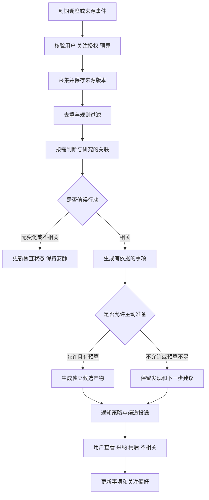
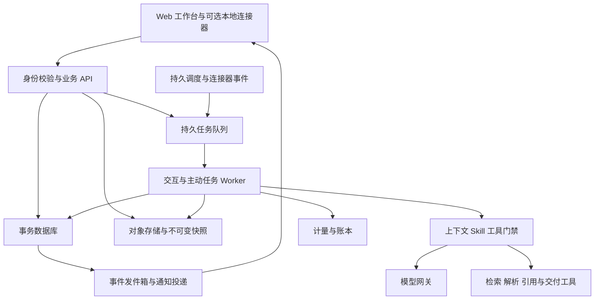

# PaperAgent 个人科研助手产品化方案

日期：2026 年 10 月 29 日  
版本：产品方案 V1  
适用范围：现有 PaperAgent 的产品定位、云端与本地边界、主动服务、订阅与计量、模型交互和实施验收。本文只形成设计，不改变代码、部署、账户连接或实际收费。

PaperAgent 定位为长期了解用户、持续关注研究变化、主动准备下一步工作的个人科研助手。产品通过云端订阅服务交付，以个人为账户、记忆、授权和付费的中心；研究空间承载具体课题、论文和学位研究。用户离线期间，已启用的关注继续运行，有价值的变化被整理成可继续处理的事项。

首版建议采用 Web 工作台、云端执行与可选本地连接器。持续关注和个人记忆进入基础产品体验，复杂研究按用量计费。默认由系统选择模型，用户通过工作模式、资料范围和预算控制执行。

## 1 产品定位与目标用户

### 1.1 核心承诺

对外表述：

> 记得你的研究，留意重要变化，帮你推进下一步。

用户应当能感受到四件事：助手知道我在研究什么；我不在线时它仍按约定工作；它能说明新信息与我的研究有什么关系；我可以从发现直接进入分析、修改和交付。

科研真实性仍由研究者负责。助手形成的判断、外部来源记录、用户已确认事实和待验证假设分别保留。提醒来自有限来源的持续检查，产品显示覆盖范围与最近成功时间，不宣称覆盖所有科研信息。

### 1.2 首批用户与进入场景

| 优先级 | 用户 | 进入场景 | 持续价值 |
| --- | --- | --- | --- |
| 首批 | 正在开展具体研究的硕博生、青年研究者 | 上传一份稿件、开题材料或研究计划，说明当前目标 | 持续文献关注、修改衔接、期限和反馈跟进 |
| 次批 | 同时推进论文和项目申请的独立研究者 | 维护研究背景，关注项目和投稿机会 | 研究资产复用、机会筛选、申请到结题的材料衔接 |
| 后续 | 有团队协作需求的个人用户 | 分享某份报告或邀请导师审阅 | 在个人助手基础上增加有限协作 |

首版优先选择一个有现成试用用户和可核对来源的学科场景验证，学科尚未选定。现有三类生命周期继续保留，不要求首页同时销售十种完整交付。

机构代付、团购码可以成为后续支付渠道，但个人账号和个人资料授权保持独立。机构购买本身不赋予查看个人稿件、对话或记忆的权限。

### 1.3 首个产品闭环

用户导入稿件或研究计划，确认研究主题和关注条件。助手完成首次材料理解，产出有来源的研究摘要；随后持续发现新信息，判断其与当前研究的关系，形成提醒或准备材料。用户点开后直接继续分析、采用证据、修改稿件或安排下一步。

首版同时保留日常对话与局部写作。用户可以先解决眼前问题，再逐步启用持续关注，不以填写画像或配置流程作为前置条件。

## 2 现有工程基础与实际差距

当前状态以 2026 年 10 月 28 日的生命周期落地和前端连接记录为准。较早文档中的八个 Workflow、34 个 Skill、尚无 PPTX 等描述属于历史状态。

| 能力 | 现有基础 | 产品化差距 |
| --- | --- | --- |
| 研究空间与持续对话 | 稿件焦点、历史、检查点和恢复机制 | 个人账号、多设备续接、账户级入口与并发编辑规则 |
| 专业方法 | 35 个活动 Skill，按需读取资源 | 真实任务质量评估、发布回归、可追溯的能力版本 |
| 生命周期与交付 | 三类生命周期、10 个 Workflow，支持局部范围、回访和确认 | 首版入口收敛、复杂业务的真实材料验收 |
| 文献与证据 | 文献记录、证据卡、来源快照和矩阵 | 语义相关性、来源覆盖、全文可得性和规模化检索 |
| 记忆与论文知识 | 研究画像、项目记忆、术语和论证记录 | 个人与项目作用域统一、用户可见的记忆管理、删除传播 |
| 版本与评审 | 稿件哈希、固定版本报告、复核和正式确认 | 云端事务、冲突处理、真实长文质量验收 |
| 主动关注 | A1 文献雷达、A2 机会雷达、A3 进度反馈，显式启用和基本去重 | 持久调度、语义筛选、统一事件处理、预算和跨端通知 |
| 提醒 | 截止日期、站内通知和基础优先级 | 勿扰、频控、合并、渠道回执、通知解释与反馈 |
| 交付 | DOCX、Markdown、投稿 ZIP、PPTX、HTML 和讲稿 | 复杂版式与图表的最终渲染验收 |
| 连接器 | 本地文件、Zotero 导出／类 API 载荷导入、邮件文本事件适配 | Zotero 真实账户持续同步、连接状态和云端适配；真实邮箱持续授权尚未完成 |
| 模型 | OpenAI 兼容及 Anthropic 兼容协议，环境变量配置 | 用户级策略、模型网关、实际用量、预算与回退控制 |
| 运行与存储 | FastAPI、SSE、线程运行、JSON/JSONL 和内容快照 | 身份隔离、数据库事务、持久队列、恢复和观测 |
| 商业化 | 尚无完整商业账户与账单体系 | 订阅权益、支付、账本、退款和到期规则 |

具体代码边界：`tasks/scheduler.py` 使用进程内后台线程；`workspace/state_store.py` 的锁覆盖单进程；`quality/evaluators.py` 的默认 Radar 判断是确定性回退；`tasks/notification_service.py` 在最近 1000 条记录内查重。这些机制适合现阶段验证，不能直接当作持久云端服务的完成状态。

首版继续复用现有单 Agent、工具执行门禁、Skill 按需读取和来源版本机制。暂不引入常驻多 Agent 系统。

## 3 产品结构与主要交互

### 3.1 五个一级入口

| 入口 | 用户目的 | 核心内容 |
| --- | --- | --- |
| 今日 | 了解值得关注的变化并采取行动 | 待确认事项、新发现、期限、继续上次工作 |
| 对话 | 随时提出问题和处理局部任务 | 个人对话、当前研究上下文、材料选择 |
| 我的研究 | 推进具体研究 | 稿件、证据、资料、评审、可选交付流程 |
| 持续关注 | 管理助手平时做什么 | 主题、来源、授权、预算、最近检查和暂停 |
| 我的助手 | 管理助手如何了解和服务自己 | 个人记忆、模型偏好、通知、数据与订阅 |

一级导航可在移动端合并，但上述职责保持。现有十个 Workflow 放入研究空间的按需交付入口。执行日志和上下文诊断留在展开视图。

### 3.2 首次使用

1. 用户注册后，可以立即对话或上传资料。
2. 助手询问当前研究方向与近期目标，允许跳过。
3. 材料理解后展示研究背景候选和来源位置，用户可更正。
4. 助手建议一至两个持续关注项，展示主题、来源类别、频率、资料范围、后台预算和提醒方式。
5. 用户启用后显示首次检查结果与下一次计划检查时间。样例内容必须明确标记，不混入真实发现。

研究方向较模糊时，先帮助收窄主题。不能自动开启宽泛、高成本关注来填满首页。

### 3.3 首页与主动消息

```text
今天值得关注

方法假设可能需要复核
发现一篇新论文，与稿件 V7 方法章节的适用条件有关。
我已整理摘要级差异；全文尚未获取。
来源：论文链接   检查时间：今天 08:30
[查看差异] [稍后处理] [不相关]

我正在替你留意
城市内涝方法文献 · 每日检查 · 最近成功：今天 08:30
目标会议通知 · 每日检查 · 一个来源暂时不可访问
[管理关注]

继续当前研究
方法章节修改 · 上次停在证据核对
[继续]
```

消息与对应研究、稿件版本、来源和后续操作绑定。点击后带入相应上下文，避免让用户重述背景。读取卡片和已生成结果不扣额度；按钮若会发起新的收费分析，显示估算与上限。

### 3.4 记忆管理

“助手知道的我”展示研究方向、表达偏好和用户确认的长期信息；每条可查看来源、修改、删除或仅限当前研究。一次临时讨论中的观点不能自动成为永久事实。

个人长期偏好可用于新研究；具体研究的私有材料默认只在该研究内使用。跨研究建议可以只引用标题和经用户确认的摘要；读取或复制另一空间的正文和证据时，沿用显式来源选择与固定版本机制。

## 4 云端与本地能力边界

### 4.1 部署决策

首版以浏览器访问为主，核心业务在云端执行。用户无需配置 Python、模型密钥或本地调度器。后续根据本机文件与 Office 需求提供可选连接器；连接器的存在不影响云端已启用的公开来源关注。

| 能力 | 云端职责 | 浏览器与本地职责 |
| --- | --- | --- |
| 账号和权益 | 身份、会话、订阅、配额、设备管理 | 登录、账户切换、显示权益 |
| 个人画像与记忆 | 作用域、版本、检索和用户确认状态 | 查看、更正、删除和选择使用范围 |
| 资料与证据 | 已上传文件、解析、索引、快照、关联 | 选择文件、预览上传范围、查看解析结果 |
| 对话和研究执行 | 上下文、Agent、Skill、工具与运行记录 | 输入、范围选择、流式呈现、取消和继续 |
| 稿件 | 已同步工作版本、不可变交付版本、冲突校验 | 编辑、临时草稿、差异预览、采纳修改 |
| 主动服务 | 调度、来源检查、筛选、主动准备、通知生成 | 关注管理、提醒展示、反馈和暂停 |
| 模型 | 服务商凭证、路由、用量、限流和回退 | 选择模式、查看具体模型与费用 |
| 导出和渲染 | 标准文件生成、可隔离的渲染与检查 | 预览、下载、保存到本机 |
| 本机接入 | 接收用户批准的同步内容 | 可选连接器访问指定文件夹或本机应用 |

云端推理需要发送本次允许使用的内容。上传、解析和发送给模型是三个可解释的步骤；不能以本地文件选择器或连接器为由承诺“数据不出本机”。首版不提供离线 AI 模式。

统一部署地区、对象存储位置和获准供应商的数据处理范围应在首发前确定并展示。用户可以收窄供应商范围；没有符合约束的模型时暂停任务，不自动切换处理地区。

### 4.2 数据的权威版本

云端已提交工作版本是跨设备继续工作的依据；正式交付使用不可变快照。本地未同步草稿清晰标记，不自动取得正式版本地位。

每次提交携带读取时的版本号。若云端已变更，保留两份内容并展示差异，由用户合并或另存分支。助手基于旧版本准备的修改同样执行版本校验，不能覆盖新编辑。网络恢复后只重传未完成的上传或提交，不重新发起已接受的 AI 任务。

缓存分为未提交输入和可重建预览。私有稿件的长期离线缓存默认关闭，用户可主动启用；退出账号清理已同步缓存，对未同步草稿先提示保存。公开通知在锁屏上默认显示概括标题，避免暴露研究正文。

### 4.3 本地连接器范围

连接器首期如实施，限定为用户选择的文件夹增量同步和本机文献管理接入。显示白名单、排除项、上次成功同步时间和撤销入口。文件内容变化形成新版本；本机删除先标记来源已移除，不直接删除云端证据历史。

Word/WPS 接入按独立阶段处理，先支持选定内容发送和明确写回。助手不能获得整盘扫描或任意本机命令权限。连接器离线时，云端使用最后同步版本，并提示本机更新尚不可见。

### 4.4 数据生命周期

首发建议默认不将私有材料、对话或记忆用于模型训练，供应商准入必须与该承诺匹配。产品提供资料导出、研究删除、个人记忆删除、账号删除和连接撤销。

删除研究后立即停止相应监测、取消未执行任务、撤销可用下载链接，并从在线检索排除正文、索引和派生摘要。在线副本清除目标不超过 7 日，备份轮换目标不超过 30 日；这两个数值是拟定服务政策，发布前须验证存储和供应商条款能否兑现。依法需保留的支付记录与研究正文分开保存并明确告知。

## 5 主动服务机制

### 5.1 三类服务与三种主动程度

沿用 A1、A2、A3 的既有划分，统一为可管理的持续关注：

| 服务 | 发现什么 | 与用户的关系 | 可准备的结果 |
| --- | --- | --- | --- |
| A1 研究进展 | 新论文、勘误、关注来源更新 | 研究问题、方法、数据或稿件主张 | 相关性说明、差异摘要、证据候选 |
| A2 科研机会 | 官方项目、期刊、会议和征稿变化 | 方向、资格候选、时间和目标约束 | 机会卡、条件清单、材料准备清单 |
| A3 进度与反馈 | 用户登记的期限、材料变化、导入反馈 | 当前稿件、评审问题和已设定计划 | 影响范围、待办、修改计划、复核草案 |

主动程度由每个关注项独立控制：

| 程度 | 默认行为 | 授权要求 |
| --- | --- | --- |
| 持续发现 | 检查来源、筛选并准备简短说明 | 用户启用关注时约定来源、频率和资料范围 |
| 主动准备 | 生成较长差异分析、检查报告或候选草案 | 同时启用准备能力并分配后台预算 |
| 授权执行 | 定期更新某份工作清单或生成新候选版本 | 逐项说明可写入的对象与上限，允许撤销 |

首版支持持续发现和有限主动准备。助手可以保存候选材料与独立报告；修改当前主稿、确认正式版本、推进现实阶段、对外发送和投稿仍要求具体确认。记录用户已执行的投稿不等于替用户投稿。

### 5.2 关注配置

每个关注项至少保存：

| 字段组 | 内容 |
| --- | --- |
| 研究意图 | 主题、问题、包含与排除条件、用户原话 |
| 作用范围 | 个人或指定研究、允许读取的材料、关联稿件版本 |
| 来源 | 检索提供商、指定来源、来源覆盖与访问状态 |
| 调度 | 用户时区、检查频率、下次检查、上次尝试与上次成功 |
| 行动授权 | 可发现、可准备、可写入的候选对象 |
| 模型与费用 | 可用供应商策略、后台月度上限、单次上限 |
| 提醒 | 渠道、汇总时段、重要性、勿扰和重复提醒规则 |
| 状态 | 草拟、运行、用户暂停、预算暂停、来源异常、已结束 |
| 撤销与期限 | 启用时间、到期条件、授权版本、停用时间 |

从对话推断出的关注先作为建议，首次启用由用户确认。用户明确说“每天帮我留意这个主题”时，界面给出已生效的范围和默认预算摘要，并允许立即调整；遇到来源、外发渠道或收费范围不明确时先补齐必需项。

关闭系统通知不等于停止后台工作；暂停关注也不删除已有成果。两种操作必须分别显示。

### 5.3 从检查到行动



抓取、内容去重、规则筛选优先使用确定性逻辑。新内容通过规则后，才按需做语义判断；复杂影响分析只针对高相关候选。无变化不启动完整 Agent 循环。

单条事件可由多个来源共同支持。论文优先按 DOI 等身份标识合并，机会按官方事项、届次和通知版本合并，反馈按研究、稿件和问题身份合并。不能仅靠网页全文哈希决定是否值得再次通知；导航或页脚变化不应生成科研提醒。

### 5.4 相关性与可信度

每个候选分别判断主题相关性、当前研究相关性、新颖性、时效性、来源可靠程度和可采取的行动。初期使用可解释规则与经评估的模型判断，不把未经校准的分数展示成概率。

只有摘要时标记“摘要级分析”；涉及稿件影响时绑定具体稿件与证据位置。机会资格缺少个人条件时显示“待核对”，抽取的日期不得静默覆盖用户确认的截止日期。官方页面无法访问时显示检查缺口，不生成“没有变化”的成功结论。

### 5.5 提醒优先级与频率

以下为首版默认值，用户可以调整：

| 类别 | 条件 | 默认处理 |
| --- | --- | --- |
| 需要决定 | 新授权、达到预算上限、材料版本冲突 | 进入待确认区；重要项允许单独提醒 |
| 高时效 | 用户已确认期限进入其提醒窗口、官方重要变化已核对 | 即时入站；外部渠道遵守用户允许的时段 |
| 有研究价值 | 新文献、普通机会、非紧急反馈 | 每日汇总，最多一条外部汇总 |
| 运行状态 | 无变化、短暂失败、例行成功 | 更新关注状态，不单独推送 |

默认每日 09:00 按用户时区汇总，22:00 至 08:00 勿扰；每日最多两次非用户请求触发的外部提醒，其中普通汇总最多一次。夜间越过勿扰仅限用户明确开启的紧急期限提醒。原文记录时间同时保存 UTC 与来源时区。

同一事项通过稳定标识跨渠道去重；来源实质更新、期限接近或用户设定的稍后时间到达时才再次提醒。已处理事项不因换了措辞重新出现。无新内容不发送空简报，收集到但未送达的消息不标记为用户已读。

首版以站内收件箱和 Web Push 为渠道；Web Push 依赖设备和浏览器支持及用户授权，系统显示实际可用性，不承诺保证送达。邮件摘要作为后续选项，独立启用。科研信息推送与营销通知分开设置。

### 5.6 失败与恢复

短暂失败指数退避，带单来源超时和重试上限。关注的“上次尝试”与“上次成功”分开，游标仅在相应事件可靠落库后推进。连续三次检查周期失败或一个检查周期超过 24 小时未成功时，显示服务异常；长周期关注以其计划周期为基准。首版工程验收需固定各来源的超时与异常阈值。

关注停用、授权撤回、研究删除或预算暂停后，未开始任务取消。已运行任务在下一安全检查点停止，并在工具调用前重新检查授权；无法撤回的已发送请求如实记录。恢复时从已保存游标继续，不重复扣费或重发历史提醒。

## 6 云端架构与可靠性

### 6.1 目标架构



初期采用模块化单体 API、独立 Worker 和调度进程。业务事实与用量账本采用事务数据库，文件与快照使用对象存储；检索先满足个人资料规模，再按真实需求扩展索引。继续保留来源、引用和确定性校验的领域边界。

交互请求与后台任务分队列，优先保证用户当前操作。SSE 断开不终止云端任务，重新打开可通过事件游标恢复。队列积压时降低后台准备吞吐，明确显示延迟。

### 6.2 可靠执行与计量

任务状态包括排队、运行、等待确认、预算暂停、已完成、部分完成、失败与已取消。事件处理按至少一次投递设计，通过幂等键避免重复产物、重复通知和重复结算。

身份授权、预算预留、任务创建需要可核对的一致关系；任务创建成功后使用事件发件箱投递队列，避免已扣额度但任务丢失。运行中保存检查点和用量，完成或终止后结算并释放未使用预留。超时预留由对账任务回收，未核清的请求不能直接再次收费。

后台任务携带用户、研究、关注授权版本和模型策略版本。执行工具与读取对象时重新验证权限，不依赖模型自行遵守隔离。下载链接短期有效，日志对凭证与研究正文做最小化处理；文件转换和联网工具在受限执行环境中运行。

### 6.3 运维可见性

用户看到排队、运行、最近成功检查、失败来源、已消耗和恢复入口。运营侧按匿名化任务标识查看调度延迟、来源失败率、模型错误、通知投递和账本差异；需要访问用户材料排障时取得限定授权并保留记录。

记录任务关联的 Skill、路由策略、实际模型、材料版本和输出版本。模型或 Skill 升级后可回溯，不以重新执行旧任务覆盖其历史。

## 7 付费与套餐设计

### 7.1 付费单位

个人按月订阅，包含研究资料管理、记忆、一定数量的持续关注和研究额度。额度用于云端分析与生成，存储和后台基础检查以套餐限额管理。研究空间数量不作为主要收费门槛，避免用户为了省钱混合不同研究。

读取已有资料、查看记忆和结果、采纳已生成内容、接收通知、修改关注设置及下载已有产物不扣额度。新的生成、深度分析或格式重建按任务告知费用。

### 7.2 首轮定价试验

以下是完整的可测试报价假设，尚未通过真实成本和购买行为验证，不构成已发布套餐。所有“每日”“每 6 小时”指来源允许且服务正常时的计划检查频率，来源发布或抓取限制会显示。

| 项目 | 免费体验 | 个人版 | 研究进阶版 |
| --- | --- | --- | --- |
| 月价假设 | ¥0 | ¥99 | ¥299 |
| 研究额度 | 注册赠送 200，有效 7 日 | 每月 2000 | 每月 7000 |
| 资料空间 | 200 MB | 5 GB | 20 GB |
| 活跃关注 | 1 项，注册后 7 日体验 | 5 项 | 20 项 |
| 基础检查 | 每日 | 每日 | 最快每 6 小时，按来源限制 |
| 主动准备 | 从体验额度内使用 | 从订阅额度内使用 | 从订阅额度内使用 |
| 单次执行上限 | 50 额度 | 默认 300，可调低 | 默认 1000，可调低 |
| 到期基础服务 | 查看、编辑、导出已有资料 | 到期后保留基础访问 | 到期后保留基础访问 |

试用结束前提醒关注将暂停，保留配置与历史结果。没有支付授权不扣款。首轮试点先做月付，成本与留存稳定后再评估年付折扣，不先卖长期无限使用。

关注数量指一个具体问题和限定范围的持续服务，不等于无限查询词或无限来源。每项首版最多五个指定网页来源；大规模文献检索按支持的检索来源另行说明。超大材料和超长任务开始前给出分页或分批建议。

### 7.3 额度计量与成本约束

对外以“研究额度”显示统一使用量；详细账单可展开模型输入输出、检索、解析和渲染等收费项目。采用发布并版本化的费率表，任务开始后保持当次费率，不能随内部成本变化追溯改价。

示例估算仅用于界面原型：局部修改约 5 至 20 额度，多篇摘要比较约 20 至 80，长稿深度评审约 100 至 400。具体区间需用真实材料、不同长度和模型测量后替换。

内部以每额度对应不超过 ¥0.01 的加权可变成本作为首轮测算目标，包含模型、收费检索、解析和执行资源；这不是额度兑人民币的承诺。基础轮询与通知成本另计，不能因“没有新发现”逐次扣用户研究额度。首次批量建索引、重新分析或新来源的大范围回溯若超出基础服务，执行前单独报价。

示例压力测算：个人版满额执行成本目标上限 ¥20，另假设存储和基础服务 ¥10，则月贡献约 ¥69，占收入约 69.7%；进阶版对应 ¥70 和 ¥20，则约 ¥209，占约 69.9%。这些数字未计支付手续费、税费、获客、人工支持和固定研发成本，不能当作净利润预测。实测超出目标时先调整费率、额度或服务成本，再开放购买。

### 7.4 前台与后台预算

订阅额度共用一个余额，用户分别设置后台可消耗上限和单任务上限。后台默认月上限为当期订阅额度的 20%，个人版 400、进阶版 1400；这是支出限制，不预先扣除或锁住全部额度。前台实际使用可能使后台剩余可用额度降低。

同一时刻各任务实际扣费、预留和余额以事务账本为准。后台预留只在任务准备执行时发生，不允许排队任务长期占满前台额度。达到后台上限，继续套餐内低成本来源检查和已设提醒，暂停新的收费准备。

预算设置展示“本月后台上限”“已花费”“正在预留”“当前最多还可使用”。追加额度不会自动提高后台上限，自动购买默认关闭。

### 7.5 结算和异常规则

| 情况 | 处理 |
| --- | --- |
| 用户点击开始 | 展示预计范围、作用资料、模型策略和最大额度，预留上限 |
| 正常完成 | 按实际计量结算，释放多余预留 |
| 用户主动取消 | 仅结算已实际执行且可在记录中核对的部分，提前说明 |
| 平台错误或供应商故障导致无有效结果 | 对失败部分不扣用户额度，平台承担无效重试 |
| 部分结果已交付 | 展示可用结果和对应消耗；故障部分不收费 |
| 达到单次上限 | 安全暂停，保存检查点；明确追加成本后再继续 |
| 重复请求或回调重放 | 返回已有任务或账单，禁止重复扣费 |
| 任务完成但通知投递失败 | 保留结果并重试投递，不重新执行研究任务 |

研究结论与用户预期不同不自动等于失败；质量争议提供问题反馈和人工核查。平台故障和模型无效输出的判断规则应在试点期间形成可复核样例。

月赠额度随账期重置，购买时明确有效期。首版追加包假设为 ¥39／1000 额度、有效 12 个月，先消耗最早到期额度；停止续费不影响未到期追加额度的前台执行，持续关注权益仍按订阅处理。到期的账本只关闭使用权，不删除使用历史。

### 7.6 到期与退款

到期后停止新的付费持续关注和后台准备，保留基础期限提醒、已有内容访问、手工编辑和已有成果导出。超出免费存储额度时禁止新增上传，不立即删除资料；保留导出及降量入口。

提供清楚的续费日期、取消自动续费和支付记录。重复扣款、未生效权益按规则原路退款；退款时回收对应未使用权益并保留账本，具体消费者条款在发布前单独核定。账号安全、数据导出和删除不能作为高价套餐专属功能。

## 8 模型选择与交互规则

### 8.1 用户主要控制工作方式

| 模式 | 行为 | 默认费用预期 |
| --- | --- | --- |
| 自动 | 根据任务、允许供应商、材料和预算安排 | 执行前估算，不超过确认上限 |
| 快速 | 限制检索、分析步骤和输出范围 | 适合摘要、局部修改与简单整理 |
| 深度 | 允许更多证据核对和跨材料分析 | 更高预算，显示准备步骤与阶段结果 |

模式是执行策略，不是质量认证。同一任务可以使用多个经准入模型；格式校验、引用身份和版本判断继续使用确定性工具。

```text
[自动 ▾] [当前章节 ▾] [材料 8 项]
根据导师意见修改方法章节……

预计 20 至 40 额度 · 本次上限 40
[开始]

高级选项
模型：系统自动／指定可用模型
回退：仅同供应商／允许已批准供应商／禁止回退
资料：本次选定材料与允许的研究记忆
```

轻量即时请求可在用户启用的单次免确认阈值内直接执行；默认阈值建议 20 额度。预计超阈值或改变资料、供应商边界时显示确认。用户可将阈值设为 0。后台任务以已保存的持续授权为执行依据，不逐次打断。

### 8.2 具体模型的高级选择

可用模型卡展示供应商、支持的任务能力、可用资料类型、成本等级、数据处理范围和当前状态。只有通过 PaperAgent 工具调用、长文、引用与安全评估的模型才进入选项；不把供应商返回的全量模型列表直接开放给用户。

用户指定模型时，“锁定”和“允许替代”分开。锁定模型不可用就暂停，不能以自动模式为由静默替换；允许替代也只能在预先批准的供应商、数据处理范围和预算内选择。多模态能力不足时提示转换方案或选择兼容模型。

首版提供平台托管模型，用户无需 API Key。自带密钥作为后续高级能力评估，届时平台服务费与用户模型费用分别显示，供应商凭证存放云端安全存储，不进入浏览器持久缓存或运行日志。

### 8.3 后台模型策略

持续关注界面首先展示检查频率、准备深度、月度预算和提醒时机。具体模型继承个人策略，单个研究可以更严格，单次任务可进一步收窄。

路由顺序是先判断授权和数据范围，再筛选能力合格的模型，再比较延迟与预算。低成本筛选使用规则或轻量模型；涉及稿件主张的分析允许更强模型，但不得突破单次与后台月度上限。无法在预算内完成时提供已完成内容和继续选项，不暗中缩小用户要求并标记完成。

在结果的“执行详情”中显示请求模式、实际模型、回退原因、资料与 Skill 版本、实际消耗。切换模型仅影响新任务；正在运行的任务保留启动时策略，必要变更走新的确认或停止续跑。

### 8.4 模型发布评估

使用获得授权并去标识的真实任务评估：中文与英文材料理解、长文一致性、结构化工具调用、引用身份、来源支持、研究间隔离、无依据断言和单任务成本。新模型先进行小流量验证，结果下降时回滚路由版本。

不使用特定型号名称作为套餐长期权益。套餐承诺可用能力、用量和服务范围，具体模型可在满足相同准入条件后更新并留有记录。

## 9 三条端到端用户旅程

### 9.1 文献变化推动稿件修改

用户上传稿件并启用一个方法主题的每日关注，允许用后台额度准备摘要级差异。助手发现新论文，保存元数据与可得内容，核对与稿件 V7 的方法假设关联。相关性足够时形成卡片；仅有摘要就明确分析范围。

用户查看已有差异不扣费。点击“核对全文并提出修改”时，界面显示可取得材料、使用模式和额度上限。助手生成独立候选修改，用户确认后应用；若主稿已变成 V8，先显示差异并重新核对，不直接覆盖。后续相同论文只在版本或影响实质变化时再次出现。

### 9.2 机会发现与期限准备

用户提供研究方向、申请阶段和关注来源。助手发现官方通知，形成资格条件候选与来源时间；个人条件不全时只提出待核对项。用户确认该机会与截止日期后，才加入其正式日程，并按用户设定窗口提醒。

用户选择准备申请，沿用 G1 和现有材料版本；发现机会本身不自动创建完整交付、不承诺资格、不替用户提交。来源日期变动时显示旧值、新值及证据，等待确认更新。

### 9.3 导师反馈与后续复核

用户导入导师意见或自行登记反馈。A3 关联稿件和问题，准备修改清单。用户选择局部修改后生成候选版本，评审问题只有在对应版本复核和用户采纳后才转为已处理。

没有授权邮箱或文档连接时，助手只知道已导入反馈，不宣称收到了外部新意见。长时间未推进时，仅按用户主动设定的跟进节奏提醒，允许“这个研究先暂停”。

### 9.4 主动消息的状态衔接

事项状态统一为新发现、已查看、待决定、处理中、已采纳、已忽略、已过期。用户点开只更新已查看；采纳证据、确认期限和应用修改分别由对应业务操作推进，不能用点击率代替实际处理完成。来源撤回或关联稿件变化时提示过期，保留原始依据和历史。

“不相关”允许补充原因，如主题不符、方法不适用、重复或暂时不做。单次反馈先影响该关注，改变个人长期偏好前由用户确认。用户可以撤销忽略，不因一次拒绝永久屏蔽整个研究方向。

## 10 首版范围与后续边界

### 10.1 可收费首版必须包含

- 个人账号、研究空间、资料上传、连续对话与跨设备恢复。
- 可查看和更正的个人记忆，研究间资料边界和来源版本。
- 一类经过真实材料验证的稿件分析与修改闭环。
- A1 公开来源关注、A2 少量指定官方来源、A3 手工登记反馈及期限。
- 可靠调度、无变化静默、去重、汇总、暂停、异常状态和一种可验证的跨端提醒渠道。
- 有限后台准备、单次与月度预算、任务恢复、账本与错误补偿。
- 自动／快速／深度模式、少量准入模型和可解释回退。
- 付费试用、月度订阅、追加额度、取消续费、数据导出与删除。

现有十个 Workflow 保留，但未完成真实场景验收的交付显示适用范围。PPTX 等已有导出能力按真实渲染结果表述，不统一承诺所有版式自动达标。

### 10.2 后续阶段

本地文件夹连接器、Word/WPS 双向编辑、真实邮箱 OAuth 持续同步、更多来源和移动端原生通知，按实际使用需求推进。团队后台、机构权限体系、全自动投稿、任意网站登录自动化和完全离线推理不进入首版。

多对话与历史分支在首版可先采用每研究一条主对话、结果事项独立关联的方式，避免在既有单对话基础上同时引入复杂分支。个人对话转入具体研究时保留原始上下文来源。

## 11 工程模块演进映射

| 现有模块 | 保留内容 | 拟新增或替换 |
| --- | --- | --- |
| `server.py` 与各业务 API | 领域接口和 SSE 语义 | 账户认证、请求幂等、所有权校验、异步任务入口 |
| `agent/`、`harness/` | 决策循环、上下文与工具门禁 | 用户策略、后台执行范围、模型网关与用量事件 |
| `skills/`、`workflows/` | 方法目录、十类契约与局部范围 | 发布版本、真实任务质量回归 |
| `domain/`、`workspace/` | 实体关系、证据与固定版本 | 数据库仓储、对象存储、用户作用域和事务 |
| `tasks/standing_intent.py`、`watcher.py` | 意图与关注定义 | 统一关注产品对象、授权版本、来源健康状态 |
| `tasks/scheduler.py`、`proactive.py` | A1/A2/A3 业务职责 | 持久调度、租约、队列、重试与执行检查点 |
| `radar/`、`quality/` | 去重、硬筛与评估接口 | 多语种语义相关、研究影响判断与来源质量 |
| `notification_service.py` | 统一通知入口 | 事件唯一约束、频控、汇总、渠道回执和反馈 |
| `connectors/`、`gateway/` | 标准化事件与领域归属 | 云端授权、游标与撤销，本地代理协议 |
| `tools/`、`kernel/` | 引用、导入、检查与交付 | 隔离执行、限制、可观测费用与渲染验收 |
| `web/v6/` | 研究空间、对话和产物查看 | 个人首页、持续关注、记忆、预算、模型与订阅界面 |
| 拟新增商业模块 | 无 | 权益、支付适配、计量费率、双重记账或等效可审计账本 |

迁移采用显式导入：展示本地空间将上传哪些资料、估算体量和归属，用户选择后创建云端项目并校验数量与哈希。保留本地原件和导入报告，不在登录后自动扫描整个 workspace。历史来源、采纳状态和确认指纹能够保留的应原样保留，失去条件的确认标记待复核。

## 12 实施阶段与交付顺序

以下按依赖和退出条件划分，工期需在人员与基础设施明确后估算。

| 阶段 | 主要交付 | 退出条件 |
| --- | --- | --- |
| A 产品与成本验证 | 单学科试点、真实旅程、材料集、来源清单、成本分布 | 用户能理解主动价值；明确来源覆盖和可收费任务边界 |
| B 云端底座 | 账号隔离、数据库、对象存储、Worker、恢复与基础账本 | 关闭页面和重启服务不丢任务；不会串资料或重复结算 |
| C 主动服务闭环 | 关注授权、A1/A2/A3、筛选、准备、去重、通知和预算 | 用户离线仍可靠工作，有变化可行动，无变化保持安静 |
| D 个人产品体验 | 首页、记忆、研究续接、模型设置、移动端可用性 | 新用户独立完成启用关注到采纳结果 |
| E 小规模收费 | 试用、月付、追加、退款与支持流程 | 账单可核对、成本在限额内、出现付费后重复使用 |
| F 扩展连接 | 文件夹、文献库、Office、邮箱等 | 每项连接单独通过授权、同步与撤销验收 |

阶段 A 可先用真实来源和人工复核验证主动消息价值，所有人工介入须记录，不能在宣传中表述成已全自动实现。阶段 B 的计量先运行观察账本，不实际收费；阶段 E 才启用真实支付。

## 13 质量标准与产品指标

### 13.1 北极星指标

每周因助手的主动服务产生至少一次有效科研推进的用户数。有效推进包括将有来源的新信息加入研究、采纳差异分析、完成待处理修改、确认有用机会或处理必要期限；单纯打开推送不计入。

同时观察主动消息被评为不相关的比例、关闭关注和通知的比例。提醒更多不自动代表服务更好。

### 13.2 试点观测

| 维度 | 指标与口径 |
| --- | --- |
| 激活 | 注册用户在 48 小时内导入有效材料并启用一个具体关注的比例 |
| 发现价值 | 用户评价过的发现中被标记相关或有用的比例，同时报告评价覆盖率 |
| 后续行动 | 有可操作发现的用户中，7 日内发生继续分析或采纳的比例 |
| 留存 | 按注册周观察第 4 周继续使用或处理主动结果的比例 |
| 打扰 | 非用户请求提醒次数、不相关反馈、取消通知与停止关注 |
| 可靠性 | 到期检查延迟、最长未成功时长、任务恢复、渠道投递和账本差异 |
| 成本 | 每活跃付费用户、每有效发现和每次有效推进的可变成本 |
| 收入 | 体验转付费、次月续费、追加率、退款和支持成本 |

建议先招募 20 至 30 位个人研究者进行 4 周定向试点，再扩大到收费样本。可设首轮讨论阈值：评价过的主动发现有用率至少 60%，有可操作发现用户的后续行动率至少 25%，满额可变成本后的贡献率目标至少 65%。这些是调整方案的试验阈值，不是已达到的表现，也不能忽略小样本与反馈缺失。

## 14 发布前验收清单

| 场景 | 必须观察到的行为 |
| --- | --- |
| 用户关闭页面、Worker 重启 | 已接受任务可恢复；关注按计划继续，运行记录保留 |
| 两次调度处理同一来源事件 | 同一事项只产生一次有效产物和结算，通知合并 |
| 来源只有页脚变化 | 不生成新的科研事项 |
| 一个来源连续不可访问 | 其余来源继续；该来源成功时间不更新，状态说明覆盖缺口 |
| 新论文只有摘要 | 结果明确分析依据，不伪造全文结论 |
| 同一文献关联两个研究 | 各研究影响分别保存，面向个人的外部提醒合并 |
| 用户停用关注或撤销连接 | 新任务不启动，运行任务在安全点停止，不重复提醒 |
| 后台达到上限 | 收费准备暂停；基础期限提醒与已有结果仍可见 |
| 单次模型费率或供应商变化 | 已接受任务按原费率和授权策略执行或暂停 |
| 锁定模型不可用 | 显示不可用并保留任务，不偷偷改用其他供应商 |
| SSE 断线、提交重试 | 回到同一任务，恢复事件，不重复生成或扣费 |
| 用户和助手同时改稿 | 版本冲突被展示，旧输出不覆盖新稿 |
| 一个用户猜测另一个文件 ID | 服务端拒绝读取、下载、检索与工具访问 |
| 用户删除资料或研究 | 相应关注停止，在线索引和派生记忆进入清除流程 |
| 订阅到期 | 新付费关注暂停，已有资料和成果可查看、导出 |
| 推送未送达 | 站内结果保留，显示渠道状态，不假装用户已收到 |
| 本地连接器离线 | 云端公开来源继续，稿件使用版本与同步缺口可见 |
| 生成 PPTX 或 DOCX | 检查内容与来源，并实际渲染核对目标交付版式 |

核心隔离、账本和授权项出现错误时不扩大收费范围。真实材料质量验收与离线接口测试分别报告，不能用后者代替前者。

## 15 产品决策与试验项

### 15.1 本方案采用的决策

个人是长期服务中心，云端承担持续工作；研究空间保留具体科研上下文。主动发现与有限主动准备进入首版。用户控制资料、供应商范围、后台预算和提醒，模型默认自动选择。订阅按个人销售，持续关注权益与研究额度共同组成套餐。本地连接器为可选后续能力。

### 15.2 发布前需要验证的假设

| 假设 | 验证办法 | 不成立时的调整 |
| --- | --- | --- |
| 某一学科有稳定的持续关注需求 | 选择现有用户最多的具体方向做 4 周试点 | 收窄到更具体的研究问题和阶段 |
| 新发现能转化为科研推进 | 记录来源、用户判断和后续行动 | 改进相关性和下一步准备，降低推送频率 |
| ¥99／¥299 与额度匹配 | 实际报价、月度续费和成本观测 | 调整权益和费率，保留清晰的订阅结构 |
| Web Push 足以建立离线回访 | 按设备观察授权、投递和打开情况 | 增加用户选择的邮件摘要或原生通知 |
| 20% 后台预算合适 | 观察后台暂停、额度利用和手动调整 | 改进默认值，保留用户可设上限 |
| 当前模型能稳定完成首个闭环 | 用真实长文和反馈做任务评估 | 缩小交付范围或更换准入模型 |

这些试验项不阻碍先完成产品原型、云端设计与质量样例。本文不启动任何监测、不连接外部账号、不变更现有前端与代码。

## 16 依据与参考

### 16.1 工程依据

- [当前工程说明](../README.md)：按日期记录能力变化，最新落地记录优先。
- [生命周期 V1 与 Skill V2 落地记录](lifecycle_v1_and_skills_v2.md)：10 个 Workflow、35 个 Skill、A1/A2/A3 和交付确认规则。
- [前端功能连接记录](frontend_function_connections.md)：稿件焦点、局部范围、投稿记录与产物下载。
- [长期上下文与生命周期架构](lifecycle_context_architecture.md)：对话、记忆、来源和研究状态。
- [主动服务运行时](../src/paperagent/tasks/proactive.py)、[调度器](../src/paperagent/tasks/scheduler.py)、[关注意图](../src/paperagent/tasks/standing_intent.py)：现有主动服务边界。
- [文献雷达](../src/paperagent/radar/pipeline.py)、[评估接口](../src/paperagent/quality/evaluators.py)、[通知服务](../src/paperagent/tasks/notification_service.py)：当前过滤、评估与去重机制。
- [模型客户端](../src/paperagent/harness/llm.py)、[状态存储](../src/paperagent/workspace/state_store.py)、[邮件文本连接器](../src/paperagent/connectors/email.py)：模型、持久化与账户接入边界。

### 16.2 外部产品与设计参考

以下页面于 2026 年 10 月 29 日核对，只用于理解市场已有机制，不代表个人助手定位或本方案定价已被验证。

- [Elicit 官方套餐](https://elicit.com/pricing)：将研究执行用量、工作流和不同服务层级组合；不直接套用其价格到本方案。
- [SciSpace 官方团队说明](https://scispace.com/help/en/articles/10921577-exploring-the-teams-page-in-scispace)：已有共享额度和账单管理机制；本方案只借鉴额度可见性，仍以个人为服务与授权中心。
- [Anthropic 关于 Agent 与工作流的设计文章](https://www.anthropic.com/research/building-effective-agents)：支持按任务选择简单、可组合机制并权衡成本与延迟。该文章发表于 2024 年，本文仅引用设计原则，不依赖其历史工具或型号信息。
