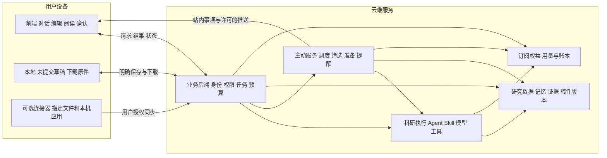
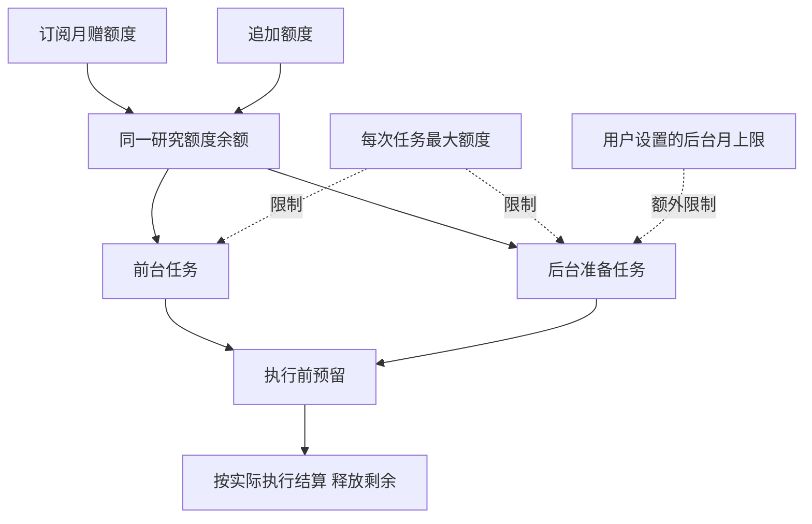

# PaperAgent 个人科研助手分工与交互方案

日期：2026 年 10 月 29 日  
版本：分工方案 V1  
状态：设计方案，尚未实施。本文落实交互图中的能力边界，是[完整产品化方案](personal_research_assistant_product_plan.md)的实施范围细化。价格与额度仍为试验假设。

PaperAgent 为个人提供持续科研服务：用户在自己的设备上交流、阅读和编辑，云端理解研究背景、执行分析、持续关注变化并准备结果。用户付费获得持续服务和一定研究额度，能够限制助手在后台的支出。

首版采用浏览器前端与云端后端。核心科研能力不依赖用户电脑运行，本地连接器作为后续可选扩展。本轮只形成方案，不修改代码、前端、部署或账户配置。

## 1 首版产品形态

| 问题 | 本版决定 |
| --- | --- |
| 服务谁 | 有具体研究任务的个人研究者，先覆盖硕博生和青年研究者 |
| 用户打开后做什么 | 查看重要变化，继续上次研究，直接对话或处理稿件 |
| 用户离线后做什么 | 按已启用的关注检查来源，在授权与预算内准备结果 |
| 重要结果怎么回来 | 先保存站内事项，再通过用户允许的 Web Push 提醒 |
| 安装什么 | 首版无需本地运行环境，通过浏览器使用 |
| 付费买什么 | 个人持续服务、资料与记忆管理、限量关注及研究执行额度 |
| 第一个完整场景 | 研究材料导入 → 持续文献关注 → 差异分析 → 用户采纳 → 稿件新版本 |

助手可发现、解释、准备和建议。用户决定研究结论、是否应用修改、是否确认正式版本和是否对外提交。

## 2 总体分工

“本地与云端”描述运行和保存的位置，“前端与后端”描述软件职责。首版前端运行在用户浏览器，业务后端和科研执行都在云端。本地连接器负责接入本机内容，不负责运行核心 Agent。

## 3 本地保留哪些能力

### 3.1 必须保留的浏览器能力

| 本地能力 | 具体行为 | 不承担的职责 |
| --- | --- | --- |
| 对话输入 | 输入请求、选择材料、模式和范围 | 直接调用模型服务商 |
| 稿件编辑 | 手工编辑、局部选择、显示差异、采纳候选修改 | 无校验地覆盖云端版本 |
| 阅读与预览 | 展示稿件、文献、证据、报告和交付文件 | 把界面预览当作已确认正式版本 |
| 草稿保护 | 缓存未发送文字和未同步编辑，显示同步状态 | 默认永久缓存全部私有研究资料 |
| 文件操作 | 用户选择上传文件、查看进度、下载成果 | 自动扫描整盘或整个工作目录 |
| 通知设置 | 展示关注与事项，控制渠道和勿扰 | 保证浏览器关闭后的后台研究执行 |

浏览器关闭后，已接受的云端任务继续；尚未提交的输入不构成云端任务。网络断开可以继续手工编辑，但新的 AI 请求等待恢复后提交。

### 3.2 后续可选的本地连接器

连接器用于指定文件夹增量同步、Zotero 等本机内容接入，以及 Word/WPS 选定内容的发送和明确写回。逐项显示接入范围、上次同步时间和撤销入口。

首版先使用上传和下载完成闭环，不要求安装连接器。连接器离线不影响公开来源监测；云端只能读取最后同步版本，必须提示本机内容可能已更新。

### 3.3 数据保存规则

- 本地原始文件由用户保管，上传不会删除或替换本机原件。
- 云端已同步工作版本作为跨设备继续工作的依据。
- 正式交付固定为不可变快照，与仍可编辑的工作稿分开。
- 本地未同步内容明确标记，版本冲突时保留双方内容并展示差异。
- 云端分析使用上传且获准使用的内容，不能将该产品表述为资料不出本机。

## 4 云端提供哪些能力

### 4.1 业务后端

业务后端负责识别用户、验证资料权限、保存研究状态、接受任务、检查订阅、预留预算、返回运行状态，以及处理版本确认和用量结算。所有校验以服务端为准，前端禁用按钮只帮助用户理解状态。

后端不把“用户看过结果”视为“用户同意改稿”，也不把“任务生成完成”视为“现实科研阶段完成”。

### 4.2 科研执行

复用现有 Agent、上下文组装、Skill、工具与确定性检查能力：材料解析、文献检索、证据提取、研究分析、写作、评审和文件交付。执行过程保存检查点、来源和版本，结果默认以候选或报告方式提交。

模型服务商密钥只保存在云端。模型选择、调用、工具权限和费用计量由统一网关与执行层控制。

### 4.3 主动服务

持续关注的配置、调度、来源采集、去重、相关性筛选、准备任务和提醒都放在云端。每项关注展示上次成功检查、下一次计划、来源异常、后台花费和停止入口。

首版沿用现有 A1 文献、A2 机会、A3 进度与反馈的业务职责。A3 首先处理用户登记的期限和导入反馈；真实邮箱持续同步属于后续连接能力。

### 4.4 可靠运行

云端任务使用持久队列和独立 Worker；业务与账本使用事务数据库；文件和快照进入对象存储。任务投递可能重试，产物、通知与扣费必须通过幂等标识避免重复。

交互任务与后台任务分队列，当前用户操作优先。SSE 断开只影响进度展示，不自动取消任务；重连后从事件游标恢复。

## 5 前后端如何交互

### 5.1 用户主动发起研究任务

例：根据导师意见修改方法章节。

| 步骤 | 前端做什么 | 后端做什么 | 费用状态 |
| --- | --- | --- | --- |
| 1 选择 | 选择稿件、意见、章节范围和模式 | 返回可用文件及版本 | 不扣额度 |
| 2 估算 | 展示预计额度、最大额度和资料范围 | 校验权限，生成带有效期的估算 | 不执行科研，不扣额度 |
| 3 开始 | 用户确认或在已授权小任务阈值内提交 | 验证估算、版本与策略，事务预留额度并创建任务 | 预留，不等于实际扣费 |
| 4 执行 | 展示阶段进度，允许停止 | 运行模型和工具，保存事件、检查点与实际用量 | 累计实际消耗 |
| 5 交付 | 展示候选修改及与原稿的差异 | 保存候选产物，结算实际用量并释放剩余预留 | 研究执行结算 |
| 6 采纳 | 用户选择应用哪些修改 | 校验稿件版本后保存新工作版本 | 采纳已有修改不再扣费 |
| 7 继续 | 提出新的核查或修改请求 | 新任务重新估算，复用允许的上下文 | 新执行单独计量 |

估算基于材料大小、任务范围、模型策略和已发布费率，不调用收费的深度研究。需要首次解析或全文回溯才能进一步估算时，先单独说明该步骤。

如果用户在任务执行时已手工更新稿件，候选结果仍绑定原始版本；采纳时展示冲突。若需要 AI 重新合并，按新任务报价，不能直接覆盖当前稿。

### 5.2 用户离线期间的主动服务

例：每天关注与研究相关的新文献，有重要发现时整理差异。

| 步骤 | 前端或用户 | 云端服务 | 费用状态 |
| --- | --- | --- | --- |
| 1 启用 | 确认主题、来源、资料范围、频率、准备权限和预算 | 保存持续授权及版本 | 保存配置不扣额度 |
| 2 检查 | 可以不在线 | 按频率检查来源、去重和基础筛选 | 套餐包含的基础检查不逐次扣研究额度 |
| 3 判断 | 无需每次确认 | 形成基础相关性说明，判断是否值得准备 | 简短发现说明包含在关注服务内 |
| 4 准备 | 在启用时允许即可 | 核对单次和后台上限，预留后生成较长差异分析或报告 | 仅授权的收费准备消耗研究额度 |
| 5 提醒 | 收到站内事项或许可的外部推送 | 保存结果，合并重复事项，遵守勿扰和频控 | 消息投递不扣额度 |
| 6 处理 | 查看、稍后、不相关、继续分析或采纳 | 关联相应研究，保存处理状态和反馈 | 查看和采纳免费；新分析另计 |

没有新发现时只更新检查状态，不发送空简报。没有准备权限或后台预算不足时，仍可呈现基础发现及下一步选项，不自动升级为收费任务。

### 5.3 最小交互契约

以下为拟新增或扩展的逻辑接口，不表示现有 API 已具备：

| 契约 | 请求必须明确 | 响应必须返回 |
| --- | --- | --- |
| 任务估算 | 研究、材料版本、范围、模式、模型限制 | 估算标识、预计区间、最大值、有效期 |
| 开始执行 | 估算标识、允许上限、幂等标识 | 任务标识、状态、已预留额度 |
| 查询和续接 | 任务标识、上次事件游标 | 当前状态、遗漏事件、结果、实际消耗 |
| 采纳候选 | 候选标识、当前稿件版本、采纳范围 | 新版本或冲突说明 |
| 启用关注 | 来源、研究范围、周期、预算、允许行动 | 授权摘要、状态、首次检查计划 |
| 暂停关注 | 关注标识、期望配置版本 | 已停止范围、运行中任务处理状态 |
| 查询账单 | 账期、可选任务或关注 | 总余额、预留、已结算、后台剩余上限 |

任务在接受后获得稳定标识。重复点击、网络重传或支付回调重放返回原记录，不创建第二份有效执行或扣费。

## 6 主动服务的执行边界

### 6.1 哪些事情可以自己做

| 行为 | 首版规则 |
| --- | --- |
| 检查用户已启用的公开来源 | 按授权频率持续运行 |
| 保存发现、来源快照和简短关联说明 | 作为关注服务的基础结果 |
| 生成长报告、候选证据和准备清单 | 需要主动准备权限，并受后台和单次预算限制 |
| 提出修改稿或计划草案 | 可以保存独立候选，不直接覆盖工作稿 |
| 应用正文修改、更新已确认期限 | 展示具体差异后由用户采纳 |
| 确认正式版本、推进现实阶段 | 用户明确操作 |
| 向外发送、投稿、替用户接受决定 | 首版不提供自动执行 |

### 6.2 提醒与停止

默认每天一次普通汇总，只在有新价值时发送。已确认期限按用户设置的窗口单独提醒；默认 22:00 至 08:00 勿扰，紧急越过需用户开启。具体时间跟随用户时区。

“关闭推送”只停止外部提醒，“暂停关注”停止检查与新准备，“关闭主动准备”保留检查和基础发现。三个开关分别呈现。

单个来源失败不影响其他来源。上次尝试和上次成功分开，无法访问不能表示没有变化。关注撤销后未开始任务取消，运行中任务在安全检查点停止，实际处理记录可查。

## 7 付费机制

### 7.1 套餐和使用量

首轮按月试售，报价与额度必须在真实成本验证后发布：

| 项目 | 个人版假设 | 研究进阶版假设 |
| --- | --- | --- |
| 价格 | ¥99／月 | ¥299／月 |
| 每月研究额度 | 2000 | 7000 |
| 资料空间 | 5 GB | 20 GB |
| 活跃持续关注 | 5 项 | 20 项 |
| 基础检查频率 | 每日 | 最快每 6 小时，受来源限制 |
| 默认后台月上限 | 400 额度 | 1400 额度 |
| 模型使用 | 准入模型，按实际任务计量 | 准入模型，按实际任务计量 |

持续关注按具体问题和限定来源定义，不代表无限范围采集。基础检查及简短发现说明的服务成本由订阅覆盖，模型辅助基础筛选同样计入平台成本，不转成未经授权的用户扣费。大规模全文处理、跨稿件深度分析和长报告属于研究额度使用范围。

注册可赠送 200 额度和一项 7 日关注体验，无支付授权不扣款。追加包假设为 ¥39／1000 额度、有效 12 个月。首轮不出售无限研究或长期年包。

### 7.2 一个余额与两个限制

后台月上限只是支出限制，不额外发放额度，也不在设置时扣走额度。后台可用量同时受总余额、正在预留的额度、单次上限和剩余后台上限约束。

例：个人版总余额 2000，后台月上限 400。后台准备报告花费 30 后，总余额为 1970，后台已花 30、最多还可花 370。用户前台再花 100，总余额为 1870，后台剩余上限仍为 370。

追加额度只增加总余额，不自动提高后台上限。跨账期启动的任务将预算预留和实际消耗归属到接受任务时的账期，避免新月重置导致重复计算；退款和补偿也关联原账期。

### 7.3 哪些动作收费

| 动作 | 是否消耗研究额度 |
| --- | --- |
| 阅读资料、查看已有结果、手工编辑 | 否 |
| 收到推送、更新关注配置、下载已有产物 | 否 |
| 套餐范围内的来源检查和简短发现说明 | 否，成本由订阅覆盖 |
| 用户请求 AI 分析、写作、评审、重新生成 | 是，先估算再执行 |
| 已授权的后台长报告和深度准备 | 是，同时受后台上限限制 |
| 采纳已生成候选、确认已有版本 | 否 |
| 超范围首次解析、大规模历史回溯 | 单独说明收费范围并确认 |

首版对任务显示“预计区间、最大额度、资料范围”，实际模型和用量可在详情查看。额度费率按版本发布，任务接受后不追溯改价。

### 7.4 异常与到期

- 平台或供应商故障导致无有效结果：失败部分不扣费，释放预留；无效重试由平台承担。
- 用户取消：结算已执行且可核对的部分，停止后的部分不收费。
- 单次上限到达：保存检查点，说明继续所需额度，等待追加授权。
- 后台月上限到达：暂停新的收费准备，保留基础检查、已设提醒与已有结果。
- 订阅到期：付费持续关注暂停，基础期限提醒保留；已有资料可查看、手工编辑和导出。已有未到期追加额度仍可用于前台任务。
- 超免费存储限额：限制新增上传，不立即删除资料，保留导出和整理入口。

## 8 模型选择交互

用户默认选择工作模式，具体型号进入高级设置：

| 用户选择 | 云端处理 |
| --- | --- |
| 自动 | 在资料授权、供应商限制、能力和预算内安排模型 |
| 快速 | 限制检索和分析步骤，适合摘要和局部整理 |
| 深度 | 允许更多材料核对与分析，提供更高的费用估算 |
| 指定模型并锁定 | 只用该模型；不可用时暂停 |
| 指定模型并允许回退 | 只在预先批准的供应商、处理范围和预算内替代 |

输入区呈现“模式、资料范围、预估费用、开始”。持续关注呈现“频率、准备深度、预算、提醒方式”，继承个人模型限制。

费用低于用户已设置的小任务阈值时可直接执行；首版建议阈值 20 额度，用户可设为 0。任何新供应商或资料范围扩大都不由该阈值自动授权。

首版使用平台托管凭证，不要求用户填 Key。现有 `auto/offline/llm` 表示执行来源与演示模式，不能直接改标签当成新产品的 `自动/快速/深度`；实施时应另设工作模式与模型策略，保留历史运行含义。

## 9 对现有工程的落地划分

| 工程部分 | 处理方式 | 首版新增工作 |
| --- | --- | --- |
| `web/v6/` | 保留研究空间与对话基础 | 个人首页、关注面板、估算确认、用量和模型设置 |
| `server.py` 和业务 API | 保留领域语义，逐步收敛任务入口 | 身份与所有权校验、异步任务、幂等和版本检查 |
| `agent/`、`harness/` | 迁入云端 Worker，保留核心方法 | 模型网关、执行策略、授权和用量事件 |
| `skills/`、`workflows/`、`kernel/` | 继续复用 | 能力版本、真实任务评估和交付验收 |
| `workspace/`、`domain/` | 保留数据关系，替换存储适配 | 事务数据库、对象存储、账户与研究作用域 |
| `tasks/`、`radar/` | 保留 A1/A2/A3 职责 | 持久调度、语义筛选、后台预算和检查点 |
| 通知服务 | 保留统一入口 | 持久去重、频控、汇总、Web Push 与送达状态 |
| `connectors/` | 首版保留导入方式 | 后续增加真实账户同步与可选本地连接器 |
| 新商业模块 | 独立提供 | 权益、估算、预留、结算、支付、补偿和对账 |

当前工程已有 10 个 Workflow、35 个活动 Skill 和多种导出能力。仍需补充云端身份隔离、可靠执行与账本。现有进程内线程、内存运行状态和文件锁不能直接承担多用户云端可靠性。

最小新增对象包括用户账户、订阅权益、任务与事件、关注授权、主动事项、费用估算、额度预留和结算流水。个人记忆与研究记忆继续沿用既有业务含义，不为每个主动流程再复制一套事实。

## 10 实施顺序与验收

| 阶段 | 交付范围 | 验收结果 |
| --- | --- | --- |
| 第一阶段 云端主动请求 | 账号、上传、云端执行、候选修改、版本确认、观察账本 | 浏览器关闭后任务不丢，重新打开可继续，用户间资料隔离 |
| 第二阶段 离线主动服务 | 持久调度、关注授权、筛选、有限准备、站内与跨端提醒 | 用户离线仍检查，有价值时提醒，无变化安静，随时能停止 |
| 第三阶段 个人收费 | 套餐、真实支付、预留结算、后台上限、取消续费 | 每笔消耗可核对，不重复扣费，不超过用户授权 |
| 第四阶段 本机接入 | 指定文件夹、文献库和 Office 按需扩展 | 范围可见、版本一致、能撤销，不影响基础云端服务 |

第一阶段只记录模拟或观察账本，不实际收费；第三阶段开放收费前，第二阶段必须形成可用闭环，避免个人助手只有聊天功能。

发布前至少验证：服务重启恢复、重复请求、来源失败、主稿冲突、模型锁定不可用、后台达到上限、用户撤销关注、订阅到期、删除资料和通知未送达。每种情况都要同时检查用户看到什么、后端保存什么、是否扣费。

首轮试点以“用户因主动发现采取了有效科研行动”为核心观察，而非推送数量。用真实任务确认相关性、执行质量与满额成本后，再确定最终价格、额度和来源频率。

## 11 本版的明确结论

1. 本地负责输入、编辑、阅读、差异确认、临时草稿与文件选择。
2. 云端负责个人研究状态、科研执行、持续关注、提醒生成和账本。
3. 前端只请求和呈现，后端执行权限、版本、预算和真实写入校验。
4. 用户主动请求与助手离线工作共用研究数据和执行能力，各自有清晰授权入口。
5. 订阅包含持续服务，收费分析消耗同一额度余额，后台另受用户设置的上限约束。
6. 默认按工作模式选择模型，具体型号可高级指定，任何回退受资料与预算策略约束。
7. 先完成 Web 与云端闭环，再扩展本地连接器。
