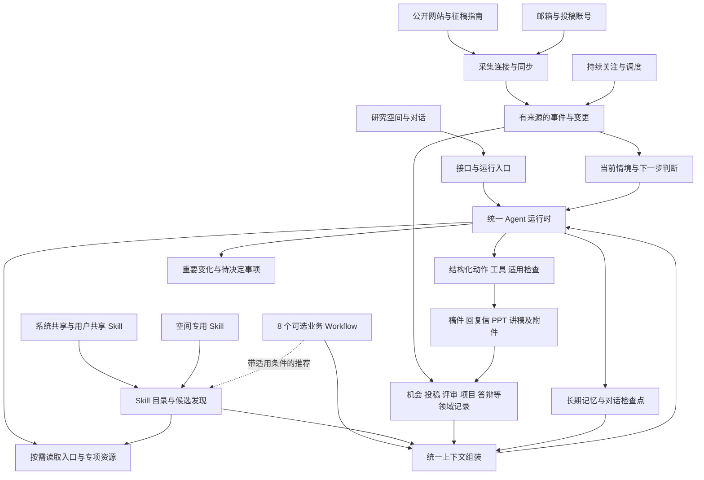

# PaperAgent 系统设计与 Workflow / Skill 总表

版本：设计稿 v1.3（入口、Skill 分类及研究产物基础能力已接入）  
更新日期：2026-10-26  
定位：在现有 PaperAgent 上演进的目标设计与实施依据。

> 本文同时描述当前基础和目标方案。“现有”指已存在相应代码或 Skill 定义，不表示已经完成所有真实业务验收；“拟新增”“拟扩展”均未因本文生成而落地。各 Workflow 中的 Skill 清单为目标推荐关系，只有明确标出的当前关联已经写入现有目录。

**2026-10-26 实施更新**：八个业务入口、五个新协调配置、现有 Skill 推荐、能力边界预览和旧阶段 ID 兼容已接入。本文的主动发现、真实账号同步、完整投稿轮次和答辩产物等目标仍按后续阶段推进；没有因为入口可选而标记完成。当前实际 Skill 关联见第 4.9 节。新增能力分类独立于存放来源；论文撰写含引用核查条件推荐，资源适配见第 5 节。

**研究能力实施更新**：已补文献证据矩阵、基本 SVG 图表增强、离线 HTML 演示与讲稿、本地 DOCX／Markdown／ZIP 投稿包及专项申请评审。共 34 个 Skill、23 个工具。来源与产物版本继续复用原存储；PPTX、复杂图表、完整刊会合规和账号同步仍未完成。细节见 [research-skills 适配实施](research_skills_adaptation.md)。

## 1. 设计目标与基本约定

PaperAgent 面向三个长期研究对象：科研项目、期刊／会议论文、毕业／学位论文。以研究空间、对话、Skill、资料和产物为交互中心，Workflow 在需要组织业务交付或长期协调时使用。

基本约定：

1. 不设置独立 Task 板块，用户可以直接提出局部工作、持续关注或完整交付请求。
2. 生命周期阶段描述现实进展，不等于必须逐个执行的工作流步骤。
3. Workflow 维护当前目标、材料关系、交付范围及适用要求，不规定固定 Skill 调用顺序。
4. Skill 提供可复用方法；工具执行操作；领域服务保存业务事实和状态。
5. 共享 Skill 为主，研究空间专用 Skill 为补充。当前论文、项目和个人事实保存在空间中。
6. 机会寻找、状态同步与重要变化处理支持主动执行；用户可以修改关注条件、暂停或退出。
7. 已发生事实、模型判断、作者决定、未确认假设分别保存，不能互相替代。
8. 沿用现有对话检查点、记忆、来源校验和稿件版本，不为每个 Workflow 再建立一套记忆。
9. 普通段落修改不要求完整提纲、目标刊会、术语台账或全套论文背景。
10. 已实现的来源、字段、规则和版本检查，不被表述为科学有效性或录用结果认证。

## 2. 当前技术基础与目标架构

### 2.1 当前基础

| 部分 | 当前实现 | 主要边界 |
| --- | --- | --- |
| 界面 | HTML、原生 JavaScript | 围绕研究空间与对话组织 |
| 服务 | Python、FastAPI、Uvicorn、SSE | 同空间运行保护，当前主要面向本地使用 |
| 决策 | 单 Agent、结构化 Action、执行后重新观察 | 不存在固定的多 Agent 分工流水线 |
| 模型 | OpenAI-compatible API | 按配置接入模型 |
| 数据校验 | Pydantic | 结构校验不代替语义判断 |
| 存储 | JSON、JSONL、Markdown、内容寻址快照 | 尚无完整多人、多进程事务体系 |
| Workflow | 8 个可选业务入口：3 个原项目交付配置、5 个新协调配置 | 其余专业交付与自动化能力明确标记待补 |
| Skill | 34 个内置 Skill，20 通用、14 生命周期专用 | 方法定义存在不等于业务闭环全部完成 |
| 内部资源 | 34 份独立方法文件、40 项资源引用 | 按需、分页、带哈希读取 |
| 工具 | 23 个注册工具 | 检索、导入、网页、文献、模板、公式与图表等 |
| 论文知识 | 术语、论证、刊会要求 | 候选与作者采纳分开，来源变化提示复核 |
| 论文评审 | 固定版本报告与可选复核 | 当前持久报告主要绑定 Markdown 工作稿 |
| 投稿 | 状态记录、历史、邮件文本解析 | 未完成真实邮箱或投稿账号的持续连接 |
| 主动运行 | Scheduler、Watcher、TriggerEngine、通知基础 | 网站自主发现、账号持续同步和完整事件执行仍需接通 |

### 2.2 目标结构



图中的机会发现、状态判断、写作和评审是逻辑职责。初期复用同一个 Agent 运行时，按事件和当前请求唤醒相应能力；不要求为每个职责启动一个常驻模型进程。

### 2.3 关键职责边界

| 概念 | 保存或提供什么 | 不承担什么 |
| --- | --- | --- |
| 生命周期 | 现实进展与阶段历史 | 强制执行顺序 |
| Workflow | 当前目标、交付要求、材料关系、可选行动 | 固定 Skill 队列 |
| Skill | 专业方法、适用条件、输出约定 | 项目私有事实和外部状态的唯一存储 |
| 工具 | 搜索、读取、导入、生成、转换等操作 | 独立决定科研策略 |
| 领域服务 | 投稿、机会、评审、项目等业务记录 | 自行编造证据或推断作者决定 |
| 连接器 | 账号或网站访问、同步和标准化事件 | 决定是否改投、补研究或接受某条意见 |
| 记忆与上下文 | 检索、恢复、长期偏好和来源回读 | 替代原始文件和业务状态 |

## 3. 三个生命周期与八个 Workflow

| 生命周期 | Workflow ID | 名称 | 当前状态 |
| --- | --- | --- | --- |
| 期刊／会议论文 | `paper_writing` | 论文撰写 | 协调入口已接入；复用写作、评审与论文知识 |
| 期刊／会议论文 | `publication_management` | 投稿与评审管理 | 协调入口已接入；持续采集与账号同步待补 |
| 科研项目 | `project_opportunity_discovery` | 项目机会寻找 | 协调入口已接入；无人值守发现与更新待补 |
| 科研项目 | `grant_application` | 项目申请 | 已有正式 Workflow |
| 科研项目 | `project_midterm_report` | 中期报告 | 已有正式 Workflow |
| 科研项目 | `project_final_report` | 结题交付 | 已有正式 Workflow |
| 毕业／学位论文 | `thesis_writing` | 论文撰写 | 协调入口已接入；复用写作、导师反馈与评审 |
| 毕业／学位论文 | `thesis_defense` | 答辩相关事宜 | 协调入口已接入；专项 Skill、PPTX 和演练交付待补 |

八个 ID 已注册到目录与选择器。旧阶段 ID 保留原始身份，运行观察同时提供 canonical_workflow_id 指向当前业务家族；旧运行与会话不批量改写。`paper_conference_drafting`、`thesis_drafting` 等兼容入口可继续解析，不能据此推断其全部专业交付已经完成。

同一生命周期可以有多个 Workflow 并存。例如论文正在撰写时仍可持续关注投稿机会；投稿等待期间可以讨论新研究问题。完成一次运行不自动推进现实阶段。

## 4. 每个 Workflow 的职责与 Skill 推荐清单

以下所有 Skill 均为按条件使用，不是执行步骤。表中的“现有”说明定义已存在；目标扩展与当前实际关联在第 4.9 节区分。学科 Skill 继续按空间背景匹配，不作为所有流程的强制推荐。

### 4.1 期刊／会议论文：论文撰写 `paper_writing`

**目标**：根据作者现有研究材料，从一个段落到完整论文组织写作、修改和一致性检查。

**按需输入**：研究问题、研究设计、实际结果、文献和证据、现有稿件、作者要求、可选目标刊会。

**可能产物**：研究定位、文献综合、提纲、章节、全文、图表说明、修改记录、待补证据说明。允许直接从中间开始，不要求全部产物。

| 推荐 Skill | 状态 | 何时使用 |
| --- | --- | --- |
| `research_design` | 现有 | 需要推敲问题、设计、证据和贡献时 |
| `literature_review` | 现有 | 需要检索、梳理研究背景和相关工作时 |
| `evidence_synthesis` | 现有 | 需要组织共识、分歧、局限和缺口时 |
| `methodology` | 现有 | 方法说明、研究设计与分析过程需要组织时 |
| `experiment_design` | 现有 | 实验、对照、测量或验证方案需要完善时 |
| `academic_writing` | 现有 | 通用学术写作和结构表达 |
| `english_academic_writing` | 现有 | 英文学术论文、摘要、章节、局部润色和整合 |
| `paper_revision` | 现有 | 已有文字、章节或论证需要实际修改时 |
| `paper_review` | 现有 | 作者要求独立评审或需要检查受影响问题时 |
| 相应学科 Skill | 现有 | 学科方法或贡献标准与当前主张相关时 |

**上下文衔接**：沿用 manuscript 中的术语、论证和刊会要求；实际结果必须有材料依据，规划中的结果不能填成事实。持续修改后识别受影响的摘要、结论、图表和补充材料。

### 4.2 期刊／会议论文：投稿与评审管理 `publication_management`

**目标**：持续管理投稿机会、目标选择、投稿记录、审稿状态、意见、返修、改投和录用后交付。

**可能触发**：作者请求、发现机会、作者选定目标、收到邮件、账号状态变化、审稿意见到达、截止日期变化、稿件更新。

**可能产物**：候选刊会、匹配说明、投稿材料、状态记录、意见分析、修订稿、回复信、改投策略。每次只处理适用部分。

| 推荐 Skill | 状态 | 何时使用 |
| --- | --- | --- |
| `research_radar` | 现有，需增强 | 持续发现和筛选投稿机会 |
| `journal_recommendation` | 现有，需增强 | 建立与论文相符的目标候选集 |
| `journal_strategy` | 现有，需增强 | 比较范围、要求、时间、费用及目标约束 |
| `conference_submission` | 现有 | CFP、Track、匿名稿、会议要求和终稿适配 |
| `submission_tracking` | 现有，需增强 | 归属投稿、同步状态、记录来源和变化 |
| `paper_review` | 现有 | 分析论文问题，复核意见与实际修复 |
| `reviewer_response` | 现有 | 对已有审稿意见组织逐项回应 |
| `paper_revision` | 现有 | 根据授权修改正文与相关材料 |
| `english_academic_writing` | 现有 | 英文稿、摘要、回复及跨文件科学含义一致性 |
| `publication_strategy` | 拟新增 | 拒稿、改投、重大返修或目标变化后的策略比较 |

**运行原则**：状态与事件影响可选行动，但不直接绑定固定 Skill 链。收到大修后，可以先判断问题、核对证据、讨论补研究条件或组织回复，具体由意见、现有材料和作者要求决定。

**评审类型区分**：外部审稿人的原始意见、助手生成的评审判断、作者对意见的决定分别保存；生成回复不等于修改已完成。

### 4.3 科研项目：项目机会寻找 `project_opportunity_discovery`

**目标**：主动发现基金、课题和机构申报通知，判断研究方向、资格、条件和时间是否匹配。

**按需输入**：研究档案、方向、团队和申请资格、指定来源、排除条件、可投入时间。可以先从用户研究档案发现机会，选中后再关联空间。

**可能产物**：机会卡片、原始指南、资格核对、匹配理由、待确认条件、截止日期和准备建议。

| 推荐 Skill | 状态 | 何时使用 |
| --- | --- | --- |
| `research_radar` | 现有，需增强 | 网站发现、持续关注、去重和变化处理 |
| `grant_application` | `grant_review`、`scientific_figure`、`grant_application_general`、`research_design`、`academic_writing` |
| `grant_writing` | 现有 | 解读资助方方向、要求及研究条件 |
| `research_design` | 现有 | 判断研究方向与拟申报问题是否可执行 |
| `grant_application_general` | 现有 | 在作者准备申请时，推敲选题与论证入口 |

**边界**：方向匹配与资格满足分开判断；缺失资格条件保持未知。发现一个机会不自动表示作者决定申报。

### 4.4 科研项目：项目申请 `grant_application`

**目标**：根据当前指南、官方模板和作者事实，组织申请书、活页及适用附件。

| 推荐 Skill | 状态 | 何时使用 |
| --- | --- | --- |
| `grant_application_general` | 现有；当前已关联 | 申请正文、选题质量、论证链条与申报前审阅 |
| `research_design` | 现有；当前已关联 | 问题、方法、数据和可行性推敲 |
| `academic_writing` | 现有；当前已关联 | 学术表达、结构与局部修订 |
| `grant_writing` | 现有；建议按需补充关联 | 资助方要求、工作包、里程碑和风险组织 |
| `literature_review` | 现有；建议按需补充关联 | 立项依据和研究基础的文献支撑 |

**可能产物**：局部论证、申请全文、论证活页、材料清单、检查记录和适用的 DOCX。

**跨阶段衔接**：保存目标、预期成果、进度、来源和已确认决定。立项后显式绑定适用基线，供中期和结题比较；最新草稿不自动成为获批基线。

**命名说明**：Workflow `grant_application` 与同名 Skill 是不同对象。该 Workflow 当前主推荐的写作 Skill 是 `grant_application_general`；同名 Skill 更偏机会识别和匹配。

### 4.5 科研项目：中期报告 `project_midterm_report`

**目标**：对照原定目标、实际工作和阶段成果，说明偏差、问题、调整及后续计划。

| 推荐 Skill | 状态 | 何时使用 |
| --- | --- | --- |
| `grant_midterm_report` | 现有；当前已关联 | 进展组织、阶段成果、偏差解释和后续安排 |
| `project_evidence_review` | 现有；当前已关联 | 核对目标、观测、成果、来源和历史调整 |
| `academic_writing` | 现有；当前已关联 | 报告表达和章节修订 |
| `methodology` | 现有；建议按需补充关联 | 研究方法调整需要说明时 |

**可能产物**：中期报告、目标进展对照、证据清单、后续计划，必要时增加汇报材料。

**事实约束**：预期成果与已发生结果分开；累计观测不机械相加；延期和未完成可以如实表达。

### 4.6 科研项目：结题交付 `project_final_report`

**目标**：核对项目目标完成情况、最终成果及其证据，形成结题正文和附件。

| 推荐 Skill | 状态 | 何时使用 |
| --- | --- | --- |
| `project_evidence_review` | 现有；当前已关联 | 目标完成、成果声明、历史调整与证据核查 |
| `academic_writing` | 现有；当前已关联 | 结题总结、价值表述和报告修订 |
| `evidence_synthesis` | 现有；建议按需补充关联 | 多类成果和证据需要归纳时 |

**可能产物**：结题报告、目标完成对照、成果附件、核查记录及归档清单。

当前没有单独的结题写作 Skill，专属交付结构由现有 Workflow 提供。先复用现有方法，发现稳定且独立的方法缺口后再决定是否新增 Skill。

### 4.7 毕业／学位论文：论文撰写 `thesis_writing`

**目标**：支持选题、开题、研究记录、章节写作、导师反馈、送审修改和定稿。

| 推荐 Skill | 状态 | 何时使用 |
| --- | --- | --- |
| `thesis_planning` | 现有 | 学位要求、章节关系、研究计划和时间安排 |
| `research_design` | 现有 | 开题和研究问题、设计对齐 |
| `literature_review` | 现有 | 文献检索与研究背景 |
| `evidence_synthesis` | 现有 | 文献综合与缺口论证 |
| `methodology` | 现有 | 方法章节和实际分析说明 |
| `experiment_design` | 现有 | 实验或验证方案需要推敲时 |
| `academic_writing` | 现有 | 通用章节撰写 |
| `english_academic_writing` | 现有 | 英文正文、英文摘要及英文表达 |
| `advisor_feedback` | 现有 | 提取导师要求、判断适用范围和冲突 |
| `paper_review` | 现有 | 章节、整稿或历史意见的独立评审 |
| `paper_revision` | 现有 | 实际修改正文及相关章节 |
| 相应学科 Skill | 现有 | 当前学科方法与主张需要专项判断时 |

**按需输入**：学位、学校与学院要求、导师意见、论文、材料、研究结果。学校格式、导师偏好与科学要求分别标注来源和作用范围。

**可能产物**：开题材料、章节、全文、导师意见处理记录、匿名送审稿和定稿。上述产物不是必须按顺序完成的步骤。

盲审与导师审阅初期作为可选活动，由评审和修订能力支持；有独立的长期交接需求时再扩展专用协调配置。

### 4.8 毕业／学位论文：答辩相关事宜 `thesis_defense`

**目标**：围绕论文证据和答辩条件，组织 PPT、讲稿、问答、演练和答辩后修改。

| 推荐 Skill | 状态 | 何时使用 |
| --- | --- | --- |
| `thesis_planning` | 现有 | 梳理论文依据、答辩条件与汇报重点 |
| `defense_presentation` | 拟新增 | 组织答辩叙事、幻灯片内容和展示重点 |
| `defense_script` | 拟新增 | 逐页讲稿、转场、重点和时间分配 |
| `defense_qa` | 拟新增 | 根据论文方法、结果、贡献和局限准备问答 |
| `defense_rehearsal` | 拟新增 | 模拟追问、检查表达和时间，形成改进意见 |
| `defense_revision` | 拟新增 | 整理答辩意见并组织后续修订与复核 |
| `paper_review` | 现有 | 核查汇报论证、问答边界和受影响问题 |
| `paper_revision` | 现有 | 根据授权修改论文正文 |
| `academic_writing` | 现有 | 讲稿、说明材料和学术表达 |

**按需输入**：当前论文版本、时长、学校模板、听众背景、作者重点、现有 PPT／讲稿。未知条件不应阻止局部工作。

**可能产物**：可编辑 PPTX、逐页讲稿、计时安排、问答记录、演练反馈、答辩后修改记录。用户可以只请求其中一种。

### 4.9 当前已经写入代码的八个 Workflow 关联

| Workflow | 当前实际推荐 Skill |
| --- | --- |
| `paper_writing` | `scientific_figure`、`figure_review`、`citation_verification`、`research_design`、`literature_review`、`evidence_synthesis`、`methodology`、`experiment_design`、`academic_writing`、`english_academic_writing`、`paper_revision`、`paper_review` |
| `publication_management` | `submission_preparation`、`research_radar`、`journal_recommendation`、`journal_strategy`、`conference_submission`、`submission_tracking`、`paper_review`、`reviewer_response`、`paper_revision`、`english_academic_writing` |
| `project_opportunity_discovery` | `research_radar`、`grant_application`、`grant_writing`、`research_design`、`grant_application_general` |
| `grant_application` | `grant_review`、`scientific_figure`、`grant_application_general`、`research_design`、`academic_writing` |
| `project_midterm_report` | `scientific_figure`、`grant_midterm_report`、`project_evidence_review`、`academic_writing` |
| `project_final_report` | `scientific_presentation`、`project_evidence_review`、`academic_writing` |
| `thesis_writing` | `scientific_figure`、`thesis_planning`、`research_design`、`literature_review`、`evidence_synthesis`、`methodology`、`experiment_design`、`academic_writing`、`english_academic_writing`、`advisor_feedback`、`paper_review`、`paper_revision` |
| `thesis_defense` | `scientific_presentation`、`figure_review`、`thesis_planning`、`academic_writing`、`paper_review`、`paper_revision` |

表内当前均引用 1.0 版本，全部带 optional 与 when。尚未创建的 publication_strategy 和五个答辩 Skill 仅列入 planned_skill_ids，不出现在可读取推荐清单。三个项目交付配置保留原方法，并按本轮请求补充了部分图表、演示和申请评审推荐；第 4.4—4.6 节其余目标关系仍按需要接入。界面预览展示全部推荐元数据；模型默认候选仍有数量上限，可通过目录按需发现其他方法。

## 5. Skill 体系、完整目录与新增规格

### 5.1 能力类型与存放来源

能力类型 capability_type 与存放来源 source_kind 是两个独立维度：通用方法换一种研究成果仍然成立；生命周期专用能力依赖特定阶段的业务目标与验收要求。两类都可放在系统／用户共享库或空间私有库。旧 layer 不负责判定这两个维度。

细分方法属于现有能力时作为内部资源，例如引言写法、摘要压缩、NSFC 立项依据或某类研究的评审标准。学校盲审要求先作为有来源的空间资料，形成可复用检查方法后再考虑空间 Skill。未声明分类的旧扩展保持可用，不强制迁移。

按需读取、适用条件、资源来源和实际核查范围继续有效，分类不成为调用顺序或 Workflow 门槛。全部分类、外部资源映射和适配取舍见 [Skill 分类与写作资源](skill_classification_and_writing_resources.md)。

存放方式如下：

| 来源 | 位置 | 用途 |
| --- | --- | --- |
| 系统共享 | `src/paperagent/skills/library` | 通用科研方法、专业方法和产品维护的指南 |
| 用户共享扩展 | `<workspace_root>/skills` | 多个研究空间复用的方法 |
| 空间专用 | `<workspace_root>/projects/<id>/skills` | 本空间的明确私有标准或方法补充 |

同 ID 同版本按空间专用、用户共享、系统内置的顺序覆盖，记录来源，不静默合并。来源限定 key 可回读特定定义。私有 Skill 可以通过明确引用使用共享 Skill 的方法，避免复制整份方法后各自失控。

首次上下文只给候选摘要；需要时读取 Skill 入口，再根据适用条件读取内部资源。资源分页包含来源与哈希，续页检查版本变化。共享 Skill 不保存某篇论文的实际结果、账号信息或导师私有意见。

### 5.2 当前 34 个内置 Skill

| 类别 | Skill ID | 职责 |
| --- | --- | --- |
| 通用写作 | `academic_writing` | 学术表达、结构和证据组织 |
| 研究方法 | `research_design` | 问题、理论、对象、数据与方法对齐 |
| 研究方法 | `methodology` | 设计类型、采样、变量、过程与分析方法 |
| 研究方法 | `experiment_design` | 实验假设、对照、程序、测量与验证 |
| 文献证据 | `literature_review` | 文献检索、筛选、证据提取和综述组织 |
| 文献证据 | `evidence_synthesis` | 共识、分歧、局限与研究缺口 |
| 文献证据 | `citation_verification` | 引文身份、原文支持、发表状态与未核实范围 |
| 项目 | `grant_application_general` | 申请正文、选题与申报论证 |
| 项目 | `grant_application` | 申报机会标准化、匹配和跟进 |
| 项目 | `grant_writing` | 资助要求、工作包、里程碑与风险 |
| 项目 | `grant_midterm_report` | 中期实际进展、偏差与后续计划 |
| 项目 | `project_evidence_review` | 项目目标、观测、成果与来源核查 |
| 论文写作 | `english_academic_writing` | 英文论文及跨章节修改 |
| 论文评审 | `paper_review` | 按范围、方法、证据开展独立评审 |
| 论文修改 | `paper_revision` | 句段、章节、全文与论证修改 |
| 审稿回应 | `reviewer_response` | 审稿意见分类、回应与修改定位 |
| 投稿 | `journal_recommendation` | 目标期刊候选匹配 |
| 投稿 | `journal_strategy` | 范围、要求、时效与投稿策略 |
| 投稿 | `conference_submission` | CFP、Track、匿名和会议交付要求 |
| 投稿 | `submission_tracking` | 投稿状态、历史与变化 |
| 学位论文 | `thesis_planning` | 学位背景、章节、研究与时间规划 |
| 学位论文 | `advisor_feedback` | 导师意见、局部与长期约束、冲突 |
| 图表 | `scientific_figure` | 真实数据与研究结构的图表制作 |
| 图表 | `figure_review` | 已有图表的确定性检查与审阅方法 |
| 演示 | `scientific_presentation` | 科研演示、讲稿与 HTML 产物 |
| 投稿 | `submission_preparation` | 本地投稿文件与版本清单 |
| 项目 | `grant_review` | 科学、可读性与指南适配的申请评审 |
| 主动发现 | `research_radar` | 机会发现、匹配、去重与通知方法 |
| 学科 | `computer_science_discipline` | 任务、数据、基线、指标和复现 |
| 学科 | `economics_discipline` | 模型、识别、因果与政策解释 |
| 学科 | `education_discipline` | 教育情境、干预、测量和结果 |
| 学科 | `management_discipline` | 理论、构念、测量和管理学贡献 |
| 学科 | `materials_discipline` | 制备、表征与结构性能证据 |
| 学科 | `medicine_discipline` | 研究设计、伦理、终点和报告要求 |

当前版本均为 1.0。旧 layer 中的 task 是方法分类，不表示用户需要管理 Task。

### 5.3 已有的 34 份方法资源（40 项引用）

| 所属 Skill | 资源 ID | 内容 |
| --- | --- | --- |
| `english_academic_writing` | `argument` | 问题、贡献、引言与段落论证 |
| 同上 | `methods_results` | 方法、实际结果和证据边界 |
| 同上 | `discussion_summary` | 讨论、局限、结论与摘要 |
| 同上 | `english_prose` | 英文表达、术语和局部修改 |
| 同上 | `displays` | 图表、公式与补充材料对应 |
| 同上 | `venue` | 刊会与出版阶段要求 |
| 同上 | `review` | 按范围评审和修改影响 |
| 同上 | `context` | 论文知识与长期写作衔接 |
| `english_academic_writing` | `introduction` | 引言与研究背景的读者功能 |
| `paper_review` | `general` | 依据、范围和评审表达 |
| 同上 | `quantitative` | 定量、测量和 SEM |
| 同上 | `computational` | 计算、ML、LLM 和智能体 |
| 同上 | `water` | 水资源、耦合系统与不确定性 |
| 同上 | `flood` | 洪水、水动力与灾害风险 |
| 同上 | `displays` | 符号和派生量来源 |
| 同上 | `rounds` | 历史意见、修改与回归复核 |
| 同上 | `continuity` | 报告、复核与上下文 |

新增通用目录有 argument、prose、evidence-boundaries、thematic-synthesis、citation-identity 五份文件；学科目录有 ml-reporting 一份。academic_writing、paper_revision、evidence_synthesis、citation_verification 与 computer_science_discipline 声明按需引用，复用同一通用文件。上述统计不含来源说明与许可证。细项见分类适配文档。

### 5.4 拟新增的六个 Skill

以下是方法规格，不是已经创建的可执行 Skill 文件。采用当前 YAML／内部资源结构实现，不另建执行状态机。

#### S01：`publication_strategy` 投稿策略与改投决策

| 项目 | 规格 |
| --- | --- |
| 触发条件 | 拒稿、目标变化、重大返修、时间条件变化，或作者明确要求比较投稿策略 |
| 按需输入 | 当前论文版本、已有评审、历次投稿、拒稿理由、已完成修改、目标候选、作者约束 |
| 方法 | 分析拒稿原因；区分匹配、贡献表达、实质证据和作者资源问题；比较可执行策略 |
| 输出 | 候选策略、目标组合、依据、不确定性、所需修改成本和作者待决定事项 |
| 内部资源建议 | `decision_analysis`、`venue_comparison`、`retargeting`、`revision_cost` |
| 复用 | `journal_strategy`、`journal_recommendation`、`paper_review`、`paper_revision` |
| 边界 | 不按一次拒稿自动降档，不编造录用概率，不代替作者决定目标 |

#### S02：`defense_presentation` 答辩演示组织

| 项目 | 规格 |
| --- | --- |
| 触发条件 | 制作、调整或审阅答辩 PPT |
| 按需输入 | 论文、研究贡献、结果图表、时长、学校模板、现有幻灯片 |
| 方法 | 选择可解释的核心论证；按时长组织叙事；定位每页证据；检查阅读和展示效果 |
| 输出 | 幻灯片结构、逐页内容、图表选择及通过产物工具生成的可编辑 PPTX |
| 内部资源建议 | `narrative`、`slide_content`、`visual_evidence`、`timing` |
| 边界 | 不强制固定页数，不把论文目录直接压成幻灯片，不添加未证实成果 |

#### S03：`defense_script` 答辩讲稿

| 项目 | 规格 |
| --- | --- |
| 触发条件 | 撰写、压缩或修改讲稿与逐页备注 |
| 按需输入 | 当前幻灯片、论文证据、时长、口语偏好和已有讲稿 |
| 方法 | 解释研究动机与核心推断；建立转场；按重点分配时间；保留科学含义 |
| 输出 | 逐页讲稿、转场、计时和可选短版 |
| 内部资源建议 | `spoken_explanation`、`transitions`、`compression` |
| 边界 | 不能逐字扩写全部正文，不能为口语流畅而强化结论 |

#### S04：`defense_qa` 答辩问答准备

| 项目 | 规格 |
| --- | --- |
| 触发条件 | 准备问题、回答导师或委员追问、核对回答依据 |
| 按需输入 | 研究问题、方法、结果、局限、既有评审和作者关注点 |
| 方法 | 针对实际设计提出有意义问题；将回答关联到来源；标明未知和未实施分析 |
| 输出 | 问答记录、简短与展开回答、证据定位、待补信息 |
| 内部资源建议 | `question_generation`、`evidence_answers`、`limitations` |
| 边界 | 不声称预测真实委员问题，不模拟特定专家身份，不虚构分析与解释 |

#### S05：`defense_rehearsal` 答辩演练

| 项目 | 规格 |
| --- | --- |
| 触发条件 | 作者要求演练、追问、计时或检查表达 |
| 按需输入 | PPT、讲稿、回答记录及实际可获取的演练材料 |
| 方法 | 按请求模拟追问；检查回答是否切题、有依据；识别表达障碍和可测时间问题 |
| 输出 | 演练反馈、问题回看、讲稿修改建议和待核对事项 |
| 内部资源建议 | `interaction`、`answer_feedback`、`timing_review` |
| 边界 | 纯文本条件下不能声称已评估真实语速、发音、肢体或现场效果 |

#### S06：`defense_revision` 答辩后修改

| 项目 | 规格 |
| --- | --- |
| 触发条件 | 收到答辩意见、需要形成处理记录或修改稿 |
| 按需输入 | 原意见、答辩记录、作者决定、当前论文、相关图表和附件 |
| 方法 | 区分要求、建议和待澄清内容；定位修改；检查相关章节与展示材料 |
| 输出 | 意见处理记录、修改计划、授权范围内的修订与复核依据 |
| 内部资源建议 | `opinion_triage`、`change_mapping`、`verification` |
| 复用 | `paper_revision`、`paper_review`、`advisor_feedback` |
| 边界 | 处理记录不代表学校已验收；回复“已修改”不代替正文证据 |

六个拟新增 Skill 若全部采用，顶层定义为现有 34 个加 6 个，共 40 个。实施时先检查独立方法边界；如果某项只需补充现有 Skill 的内部资源，可合并，避免为了目录数量拆分能力。

### 5.5 优先增强的现有 Skill

| Skill | 增强内容 |
| --- | --- |
| `research_radar` | 投稿／项目两类来源发现、当前有效性、变化判断、匹配解释和通知价值 |
| `grant_application` | `grant_review`、`scientific_figure`、`grant_application_general`、`research_design`、`academic_writing` |
| `journal_recommendation` | 支持可追溯的真实候选，区分范围匹配与目标等级 |
| `journal_strategy` | 适用要求、时效、成本、发表目标和多候选比较 |
| `submission_tracking` | 账号与稿件身份、最新正文与引用历史、歧义和冲突状态 |
| `reviewer_response` | 与具体投稿和评审轮次、实际修订和允许回应范围关联 |
| `paper_review` | 在既有复核基础上关联外部评审轮次与相关产物 |

网站抓取、账号登录、定时调度、PPTX 写入属于连接器、运行时或工具能力。Skill 描述如何判断和使用结果，不能用一份指南代替这些工程实现。

## 6. 主动机会发现与连接同步

### 6.1 机会发现 Agent 的两种配置

| 配置 | 发现对象 | 关键匹配因素 |
| --- | --- | --- |
| 投稿机会 | 常年投稿期刊、专刊、会议、Workshop、Track | 主题、贡献类型、研究方法、文章类型、目标要求、时间与费用 |
| 项目机会 | 基金、课题、学校和机构申报通知 | 方向、申请资格、团队基础、限项、经费、时间和附件 |

共用发现、采集、来源保存、去重、变化检测和通知基础。普通期刊、专刊和会议分别处理，不统一假设存在固定截止日期。

### 6.2 持续关注配置

扩展现有研究档案、StandingIntent、Watcher 和 Automation，表达：

- 关注方向、机会类型、指定来源、可搜索的新来源和排除条件。
- 当前研究空间或用户级作用范围。
- 检查频率、时间窗口、模型与网络使用预算。
- 目标刊会偏好、项目资格条件、费用和时间约束。
- 通知渠道、通知条件、暂停与恢复。

配置可从自然语言逐步形成；初期允许不完整，系统说明哪些匹配条件仍未知。

### 6.3 发现与更新能力

| 能力 | 设计要求 |
| --- | --- |
| 已知来源监测 | 检查已配置网站、订阅、通知页或其他可用接口 |
| 新来源发现 | 按当前方向搜索，识别原始来源后保存来源依据 |
| 信息提取 | 区分原始公告、转载、示例与推断；提取范围、日期、条件和附件 |
| 当前有效性 | 判断是否对应当前届次、是否开放、是否延期或规则改变 |
| 去重 | 同一公告的多个网址和转载不反复形成机会；保留来源关联 |
| 匹配 | 给出满足条件、缺失条件、理由及不确定性 |
| 更新 | 对已有机会更新版本，不把每次抓取都当成新机会 |
| 通知 | 只在重要新机会、实质变化、连接故障或需要作者决定时通知 |

### 6.4 账号连接层

| 连接对象 | 获取内容 | 初期支持方式 |
| --- | --- | --- |
| 邮箱 | 投稿回执、编辑决定、审稿意见与附件 | 先支持导入，再接真实账号的持续同步 |
| 投稿账号 | 当前状态、稿件编号、决定与文件 | 按具体平台适配，可用接口优先 |
| 网站 | CFP、作者指南、项目通知 | 来源采集、搜索发现与内容变化检测 |
| 人工补充 | 转发内容、上传决定信、手动状态 | 始终保留，连接不可用时继续工作 |

连接记录保存账号标识、可用权限、同步游标、上次成功时间、错误与凭据引用；凭据本身不写入 Skill、模型上下文或普通科研记忆。

真实邮箱同步不等于接收一段邮件文本。还需实现账号连接、增量同步、邮件及附件归档、去重、连接失效处理和重新连接。

外部内容按资料处理，不能作为高于用户与系统的指令。来源与权限判断由连接层和运行时负责。

## 7. 投稿、评审轮次与策略决策

### 7.1 一篇论文、多次投稿、多轮评审

```text
论文研究对象
├─ 论文知识：术语、论证、研究背景
├─ 稿件及产物版本
├─ 向刊会 A 的一次投稿
│  ├─ 提交稿、匿名稿、材料包
│  ├─ 原始邮件、账号状态、编辑决定
│  ├─ 评审轮次 1：原意见、修订稿、回复、复核
│  └─ 后续轮次或终止决定
└─ 向刊会 B 的另一次投稿
   ├─ 改投依据与新要求
   ├─ 实际提交版本
   └─ 独立状态与评审轮次
```

同一目标的返修与改投新目标分别记录。旧投稿、旧意见和旧要求保留，不能把唯一一条 Submission 不断改名来覆盖历史。

### 7.2 状态观测与归属

每个外部状态变化保留原始来源、外部事件 ID、发生时间、获取时间、原始状态文本、规范状态、归属与判断依据。

身份匹配结合账号、刊会、外部稿件编号、标题、作者和已有关联。稿件编号不是跨刊会唯一标识。邮件解析优先识别最新正文、附件和决定，避免从转发引用的旧邮件里提取错误状态。

有明确来源且身份匹配的变化可在预设范围内自动记录；含糊、冲突或缺少归属的信息保留为待核对事件。平台状态、助手解释和作者决定分别存储。实际业务状态转换校验不意味着强制用户通过每一个生命周期阶段。

### 7.3 根据事件形成可选行动

| 当前信息 | 可选行动示例 |
| --- | --- |
| 新投稿机会 | 核对来源、解释匹配、与当前目标比较 |
| 已提交 | 绑定实际提交版本、记录外部编号和重要日期 |
| 等待编辑／外审 | 同步变化，必要时提示异常等待；不虚构审稿进度 |
| 收到修改意见 | 整理原意见、判断问题、核对数据、讨论补研究条件、修改或准备回复 |
| 收到拒稿 | 分析理由、评估受影响结论、比较修订与改投方案 |
| 录用 | 核对终稿要求、声明、作者信息和适用附件 |
| 作者改变目标 | 归档旧策略，重新匹配要求和可选行动 |

表格不是自动动作映射表。状态、事件、作者目标、材料和已完成操作共同决定下一步，避免重复运行全部 Skill。

### 7.4 拒稿后的策略

| 拒稿或约束类型 | 判断重点 | 可比较的策略 |
| --- | --- | --- |
| 范围／读者错配 | 是否主要为选刊问题 | 寻找更匹配的同层级或其他目标 |
| 贡献不足 | 表达不足还是实质增量有限 | 重构定位、补证据、缩小主张或调整目标 |
| 方法与证据缺陷 | 是否影响核心结论、能否修复 | 补分析、补研究、修正结论后再决定投稿 |
| 审稿意见分歧 | 哪些有事实依据，哪些是偏好或未知 | 逐项判断后修订或改投 |
| 时间／资源受限 | 发表目标与可投入成本 | 比较目标、时效、修改成本和确定性 |

策略依据包括当前稿件和评审版本、拒稿原因、刊会范围与要求、已完成修订、未解决问题、作者时间预算及最低目标。

用户可以选择其采用的期刊或会议评价体系，记录来源、年份和适用学科。系统不内置“一次拒稿自动降一档”的规则，不把期刊等级当作论文质量的直接测量，也不编造录用概率。

策略输出保留候选方案、推荐理由、未知条件、修改成本和作者选择。后续变化可追溯到之前为什么选择目标、哪些依据已经改变。

## 8. 答辩与多产物关联

### 8.1 产物关系

| 产物 | 需要关联的依据 |
| --- | --- |
| PPT 页 | 研究问题、贡献、论文段落、图表、结果及版本 |
| 讲稿段落 | 幻灯片页及其版本、科学含义和时长目标 |
| 问答 | 原问题、实际方法、结果、局限和支持来源 |
| 演练反馈 | 被评价的 PPT／讲稿／回答版本以及可获取的演练记录 |
| 答辩后修改 | 原意见、作者决定、受影响稿件和复核依据 |

论文修改后，提示哪些幻灯片、讲稿或回答依赖旧内容。提示受影响范围，不自动修改全部产物。

### 8.2 产物服务扩展

扩展现有稿件快照和导出能力，逐步支持 Markdown、DOCX、PPTX、PDF 等产物的来源、版本、预览和关联。

共同保存 artifact_id、类型、版本哈希、来源关系、生成依据、当前适用性和检查范围。不同格式采用对应的生成与检查适配器，不强行把所有文件当成 Markdown。

PPTX 应具备可编辑内容和实际布局检查；讲稿可独立保存或关联演示备注。格式生成成功、截图检查、内容一致性和现场表达效果分开报告。

这一服务也可用于项目中期与结题汇报，但不要求新增另一套汇报工作流或重复保存项目事实。

## 9. 领域记录与上下文记忆

### 9.1 复用与扩展的领域对象

下表为逻辑模型，不要求一个对象对应一个独立 JSON 文件。实施时优先扩展已有实体和服务。

| 对象 | 复用／扩展方式 | 主要内容 |
| --- | --- | --- |
| ResearchSpace | 复用研究空间 | 对话、资料、生命周期、私有方法与产物 |
| ResearchProfile | 复用研究档案 | 方向、背景、长期兴趣和作用范围 |
| DiscoverySubscription | 扩展 StandingIntent／Watcher／Automation | 关注条件、来源、频率、预算、通知规则与运行情况 |
| Opportunity | 扩展现有机会记录 | 机会类型、原始来源、当前版本、匹配与未知条件 |
| VenueProfile | 拟补充公共刊会资料与版本 | 刊会、届次、Track、文章类型、当前要求、来源和日期 |
| SubmissionAttempt | 扩展现有 Submission | 一次实际投稿、目标、账号、外部 ID、提交版本与状态历史 |
| ReviewRound | 拟补充 | 原始意见、编辑决定、回复、修订产物和轮次关系 |
| ReviewReport／Followup | 复用并扩展 PaperReviews | 助手评审、检查范围、证据、候选与人工复核 |
| DecisionRecord | 拟补充可追溯决策 | 选刊、改投、补研究或作者保留的理由、依据与替代关系 |
| ArtifactRelation | 扩展版本产物机制 | 稿件、回复、附件、PPT、讲稿之间的依赖 |
| DefenseContext | 拟补充 | 答辩时间、时长、模板、要求、材料及实际意见 |
| ConnectorAccount | 拟补充 | 连接身份、权限范围、凭据引用、同步游标和健康状态 |

公共刊会资料、作者当前投稿目标和作者偏好分别维护。将某刊会列入候选不自动把它设为当前唯一目标。

### 9.2 现有记忆继续承担的职责

| 信息 | 保存位置／机制 |
| --- | --- |
| 当前请求、工作计划、待解问题 | ConversationManager 与运行检查点 |
| 长期偏好、明确决定和经验 | 现有 MemoryManager，带来源与作用范围 |
| 论文术语、论证与当前刊会要求 | ManuscriptContext |
| 项目目标、进展、成果和调整 | ProjectDossier |
| 投稿实际状态 | 投稿领域记录与原始事件 |
| 外部审稿意见 | 原始资料和 ReviewRound |
| 助手评审与复核 | PaperReviews |
| 原稿与交付版本 | 版本产物与不可变快照 |

模型上下文保留当前请求和重要限制，提供相关记录摘要及精确回读入口。长邮件、历史评论、全部候选和完整 PPT 不自动整份装入每次上下文。

### 9.3 有效性与中断续接

1. 记录具体版本与来源；作者采纳、外部确认和科学核实分别表达。
2. 稿件、引用依据、刊会规则或关联决定变化时，标出受影响记录。
3. 旧评审和旧回复保留历史身份，不作为新版本已经检查的证明。
4. 恢复运行时重新读取当前状态和必要来源，不重放旧操作。
5. 后台同步与前台对话共用领域记录，不维护互相矛盾的记忆副本。
6. 默认隔离研究空间；机会可在用户级发现，具体选择后显式关联空间。
7. 当前摘要丢弃和检索策略继续使用原预算机制，后续再演进语义检索与受控压缩。

## 10. 主动运行与下一步决策机制

### 10.1 事件记录

事件类型可包括 OpportunityDiscovered、OpportunityChanged、SubmissionStatusObserved、EditorialDecisionReceived、ReviewReceived、RevisionUploaded、DeadlineChanged 和 ArtifactChanged。

事件保留事件 ID、来源 ID、作用空间、发生与获取时间、关联对象、来源版本、处理情况和可追溯的执行结果。

### 10.2 运行方式

- 确定性采集、游标更新、去重和简单状态校验优先由服务执行。
- 出现实质变化或需要研究判断时，再唤醒 Agent。
- Agent 读取当前目标、领域事实、相关记忆和可用方法，形成可修订的可选行动。
- 实施前重新核对依据和是否已有等价结果，减少重复抓取、重复通知和重复修改。
- 持久保存执行进度、失败、重试与结果。后台工作与前台对话按空间协调。
- 配置预算、退避和恢复；没有变化时保持安静。

当前服务内线程调度需要逐步补上重启恢复与可靠执行。若需要关闭交互界面后仍持续工作，可部署独立后台执行进程，但继续复用同一业务和 Agent 协议。

### 10.3 自动执行范围

用户可预先设置自动范围。发现、同步、资料归档、分析和重要变化通知可以持续执行；投稿、撤稿或发送编辑邮件等外部动作遵循用户明确授权。无需为每次常规读取或已授权的同步重复询问。

未知状态和失败记录必须可见。抓取失败不代表没有机会，邮箱暂时断连不代表投稿状态没有变化。

## 11. 界面组织

| 位置 | 内容 |
| --- | --- |
| 首页或现有机会动态 | 有价值的新机会、重要变化、待决定事项 |
| 研究空间主区 | 对话、当前稿件、材料、当前可选 Workflow |
| 论文知识 | 术语、论证、背景、适用刊会要求 |
| 投稿与评审区域 | 各次投稿、原始通知、轮次、意见、修订与回复 |
| 项目资料区域 | 目标、基线、实际进展、成果和阶段交付 |
| 答辩材料区域 | PPT、讲稿、问答、演练和修改关系 |
| 持续关注设置 | 来源、兴趣、频率、连接状态、暂停和通知偏好 |

不创建通用 Task 列表，不把每次 Skill 调用展示成用户必须维护的任务。后台可以保存运行 ID、执行队列和错误，它们属于执行基础设施。

界面允许直接开始、局部补充信息、换目标和中断续接。需要作者判断时呈现具体问题、依据与候选方案。

## 12. 分阶段实施与验收

| 阶段 | 内容 | 验收依据 |
| --- | --- | --- |
| A1 架构入口与关系 | 补齐八个 Workflow 的定义、可选 Skill 关系和兼容映射 | 普通工作不依赖流程；建议动作可跳过；原项目配置继续可用 |
| A2 投稿记录与轮次 | 多次投稿、评审轮次、人工导入通知、版本和回复关联 | 同一论文各次投稿可追溯；旧意见不污染新稿；无重复记录 |
| A3 真实邮箱同步 | 连接、增量获取、附件归档、身份匹配、事件和失效恢复 | 新旧邮件不混淆；跨刊会编号不误合并；重试不重复应用 |
| A4 主动机会发现 | 网站发现、持续关注、资格／范围判断、来源变化和通知 | 机会有来源；未知条件明确；延期和关闭可更新；无变化不打扰 |
| A5 投稿策略 | 拒稿分析、目标比较、修改成本和作者决策记录 | 不机械降档；理由与证据可回读；不编造录用概率 |
| A6 答辩交付 | PPTX、讲稿、问答、演练、多产物关联和版式检查 | 可编辑产物可用；数字和结论与论文一致；受影响内容可定位 |

各阶段独立形成可验证结果。数据模型和版本关联优先于大规模账号自动化；简单的答辩 Skill 可按需要并行提前使用。

共同验证要求：

- 保留现有对话、Skill 按需读取、项目交付、论文知识和评审回归。
- 事件处理具备去重、重复投递、失败恢复和陈旧版本保护测试。
- 使用模拟数据检验邮箱与网站连接，再以经授权的真实来源验收。
- 测试歧义、缺少材料、无问题结果、冲突信息、作者改目标和连接失效。
- 验证在 Workflow 关闭时仍能独立写作、评审、查询机会或修改讲稿。
- 真实模型的科学判断与写作质量单独验收，不以静态测试或字段完整替代。

## 13. 与现有代码的对应关系

| 现有入口 | 演进职责 |
| --- | --- |
| `workflows/catalog.py` | 八个正式业务入口与可选 Skill 推荐；阶段目录独立 |
| `workflows/registry.py` | 按请求与显式选择装配适用协调配置 |
| `conversation.py` | 当前目标、可修订计划、要求与续接 |
| `skills/loader.py`、`skills/context.py` | 共享／私有方法发现和内部资源读取 |
| `agent/decision_loop.py` | 统一决策与执行事件，不扩展成固定阶段脚本 |
| `harness/context_assembler.py` | 汇总前后台当前状态并提供来源指针 |
| `tasks/scheduler.py`、`tasks/watcher.py`、`tasks/trigger_engine.py` | 扩展主动运行、事件与可靠恢复；现有目录名不表示恢复 Task UI |
| `tasks/grant_discovery.py` | 项目机会匹配，接入实际来源采集 |
| `tasks/journal_recommender.py` | 真实候选、目标比较与解释 |
| `tasks/submission_manager.py`、`tasks/submission_parser.py` | 投稿身份、来源观测、多次投稿与轮次 |
| `connectors/` | 真实账号与网站连接、同步和标准化事件 |
| `domain/manuscript.py` | 论文知识及其来源有效性 |
| `domain/paper_review.py` | 评审与复核，衔接外部评审轮次 |
| `domain/project_dossier.py` | 项目承诺、实际记录、阶段基线和来源 |
| `workspace/` 与产物工具 | 多类型产物、版本、预览与一致性关联 |

相关现有文档与代码：

- [现有生命周期与上下文架构](lifecycle_context_architecture.md)
- [实施记录与验收范围](implementation_audit.md)
- [当前 Workflow 目录](../src/paperagent/workflows/catalog.py)
- [当前 Skill 加载器](../src/paperagent/skills/loader.py)
- [当前论文知识](../src/paperagent/domain/manuscript.py)
- [当前论文评审](../src/paperagent/domain/paper_review.py)

本文是后续演进依据，不将目标设计标记为已经实施。现有学术写作与评审资源的参考来源及 MIT 许可说明继续保留在对应资源目录中。
