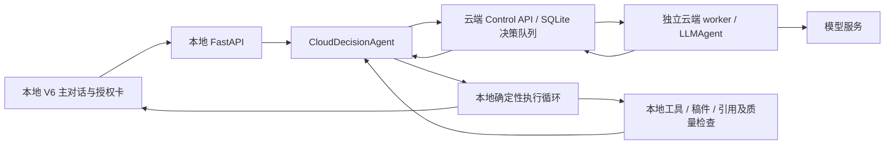

# 主对话统一到云端 Agent（2026-11-03）

主页面输入需求 → 对话内确认本轮授权 → 云端 worker 决策 → 本机执行工具及验证 → 同一对话显示结果。无需另建云端任务。

## 当前实现边界

“云端 Agent”指模型推理和动作选择运行在 cloud worker；现有 `DecisionLoop` 的观察、权限检查、工具调度、检查点和质量检查仍在本地。保留执行框架是为了复用已有工具和研究工作流，不能描述为整个循环已经搬到云端。当前演示的云服务进程也运行在本机回环地址，尚未部署远程生产服务器。

| 部分 | 代码位置 | 职责 |
|---|---|---|
| 当前主界面 | `src/paperagent/web/v6/` | 主输入框、授权卡、流式进度和结果 |
| 本地 API | `src/paperagent/api/` | 请求校验、项目/流程绑定、SSE、停止与续接 |
| 云端适配器 | `src/paperagent/tasks/cloud_conversation.py` | 本轮授权、上下文筛选、动作拉取、结果与完成状态补报 |
| 本地执行 | `src/paperagent/agent/decision_loop.py`、`harness/` | 工具、路径与写入权限、验证、检查点 |
| 云端 API | `backend/src/paperagent_cloud/conversation_api.py` | 用户/空间/设备隔离、持久队列、序号幂等、撤销 |
| 云端 worker | `backend/src/paperagent_cloud/worker.py` | 模型决策、配额、租约、失败重试 |
| 旧桌面工程 | `frontend/` | 独立兼容客户端；本轮统一的是 V6 主入口 |

## 授权与记忆

- `auto` 默认等同 `cloud`；连接未配置时显示设置提示，云端不可用时报告错误，不静默改用本地模型。设置里仍可显式选择本地 `llm` 或 `offline`。
- 发送时只在本地保存待授权请求。确认后才向云端发送需求和项目上下文；取消或仍待授权的请求不会混进后续模型历史。
- 每轮授权最长一小时，默认只读当前项目。修改稿件/生成产物、个人记忆、已导入的外部目录、MCP 分别明确选择。MCP 默认禁用；若启用，其权限沿用外部工具配置，**不局限项目目录**，且还需允许写入。
- 项目近期对话、文献/证据摘要、研究记录、流程状态和按需工具结果可以上送；不会自动整份上传原始文件，但读取工具返回的正文会随上下文上送。不要将“按需传输”理解为正文绝不离开本机。
- 本地仍为记忆主存储。本轮勾选个人记忆后参与上下文组装；没有新增隐式双向记忆同步。原有显式共享记忆和主动监测接口保留。
- API 校验 owner/space/device，执行器按授权路径及写入范围检查动作；这不是操作系统级沙箱，也不能约束用户自行配置的 MCP 服务内部行为。

## 兼容与恢复

原有论文/学位/项目工作流、质量门禁、资料库、SSE、检查点、显式本地模式继续使用。旧云任务、提案与主动监测接口保留；页面移除单独创建研究任务的表单，提供返回主对话的入口。

网络中断后，工具执行结果先保存在本地，再补报云端。不会为了重试 ACK 重做已完成的文件写入。进程中断后使用新一轮授权继续，避免自动重放不确定的副作用。

已知限制：完成状态补报必须仍在有效授权期内；超过一小时仍未同步时，本地结果保留，云端状态可能停留在运行中。本轮未实现过期后的单独补报授权。当前队列是单主机 SQLite，生产高可用、团队 RBAC、真实 Office 环境转换不在本轮验收范围。

启动和账户/设备绑定方式参见 [控制面运行说明](control_plane.md)。测试证据见 [回归记录](unified_chat_verification.md)。
